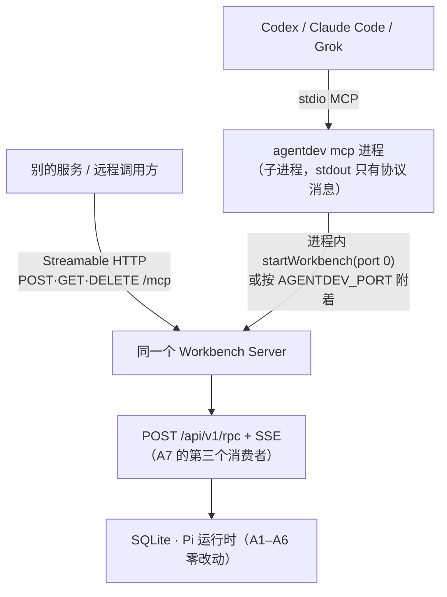

# Plan · 让别的 Agent 调用 AgentDev：MCP 服务（调研 + 设计方案）

```yaml
plan:
  task: agent-interface-20261028
  date: 2026-10-28
  status: Approved（本轮确认取舍；产品文档已写入 productnew；实现未开始）
  revision: 3（v1 是 ACP 方案；v2 改为 MCP 服务；v3 定稿固定会话并把产品文档写入 productnew）
  requirement_ids: [X-01, X-02, X-03, X-04, X-05, X-06, X-07, X-08]
  product_basis: docs/productnew/modules/external-agents.md
  goal: >
    Codex / Claude Code / Grok 这类编码 Agent 能像调一个工具那样调用 AgentDev：
    交一个目标，拿回真实的交付结果、阶段进度与报告，能中途看进度、答问题、取消。
    不改 A1–A6 的 Server 语义。
```

## 0 结论（四行）

1. **做 MCP 服务，不是 ACP**。实测三个目标客户端都是 MCP 客户端，没有一个是 ACP 客户端；ACP 是"编辑器 ↔ Agent"，要接它们得先给每个客户端加 ACP 支持，或我们自己再写一个 MCP↔ACP 桥（多一层、少一半覆盖）。
2. **协议基线 = MCP `2025-06-18`**（Codex 0.155.1 实测就说这个版本），向上兼容 `2025-11-25`（Claude Code 实测）与 `2026-07-28`（Claude Code 先探测的 stateless 世代）。官方 TS SDK `1.32.2` 的 `latest` 是 `2025-11-25`，2026 世代是 draft，不押注。
3. **长任务用"句柄 + 轮询"，不用一次阻塞到底**：工具 ≤45 秒返回一片进展，`runId` 是普通字符串参数（2026 规范自己就是这么建议的）。实测 Codex 能忍 75 秒的调用，但那不是 30 分钟。
4. **提问不能只靠 elicitation**：实测无人值守时 Claude Code 回 `cancel`、Codex 回 `decline`。所以提问的主通道是 `status.pendingQuestion` + `agentdev_answer`，elicitation 只在真人面前当加速器。

## 1 调研：谁在调用我们，用什么协议（实测，不是文档推测）

### 1.1 三个目标客户端

| 客户端 | 版本 | 作为 MCP 客户端 | 能当 ACP 客户端吗 | 证据 |
|---|---|---|---|---|
| Codex CLI | 0.155.1（本机） | 是：`~/.codex/config.toml` 的 `mcp_servers`，stdio + Streamable HTTP | 否（它只以 ACP **Agent** 身份被 `codex-acp` 适配器包装） | 实测 + `codex mcp add/list/get` 源码 |
| Claude Code | 2.1.310（本机） | 是：`claude mcp add`、项目 `.mcp.json` | 否（`claude-agent-acp` 是把 CC 包成 ACP Agent，方向相反） | 实测 + 官方 CLI 文档 |
| Grok（官方 Grok Build） | 未安装 | 是：`grok mcp add`，stdio / Streamable HTTP / SSE，工具名 `server__tool` | 未发现 | `docs.x.ai/build/features/mcp-servers` |

> Claude Code 文档里对这件事的描述最直白：ACP Agent "normally wrapped by a small MCP server before Claude Code can call it as a tool"。也就是说 MCP→ACP 桥是标准做法，而我们没有 ACP 形态要保护，直接做 MCP 就是少一层。

### 1.2 实测：它们到底说什么（本机跑出来的原始帧）

我用一个只做记录的 MCP stdio 服务器（`/tmp/mcpprobe/server.mjs`，一行一个 JSON-RPC）分别接了 Codex 与 Claude Code：

| 观测点 | Codex 0.155.1 | Claude Code 2.1.310 |
|---|---|---|
| 第一条消息 | `initialize`（直接进入） | **先** `server/discover`，`_meta` 带 `protocolVersion: 2026-07-28` + `clientInfo` + `clientCapabilities` |
| 协商到的协议版本 | **2025-06-18** | **2025-11-25**（discover 之后仍按老协议握手） |
| 声明能力 | `elicitation: {form, url}`、`experimental.codex/auth-change` | `roots`、`elicitation: {form, url}`、**`extensions: {"io.modelcontextprotocol/tasks": {}}`** |
| `tools/call` 是否带 `progressToken` | 带（`progressToken: 1`） | 带过（`3`）也有不带的时候 |
| `structuredContent` | 接受 | 接受 |
| 只广告了 `resources` 能力时 | 未调用 `resources/list` | 调用了 `resources/list` |
| 无人值守时 `elicitation/create` 的答复 | `{action:"decline"}` | `{action:"cancel"}` |
| 75 秒的工具调用 | 通过（墙钟 90.2s，`isError:false`） | 通过（墙钟 88.6s，`isError:false`） |

结论三条：
- **进度通知是现实可用的**（两家都发 `progressToken`），阶段推进可以实时推送。
- **`elicitation` 只能当"有人在场时"的捷径**：无人值守必然 decline/cancel，不能作为主通道。
- **Codex 的协议下限是 2025-06-18**，CC 会向下协商；我们的服务按 2025-06-18 + 2025-11-25 的并集实现即可覆盖两者。
- 75 秒的调用两家都扛住了，但这只是"还没撞上超时"，不是预算：Codex 与 CC 的超时都可配置，任务本身是 10–90 分钟，所以仍然按"≤45 秒一片进展"设计。

### 1.3 MCP 规范现状（2026-10-28）

| 事实 | 影响 |
|---|---|
| 最新修订 `2026-07-28`：**去掉协议级 session 与 `initialize`**，每个请求在 `_meta` 里带版本与能力；新增 `server/discover`（服务器 MUST 实现）、`resultType`、MRTR（`input_required` 多轮）、`subscriptions/listen` | 我们要能同时服务"老握手"与"新 stateless"两种客户端；CC 已会探测 `server/discover` |
| Tasks（长任务）**已从核心移到官方扩展** `io.modelcontextprotocol/tasks`（`tasks/get` + `tasks/update` + `tasks/cancel`，服务器主动返回句柄） | 语义正是我们需要的；但扩展矩阵里**没有任何客户端标注支持**（CC 只是声明了该扩展能力）。所以句柄工具必须自己实现，不押注扩展 |
| `roots`、`sampling`、`logging` 已进入 deprecated | 不实现；日志走 stderr |
| 官方 TS SDK `@modelcontextprotocol/sdk@1.32.2`：`LATEST_PROTOCOL_VERSION = 2025-11-25`，另有 `DRAFT-2026-v1` | 主线走稳定入口；2026 世代后面再加 |
| 工具注解（`readOnlyHint`/`destructiveHint`/`openWorldHint`）、`outputSchema`+`structuredContent`、`notifications/progress` | 宿主靠注解决定要不要问用户批准；我们的工具必须如实标注 |

### 1.4 长任务为什么必须"句柄 + 轮询"

- Codex 有 `tool_timeout_sec`（配置项，默认 60s）；实测 75s 没断，但一个 write Task（设计→开发→审核→测试→结算）是 10–90 分钟。阻塞式工具调用迟早被掐。
- MCP 在 2026 世代明确写了：跨调用状态用"服务器铸造的句柄作为普通参数"传递，协议层不再有隐式会话。我们的 `runId` 天生就是一个稳定 ID（Task/Session），断线重连照样能查。
- 所以工具面 = 启动 + 查询/等待 + 回答 + 取消 + 读取，而不是一个 `delegate_and_block`。

## 2 形态



- 载体：`node devagent/src/mcp/main.ts`（`npm run mcp`）。stdout 只放协议消息，日志只走 stderr。
- **两个传输，一个核心**：同一份工具表 / schema / 状态推导同时挂在
  - **stdio**：被 Codex / Claude Code / Grok 当子进程拉起（三家都支持，零配置）；
  - **Streamable HTTP**：既有 HTTP 服务上多一个端点 `POST/GET/DELETE /mcp`，别的**服务**可远程调用（Codex `--url`、Grok `--transport http`、CC `--transport http` 都能连）。
- Streamable HTTP 的实现要点（按 2025-11-25 规范逐条核对）：单端点；POST 的 `Accept` 必须同时列出 `application/json` 与 `text/event-stream`；只含通知/响应的 POST 回 **202**；GET 打开服务器→客户端流；`initialize` 时发 `Mcp-Session-Id`，会话失效回 **404** 让客户端重握手；后续请求带 `MCP-Protocol-Version`；**Origin 必须校验**（不合法 403，复用现有同源/CSRF 判断）。
- 鉴权：stdio 由父进程继承 `AGENTDEV_ACCESS_PASSWORD`（不落盘）；`/mcp` 接受 `Authorization: Bearer <同一口令>`（Codex `--bearer-token-env-var`、Grok `--header`、CC `--header` 都能给），浏览器场景沿用同源 cookie。**不接受匿名请求**，与 `/api/v1/*` 同一套口令。
- **单个 Server 规则不破**：MCP 进程自己 `startWorkbench`（进程内，不是第二个进程）；已有一个在跑就附着，不抢锁、不启第二个库。`/mcp` 就挂在这个唯一的 HTTP 服务上。
- 项目绑定：取 MCP 进程的 `cwd`（Codex 的 `mcp_servers.<name>.cwd`、CC 的启动目录都会给对），也允许工具参数 `project_path` 覆盖；两者都走 `project.open` 的 realpath 唯一约束。

### 2.1 会话模型：每个项目一个固定会话（本轮定稿）

MCP 过来的调用**不新建会话**：每个项目有一个固定的 chief 会话，第一次委派时创建，之后一直复用（`channel = 'mcp'`）。下面每条都是代码/契约里的事实，不是设想。

| 事项 | 事实 | 对固定会话的影响 |
|---|---|---|
| 身份从哪来 | `sessions` 表只有 `id / projectId / roleId / cwd / title / revision …`，**没有任何来源/通道字段**；`title` 是用户可改的显示名（A3：显示名不作身份） | 必须新增一个程序字段。靠标题不行（用户随手改名），靠 MCP 侧的状态文件也不行（文件丢了会静默换会话） |
| 怎么加 | `SCHEMA_VERSION = 14`，已有 `addColumn` 迁移机制（v10→v11 重建表、v13→v14 加表都是先例） | v14→v15：`ALTER TABLE sessions ADD COLUMN channel TEXT` + `CREATE UNIQUE INDEX … ON sessions(projectId, channel) WHERE channel IS NOT NULL`；`session.list` 回 `channel` |
| 幂等入口 | `session.create` 无条件新建（id 随机） | 新增 `session.open{projectId, channel}`：有就返回、没有就建；并发下靠唯一索引保证只建一个 |
| 忙碌时 | `session.input.submit` 在会话已有未结束 Task 而输入未关联 `taskId` 时返回 `{status:'queued', waitingForTask}`；`session.get.queuedInputs` 给排队数 | 第二个调用方拿到"排队中"而不是失败；`status` 必须如实回 `awaiting:'queued'` 与挡在前面的 run |
| 同时只有一个 Task | A3/A5：一个主管会话同时只绑定一项未结束 Task | 固定会话天然把同一项目的并发串行化；跨项目仍并行（每项目一个会话） |
| 长会话的上下文 | Pi 到 contextWindow 自动压缩；我们**目前不上报压缩**（`history.ts` / `live-snapshot.ts` 明确忽略 compaction 条目） | 上下文会被摘要，权威事实只能来自 `status` / `read`（`task.get`、报告、Plan），不能假设"聊天还记得" |
| 用户删掉它 | `session.cleanup` 允许删除无未结束工作、无引用的会话 | channel 身份让重建是确定的；但上下文随之消失（等于"忘掉"）。旧 runId 解析不到时返回 `unknown run`，不假装是新的一轮 |
| 卡住的 Task | 未结束的 Task 会让同会话的后续未关联输入全部排队（`waitingForTask`） | 固定会话放大了这个后果：一个卡住的 Task 挡住整个项目的委派。`status` 必须明确回 `waitingForTask` + 可 `cancel`/`tell`；**绝不自动取消**（那会替用户做决定） |
| 调用方之间 | Codex 与 CC 连同一个 `/mcp` 时会看到同一段对话 | 这正是"一个人"的语义；若要隔离，channel 细到 `mcp:<clientInfo.name>` 即可（MCP 层拿得到 `clientInfo`） |

## 3 工具面（核心设计）

十个工具，全部带 `outputSchema`，结果同时给 `structuredContent` 与一段 JSON 文本（老客户端只读文本）。

| 工具 | 参数 | 返回（structuredContent 摘要） | 注解 |
|---|---|---|---|
| `agentdev_delegate` | `objective`（必填）、`mode`（review/implement/test，**只是给主管的指令提示**）、`acceptance?`、`scope?`、`requires_test?`、`project_path?`、`wait_seconds?`（0–45，默认 20） | `runId`、`status`、`phase`、`plan[]`（阶段-轮次 + 计划尾段）、`members[]`、`pendingQuestion?`、`message`、`complete` | `destructiveHint: true`、`openWorldHint: true` |
| `agentdev_status` | `runId` | 同上（不含启动） | `readOnlyHint: true` |
| `agentdev_wait` | `runId`、`seconds`（0–45，默认 25） | 同上；**有变化或到点就返回**，不报错 | `readOnlyHint: true` |
| `agentdev_answer` | `runId`、`question_id`、`answer` | 同上 | 非只读 |
| `agentdev_tell` | `runId`、`message` | 同上（补充指令以关联 `taskId` 的输入提交，`session.input.submit{taskId}`） | 非只读 |
| `agentdev_cancel` | `runId` | 终态摘要 | `destructiveHint: true` |
| `agentdev_read` | `runId`、`kind`（report / plan / transcript / files）、`limit?` | 正文或文件清单 | `readOnlyHint: true` |
| `agentdev_runs` | `project_path?`、`limit?` | 该项目最近的 run（`runId`、目标、状态、时间） | `readOnlyHint: true` |
| `agentdev_projects` | `limit?`、`cursor?` | 已登记项目：`projectId`、`realPath`、目录是否存在、会话/任务数、最后活动（来自 `project.list`，不读项目文件、不调模型） | `readOnlyHint: true` |
| `agentdev_requirements` | `project_path?`、`kind?`（proposal/implementation）、`status?`、`limit?`、`cursor?`、`requirement_id?`（给了就返回单条全文） | `items[]`（`requirementId`、kind、status、title、更新时间）+ `invalidFiles[]`（来自 `requirement.list`/`get`，非法文件如实报告） | `readOnlyHint: true` |

返回体的统一形状（`agentdev_*` 共用一个 outputSchema）：

```jsonc
{
  "runId": "t-1f2a3b4c5d",
  "status": "running",                 // running | queued | waiting_user | paused | unknown | completed | failed | cancelled
  "phase": "develop",
  "plan": [                            // 与 UI 任务清单同一套推导（U5）
    { "phase": "design", "round": 1, "state": "completed", "members": ["Designer"] },
    { "phase": "develop", "round": 2, "state": "in_progress", "members": ["Developer"] },
    { "phase": "review", "round": 0, "state": "planned", "members": [] }   // round=0 表示计划内
  ],
  "pendingQuestion": { "id": "i-9a8b7c", "title": "…", "options": ["…"] },
  "progress": { "stepsDone": 2, "stepsTotal": 5 },
  "message": "Developer is implementing the ACP→MCP mapping (42s)",
  "complete": false
}
```

要点：

- **`status` 是一次读、一次回答**：`task.get` + `session.get` + stream 快照，全部是既有只读方法；不调用模型、不写库。
- **进度通知**：`tools/call` 的 `_meta.progressToken` 存在时，阶段切换/成员停稳各发一条 `notifications/progress`（`progress`/`total`/`message`），让宿主在长等待里看到活的东西。
- **`wait_seconds` 上限 45 秒**：留出宿主默认超时的余量；调用方循环即可，`runId` 不会失效。
- **文本兜底**：`structuredContent` 之外再给一份 JSON 文本（规范建议，老客户端只读文本）。

## 4 一件 run 的生命周期（映射到既有契约）

| MCP 动作 | 内部 | 说明 |
|---|---|---|
| `delegate` | `project.open`（cwd）→ **`session.open{projectId, channel:'mcp'}`**（幂等：有就复用，没有才建）→ `session.input.submit`（`content=[text]`，**authorizationRef 就是这次 inputId**） | 委派正文写清目标/边界/`mode`/验收；Task 类型与阶段由主管按 D-04 判断（产品不允许程序从自然语言推断类型），与真人委派完全同一套规则 |
| runId | **`inputId`**（提交即确定）；Task 出现后把 `taskId` 一并带出，`status` 两个都能解析 | 会话固定，所以 run 的身份只能来自输入，不能来自会话 |
| `status` / `wait` | `task.get`（阶段/成员/报告状态）+ `session.get`（activity、等待原因）+ 快照里的 `interactions[]` | plan 的推导复用 U5 规则（见 4.1） |
| `answer` | `interaction.respond{chiefSessionId, interactionId, expectedRevision, response}` | 与浏览器答复同一条路径（M5），不分叉 |
| `cancel` | `session.input.stop`（当前输入）+ `task.control{command:'cancel'}` | 两个终态都核对过才回 `cancelled` |
| `read` | `task.report.get` / Plan 文件 / `session.messages.list`（尾部 N 条）/ `project.files.list` | 全部走既有只读方法，不接受任意路径 |

### 4.1 Task → plan：和 UI 同一条推导

与 U5 任务条/任务清单完全一致的规则（这是第三个消费者）：

- 真实阶段-轮次分组 → 每条 `{phase, round, state: completed|in_progress}`；`develop→review→develop` 就是 round 2。
- 计划尾段（`review` + `requiresTest` 时的 `test` + `settle`）→ `{state:'planned', round:0}`。
- 取消 → 全部 `state:'cancelled'`（MCP 侧不受 ACP v1 那个"没有 cancelled 状态"的限制）。
- 实现上搬到服务端纯函数 `src/runtime/task-progress.ts`，MCP 直接调；`webapp` 那份保留（两套构建互不 import），用**同一份 fixture**（`devagent/test-fixtures/task-progress.json`）在两边各跑一个单测钉住，防止第三份实现漂移。

## 5 交互：把调用方当成"一个人"

产品既有规则一条不改：委派内容就是一次**用户输入**，主管按 D-04/G2 判断该建什么 Task、走哪些阶段、要不要提问；程序不因为"这是别的 Agent 发来的"加门禁，也不因为"这是机器"放宽任何核对。

| 场景 | 主通道（一定有） | 加速通道（有就更好） |
|---|---|---|
| chief 的 `question`（confirm/select/input） | `status.pendingQuestion` + `agentdev_answer`；`status.awaiting='user'` 时 `wait` 立即返回 | `elicitation/create`（form）：仅在客户端声明 `elicitation` 能力时发；收到 `decline`/`cancel` **不代表拒绝任务**，继续等 `answer`（实测无人在场时两家都回 decline/cancel） |
| 写授权（`authorizationRef`） | 授权引用 = 本次委派的 `inputId`（R1 允许的来源之一）；"是否算授权"由主管按既有规则解释 | 同上 |
| 需要用户决定的阻断 | 正式 blocked 报告 → `status.status='waiting_user'` + `message`，调用方可 `answer` 或 `cancel` | — |

调用方替用户答复是允许的（它确实是一个"用户"），但必须**显式**调用 `agentdev_answer`：不自动、不推测、不因超时替答。问题与答案一起进库，浏览器里能看到是被哪个调用方答的。

## 6 安全边界（必须写进契约页）

1. **调用方的沙箱不约束我们**。Codex 实测运行在 `sandbox: read-only`，但它调用的 MCP 服务器是我们自己的进程、用我们自己的 Pi 工具写项目——它"只读"，依然能通过我们产生写入。对策：`destructiveHint` 注解让宿主自己提示批准、委派正文写清边界、所有 run 的转录与报告留在我们库里随时可查。这与"另一个人在浏览器里让主管干活"是同一类信任，不假装有隔离。
2. **调用方的模型可以替用户答问题**。默认不自动答；`agentdev_answer` 必须被显式调用，且答案进库、可审计。
3. **提示注入**：调用方给的 objective 会变成我们主管的用户输入。它能做的事和一个真用户输入一样多——所以边界靠"用户信任谁"，不靠文本筛查；契约页要写明这一点，不假装有隔离。
4. 凭证：MCP 进程读 `AGENTDEV_ACCESS_PASSWORD`（与 Server 同一个），不落盘、不进工具结果、不进日志。

## 7 验证（可执行，按强弱排序）

| 层 | 手段 | 通过标准 |
|---|---|---|
| 协议 | `npx @modelcontextprotocol/inspector` 连 stdio | `tools/list` 全量、每次 `tools/call` 成功、schema 合法 |
| 自动化集成 | 新测试：`startWorkbench`（stub 模型）→ spawn MCP 进程 → 直接说 MCP → delegate/status/wait/answer/cancel | 帧序列断言；stdout 无非协议字节 |
| **真实客户端**（最关键） | `codex exec` 与 `claude -p` 各跑一遍：列工具 → 委派一个 review 任务 → 轮询 → 读报告 | 调用方打印出真实报告摘要；我们把两边日志存档进 `validation.md` |
| 单元 | `task-progress`/payload/错误映射纯函数 + 与 webapp 共用的 fixture | 与 UI 结果逐字段一致 |
| 回归 | `npm test`、`npm --prefix webapp test`、`tsc`、`build`、浏览器 56 用例 | 全绿（MCP 不改前端） |

## 8 已定的取舍（本轮确认）

| 决定 | 取值 | 影响 |
|---|---|---|
| 传输 | **stdio + 常驻 `/mcp`（Streamable HTTP）** | 三家客户端本地直连；别的服务可远程调用。HTTP 端点只做协议适配，不加业务分支 |
| delegate 的会话 | **每个项目一个固定会话**（`sessions.channel='mcp'`；v15 迁移 + `session.open` 幂等入口） | 上下文连续（同一个"人"一直在聊）；并发串行化，第二个调用方看到"排队中"；用户删掉会话等于"忘掉"，重建是确定的 |
| 委派策略 | **不加策略层**：调用方就是用户，一切按 AgentDev 既有规则 | 零产品改动；`mode` 只是给主管的指令文本 |
| 只读还是写 | 由主管按 D-04 判断（与真人委派一致） | 需要硬保证时另立项，本轮不假装 |
| 列表接口 | 新增 `agentdev_projects`、`agentdev_requirements` | 调用方能先看清有哪些项目/需求，再决定委派什么 |

## 9 分期

| 期 | 交付 | 门禁 |
|---|---|---|
| P1 协议骨架 | schema v15（`sessions.channel` + 唯一索引）、`session.open`、stdio server（2025-06-18 基线 + 2025-11-25 能力探测）、`delegate/status/wait/tell/cancel`、`projects/requirements`、错误映射、stdout 纪律 | 迁移测试 + Inspector + 自动化集成测试 |
| P2 可见性 | plan（含尾段）、`notifications/progress`、`pendingQuestion`+`answer`、`read`、`runs` | 与 UI fixture 一致的单测 |
| P3 常驻端点 | `/mcp` Streamable HTTP（POST/GET/DELETE、`Mcp-Session-Id`、`MCP-Protocol-Version`、Origin 校验、Bearer 口令），与 stdio 共用同一核心 | Inspector `--transport http` + 同一套集成测试 |
| P4 真实客户端 | codex / claude 端到端（stdio 与 http 各一次），stub 模型 → 真模型，日志存档；契约页 + 缺口登记 | 调用方输出里出现真实报告 |
| P5 可选 | tasks 扩展（对 CC）、MCP prompts（`/delegate-review`）、`/mcp` 若对外网再谈 OAuth | 各自单测；不阻塞前四期 |

## 10 文档改动

**已写入（本轮）**：`docs/productnew/modules/external-agents.md`（X-01～X-08，产品行为与失败边界）；`docs/productnew/README.md`（模块表、可见能力、首版范围、使用场景）；`docs/productnew/journeys.md`（J-11）；`docs/productnew/acceptance.md`（AC-38～AC-42）；`docs/INDEX.md`（模块数）。

**随 P1 写入（技术契约）**：

- 新增 `docs/technicalnew/mcp-service.md`：工具表（含两个列表接口）、固定会话模型（`channel`）、返回 schema、状态映射、两个传输的端点与鉴权、错误目录、安全边界、验证入口。
- `docs/technicalnew/README.md` 链路索引、`docs/INDEX.md` 入口表各加一行。
- `docs/technicalnew/architecture.md` A7 增一行：MCP 是第三个接入层（`/api/v1/rpc` + SSE 的消费者），`/mcp` 是同一 Server 上的协议端点，不改 A1–A6。
- `docs/technicalnew/runtime-contract.md` R1 增 `session.open{projectId, channel}` 一行，`session.list` 的返回补 `channel`；`docs/technicalnew/storage-and-recovery.md` 记录 v14→v15 迁移（加列 + 部分唯一索引，不改既有行）。
- `docs/technicalnew/architecture.md` A3 补一句：`sessions.channel` 是程序字段（`mcp` 等外部通道的固定会话），显示名仍是 `title`。
- `docs/technicalnew/runtime-contract.md` R1 的认证段落补一句：`/mcp` 接受 `Authorization: Bearer <访问口令>`（机器调用方），与 cookie 并存。
- `gap-register.md` 登记：会话级用量查询、会话级模型/等级配置、只读委派硬保证（本轮明确不做）。

## 附录 A：本次实测的可复现命令

```bash
# 探针服务器：一行一个 JSON-RPC，记录所有入站消息到 /tmp/mcpprobe/log.jsonl.<client>
node /tmp/mcpprobe/server.mjs <client>

# Claude Code（非交互，注入式 MCP 配置，不碰 ~/.claude/settings.json）
claude -p "Call the MCP tool mcp__probe__probe ..." \
  --mcp-config /tmp/mcpprobe/mcp.json --strict-mcp-config \
  --allowedTools mcp__probe__probe --output-format json

# Codex（-c 覆盖，不碰 ~/.codex/config.toml）
codex exec --skip-git-repo-check -C /tmp/mcpprobe/work \
  -c 'mcp_servers.probe.command="node"' \
  -c 'mcp_servers.probe.args=["/tmp/mcpprobe/server.mjs","codex"]' \
  "Call the MCP tool probe ..."
```

观测到的关键帧（Codex）：`initialize{protocolVersion:"2025-06-18", capabilities:{elicitation:{form,url}}}` →
`tools/call{_meta:{progressToken:1}}` → 我们的 `elicitation/create` → `{action:"decline"}`。
（Claude Code 同形，先 `server/discover{_meta.protocolVersion:"2026-07-28"}`，再 `initialize{protocolVersion:"2025-11-25"}`，elicitation 答 `cancel`。）

## 附录 B：ACP 方案（v1 草案，保留但暂不实施）

调研结论：ACP（Agent Client Protocol，Zed 发起）的稳定线是 v1（SDK `@agentclientprotocol/sdk@2.0.2` 默认入口），v2 仍 experimental；标准传输只有 stdio（Streamable HTTP 是 draft）。它解决的是"编辑器 ↔ 编码 Agent"，所以**要接 Codex/CC/Grok，得它们自己实现 ACP 客户端，或者我们额外写一个 MCP↔ACP 桥**——两者都比直接做 MCP 贵。

若将来要做（例如接 Zed / Neovim 这类 ACP 客户端），映射已经定稿，可直接复用：

| ACP v1 | 我们的实现 |
|---|---|
| `initialize` | `protocolVersion:1`；`loadSession:true`；`promptCapabilities:{image:true,embeddedContext:true}`；`mcpCapabilities` false；`sessionCapabilities:{list,close}`；`authMethods:[]` |
| `session/new{cwd}` | `project.open` + `session.create`；ACP sessionId = `${projectId}:${sessionId}`（两者都是 `[a-z]-<hex>`，`:` 不会出现，可逆且无需额外状态） |
| `session/prompt` | `session.input.submit`，挂起到输入终态再回 `{stopReason}` |
| `stopReason` | completed→`end_turn`；ACP 取消→`cancelled`；宿主中止/失败/中断→`refusal` + 说明（v1 没有 `error`，不伪造 `end_turn`） |
| `session/update` | `agent_message_chunk`/`agent_thought_chunk` ← Pi delta；`tool_call(_update)` ← toolCall 块 + toolResult 消息；`plan` ← `task.get`；`session_info_update` ← 派生标题；`notice` 仅当客户端声明 `session.notices`；不发 `usage_update`（无会话级用量） |
| `session/load` | `session.messages.list` 重放 + `session.stream.prepare` 接实时 |
| 取消 | `session/cancel` → `session.input.stop` |
| 提问/授权 | `elicitation/create`（客户端声明才发）与 `session/request_permission`（写授权） |
