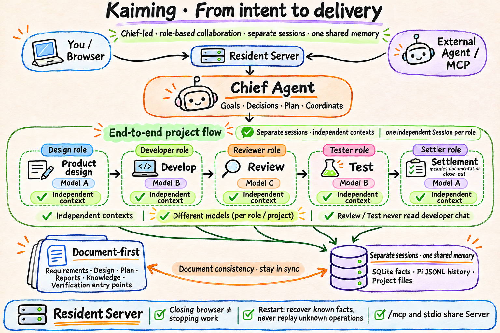

# Kaiming

[简体中文](README.md) | **English**

> AI coding agents can already write good code, but delivering a piece of work takes far more than one generation: goals must stay consistent across conversations and phases, conclusions must survive independent checks, progress must survive disconnects and restarts, and results must stay in the project as documents. Kaiming turns that entire process into a self-hosted, single-user workbench.

Kaiming is not a code-completion plugin, and it is not a chat transcript that disappears when the tab closes. It keeps the full lifecycle of a piece of software work — backlog items, specs, the overall Plan, Tasks, phases, specialist Sessions, reports, verification results and final settlement — as a traceable project asset, and delivers three outcomes:

1. **The work gets done**: real code or document results, with a record of which checks ran and what issues remain.
2. **The project remembers**: backlog items, specs and project knowledge, code and test entry points are updated as work proceeds — not just a chat summary.
3. **You can pick up next time**: work continues after you leave; reopening or switching sessions finds the progress, results and next step.

**Status: early development.** Before using it, read [Installation and setup](docs/install.en.md), the [product overview (Chinese)](docs/productnew/README.md) and [Security boundaries](#security-boundaries).

## Why this workflow

Today's AI coding tools default to putting everything into one ever-longer chat. Context windows are indeed growing, but the failure modes of delivery are not caused by windows being too small — they are properties of the "one long chat does everything" form itself, and a bigger model does not remove them:

| Failure mode of the long chat | Kaiming's answer |
|---|---|
| **Context drift**: restatements of early facts become unreliable, or the model confidently invents decisions that were made | **Facts live in files**: specs, Plans, reports and knowledge are project files; sessions load the current documents on demand instead of inheriting a possibly-drifted memory |
| **Self-review**: development and checking share one context, so "looks right" gets announced as done | **Structural independence**: review and test are separate Sessions with separate context; they read real files and run results, not the developer's self-assessment |
| **Nobody resumes**: closing the page loses progress; after a restart, nobody knows what finished | **Resident Server + fact checks**: execution is separate from viewing; recovery works from the database and actual files, not replay |
| **Scope drift**: things done in passing quietly expand the delivery | **Explicit gates**: a backlog item exists only when the user asks for it, and delivery starts only when the user says so; new findings start as suggestions |
| **Nowhere to hand over**: conclusions are scattered in chat, and the next session starts from zero | **Settlement writes back**: when a Task ends, the spec implementation state, closed backlog items, module knowledge and verification entry points are written into the project |

Each design decision answers a concrete failure mode; roles exist for responsibility and context, not to mirror a human org chart. Kaiming is designed around these long-lived facts, not around one model's context window: the user owns goals and trade-offs, agents organize work within the authorized scope, and the host persists facts and checks required results.

## First principles

### 1. Project facts belong to the project, not to a chat

Model context is compressed, truncated, lost, or simply restated incorrectly — not as an occasional bug, but as an inherent property of long context. Specs, Plans, reports, project knowledge and actual code must live in files. Tasks, inputs, phases, interactions and report references must live in durable records. Chat is an interface, not the source of truth.

Documents are also the input for sessions: each specialist Session assembles its context from the relevant documents, not from a long chat that may have drifted. The decision in the document is the only version that happened; a restatement in chat is not.

### 2. Execution and viewing are separate

The browser is one client for observing and controlling the workbench. The resident Server does the work. Closing the page, switching browsers or losing the network must not terminate an in-progress Task. Conversely, when the Server stops, execution stops: "the page is still open" must never be mistaken for "the task is still running."

### 3. Humans own goals; agents execute

A backlog item exists only when the user explicitly asks to record it. Delivery starts only when the user explicitly says to implement it. Newly discovered work is a suggestion until the user expands scope. Authorization, pause, cancel and important trade-offs belong to the user; the chief explains, organizes and executes.

### 4. Independence comes from structure, not from asking a model to review itself

Review and test use separate Sessions, separate context and real evidence, not the developer agent claiming success in its own chat. Independent context is not just a different perspective: a session that loads facts from documents has no memory to confuse — it never joined the developer's chat, so it neither vouches for the developer nor repeats conclusions that may have drifted there. The smaller and more purpose-built the context, the fewer places hallucination can hide.

An agent's completion report is not completion; the host checks identity, state, required reports, actual artifacts and persisted results.

### 5. Failure is normal, not an edge case

Models time out, processes crash, persistence can be uncertain, and users pause work. The reliable approach is to persist inputs and facts before execution; recover work that is recoverable; keep "execution outcome unknown" for operations that cannot be confirmed; and never replay unknown work or fake success.

### 6. Build fewer objects; prefer existing mechanisms

An installation has one Server, one SQLite database and a Pi runtime with independent Sessions. Tasks are only read or write. Specialist roles use the same Session machinery. We do not add one process per project, a workflow DSL, extra approval objects or a distributed scheduler without a concrete need.

## Product model

```text
Installation
└── Project (a real directory; not copied)
    ├── Chief Session (one topic / collaboration thread)
    │   └── Task (one current delivery objective)
    │       ├── Overall Plan
    │       ├── Phases (analysis / design / plan / develop / review / test / settle)
    │       └── Specialist Sessions (investigate, design, develop, review, test, settle)
    ├── Backlog (things to do later, directly editable)
    ├── Specs (behavior, acceptance points, implementation state)
    └── Project knowledge (modules, evidence, implementation and verification entry points)
```

| Object | Meaning |
|---|---|
| **Project** | An existing project directory selected by the user. The workbench records its path and ownership; it never copies the project. |
| **Chief Session** | The collaboration context between the user and the chief. It advances at most one unfinished Task at a time; other topics get a new session. |
| **Task** | One delivery objective with a goal, overall Plan, phases and completion conditions. |
| **Specialist Session** | The context of one specialist agent in a phase, with independent history, tool permissions and review. |
| **Backlog** | The project backlog file: id, title, state; optional body and spec references. |
| **Spec** | A module spec: behavior, exceptions, acceptance points, implementation state and unknowns. |
| **Result/Report** | The formal result a specialist Session actually delivered, stored in the project or the server workspace with a recorded reference. |



<sub>Hand-drawn overview generated with the local Codex gpt-image-2 tool; text-exact version: [SVG](docs/assets/kaiming-overview.en.svg).</sub>

**One shared memory, separate sessions.** The chief Session and each specialist Session have independent context and history, but they share the same data directory, project facts and Task/report records. Switching sessions does not switch project memory.

**Different models.** Models are configured per role or project and fixed for a run. Design, development, Review and Test can use different models; independence comes from separate context, responsibilities and real evidence, not from changing the model alone.

## The resident process

### What an instance is

One Kaiming instance consists of:

```text
one data directory + one resident Server process + any number of project directories
```

The Server is responsible for:

- accepting inputs from browsers and external agents;
- persisting inputs, Tasks, interactions and reports;
- scheduling independent Pi Sessions that run models and tools;
- providing live progress to browsers over HTTP/SSE;
- exposing `/mcp` on the same process, or letting a stdio MCP process attach to it;
- performing recovery checks at startup and during operation.

A project directory is just a working directory that was opened. The data directory stores execution records. They must not be mixed.

### Closing the browser does not stop work

When the browser closes, refreshes or loses its connection:

- the Server and an in-progress Task can continue;
- the relationship between the chief waiting and specialist Sessions is persisted;
- reopening the page or switching browsers restores the view from snapshots, history and Task records;
- questions that need a user answer remain available, and can still be answered after reconnecting.

Execution stops when the Server process stops, or when the user explicitly pauses or cancels the Task. **The resident process is what keeps work moving**; it is not decoration.

### What restart recovers

Restarting the Server does not "run everything again." Recovery is a fact check:

- Tasks, Session history, phases, reports and decisions already made by the user are kept;
- unfinished inputs from the previous process are scanned and execution whose boundary cannot be confirmed becomes `interrupted` or awaiting verification;
- phases that completed successfully are not redone;
- the original tool stack is not revived, no fake ToolResult is written, and unknown operations are not automatically replayed;
- to continue, the chief submits new remaining work based on real records and the actual files.

In short: **a closed page can continue and a restarted process can resume, but nobody can recreate an in-memory call that no longer exists.**

### Keeping it running

The current start script runs a long-lived foreground process. It does not install systemd, launchd or a container service:

```bash
./scripts/start.sh
```

For production, let the host environment supervise it:

- **systemd / launchd**: write a user service whose `ExecStart` points to `scripts/start.sh`;
- **tmux / screen**: convenient on a personal machine;
- **a container or orchestrator**: persist the data directory and `.env`, and ensure only one instance writes to that data directory.

Do not start multiple Servers against the same data directory. An MCP stdio process attaches to an existing instance first; it must not become a second owner of the database.

## How a piece of work flows

1. The user opens a project and discusses its current state and goal with the chief.
2. When the user says "record it", a backlog item is created; it only records future work and starts nothing.
3. The user says "implement B-12" or gives a development goal directly. The chief checks whether the specs are enough to write observable acceptance; if not, design runs first and produces specs plus a slice list the user confirms.
4. The chief creates a Task. The Plan must first state acceptance (from the specs or a user decision) and scope; then specialist Sessions are dispatched for the current step.
5. Review or test findings return to the same Task; independent Sessions re-check the work.
6. Once completion conditions hold, settlement updates the spec implementation state, closes finished backlog items, records remaining issues as new backlog items, and stores the result and report.
7. Later, the user reopens the project and sees the real state of the same Task instead of explaining the goal again.

## Document consistency and settlement

Kaiming is document-first, not transcript-first. Specs, design, the overall Plan, reports, project knowledge and verification entry points are project facts: they determine what the next session can read, and whether a delivery is actually complete.

- **Phase changes**: when the chief updates the current phase and results, the affected specs, navigation, knowledge or verification entry points are maintained together; documents must not be left at an old state.
- **Settlement is not just code**: settlement includes documentation close-out: the spec implementation state, closed backlog items, module knowledge, code/test entry points, verification report, uncovered items and open issues all need a landing place.
- **Consistency comes from actual files**: Review/Test read real documents, code and reports; they do not treat the chief's narrative or a chat summary as project fact.
- **Handover is document-based**: sessions have independent context, but hand over through the same documents, spec references and Task records. A new session reads what it needs instead of re-explaining the whole project.

The host verifies identity, state, required reports, versions and actual saves. Whether the documents are complete and meet the goal is still judged by the chief and independent agents.

## What it does

- **Chief conversation**: free discussion, project investigation and clarification. Only an explicit request records a backlog item; only explicit implementation starts delivery.
- **Backlog and design**: record what may be done later; design agents produce specs and a slice list, which the user confirms before implementation.
- **Controlled delivery**: the chief writes an overall Plan and organizes development, independent review, independent test and settlement. Phases do not advance silently.
- **Specialist Sessions**: role-isolated context; multiple members can work in parallel in one phase, with waiting, pause, resume and restart continuity recorded.
- **Project memory**: backlog items, specs, code and verification entry points are updated as work progresses; a new session does not need the whole project explained again.
- **External agent access**: Codex, Claude Code, Grok and other agents can delegate work through MCP and see the same session, Tasks and reports in the browser.
- **Single machine, single user**: one Server manages multiple projects and chief sessions; data is local and model credentials do not enter the conversation.

## Design trade-offs

| Trade-off | Choice | Why |
|---|---|---|
| One process per project vs one global Server | One global Server | Projects, sessions, Tasks and interactions need one source of truth; MCP and the browser see the same work. |
| Browser execution vs Server execution | Server execution | Closing the page, switching browsers or losing connectivity must not kill the work. |
| Custom workflow DSL vs roles + Sessions + Tasks | Existing Sessions/Pi + Tasks | Complex work needs model judgment; a fixed DSL turns human decisions into hard-coded steps. |
| Trust the model's claim of completion vs host verification | Persisted state, reports and evidence | A linguistic claim cannot replace actual files, tests and runtime results. |
| One long chat vs multiple specialist Sessions | Independent Sessions | Context isolation and clear responsibility; Review/Test never read the developer's self-review. |
| Replay unknown operations vs keep them for verification | Keep and verify before continuing | Unknown side effects cannot be treated as if they never happened, and must not be repeated automatically. |
| Team SaaS vs single-user self-hosting | Single user, local, self-hosted | The scope is explicit; start by making one person's project deliverable continuously. |

## Not in scope

The current version does not provide team accounts, RBAC, multi-tenant hosting, scheduled jobs, production release automation or a general project-management suite. It does not treat the browser or a model as durable truth. Agent `bash` runs with the system user's permissions and is not an OS sandbox.

## Architecture

```text
Browser ── HTTP / SSE ──┐
                       ├── resident Node Server
External agent ── MCP ─┘        │
                                ├── SQLite (projects, sessions, inputs, Tasks, reports, interactions)
                                ├── Pi native session history (JSONL)
                                ├── independent specialist Sessions / model loops
                                └── your project directories (never copied)
```

The browser only displays state and sends user actions. The Server persists inputs, schedules agents and records results. External agents use the same Server and the same tools; they do not follow a second set of business rules.

## Requirements

- macOS or Linux (POSIX). The current implementation uses `node:sqlite` and POSIX path guards; Windows is unverified.
- Node.js **24 LTS**. 24.22.1+ is recommended; earlier 24.x may run, but `officeparser` can print an engine warning.
- An OpenAI-compatible, Anthropic or local model endpoint with an API key.
- No Docker and no global Kaiming installation.

## Quick start

```bash
git clone <repository-url>
cd <repository-directory>

./scripts/setup.sh
./scripts/start.sh
```

`setup.sh`:

1. installs server and webapp dependencies;
2. builds the browser shell (`kaiming/web-static`);
3. creates a random access password and local configuration in `kaiming/.env` (mode 600, gitignored);
4. prints the URL and password.

Open `http://127.0.0.1:4173` and sign in with the password.

Then open **Settings → Models**, add a provider, model id and API key, and choose a default model. Before that, projects, backlog items and history are readable, but inputs are not executed by a model.

Restart later with:

```bash
./scripts/start.sh
```

## Where things live

| Content | Default location | Notes |
|---|---|---|
| Program code | Any directory; no global install | Clone the repo and run `scripts/setup.sh` |
| Startup config | `kaiming/.env` | Password, port and data directory; gitignored |
| Runtime data | `kaiming/.kaiming-data/` | SQLite, session history, attachments, model credentials; override with `KAIMING_DATA_DIR` |
| Browser build | `kaiming/web-static/` | Generated, not committed; `setup.sh` creates it |
| Your projects | Any local directory | The workbench records the path only; never place a project inside the data directory |

For manual installation, environment variables, model credentials, backup/restore, MCP configuration and troubleshooting, see **[docs/install.en.md](docs/install.en.md)**.

## Everyday operations

```bash
./scripts/start.sh                 # start the resident Server
# Ctrl-C stops it

# Backup: stop the workbench, then copy the data directory
tar -czf kaiming-backup-$(date +%Y%m%d).tgz -C kaiming .kaiming-data

# Upgrade
git pull
./scripts/setup.sh
./scripts/start.sh
```

The data directory contains model credentials and session history; treat backups as secrets. Back up project directories separately.

## Development

```bash
cd kaiming
npm ci
npm --prefix webapp ci
npm run build
npm start

npm test                # server unit/integration tests
npm --prefix webapp test
npm run typecheck
npm --prefix webapp run typecheck
npm run test:browser    # real Chromium + real server process + stub model
```

Real-model checks:

```bash
cd kaiming
cp config/model.example.json config/model.json   # fill provider/model/key
npm run check:model
npm run check:runtime
```

`config/model.json` is only for check scripts and is gitignored; the server's model configuration comes from Settings or `models.json` in the data directory.

## External agent access

The workbench provides stdio MCP and a resident `/mcp` endpoint. Codex, Claude Code, Grok and similar clients can delegate work to the same Task and see the same progress in the browser.

- Local stdio: the client starts a child process that attaches to an existing Server, or starts one if none is running;
- Resident HTTP: clients connect to the same Server and share the same work records;
- Each project has one fixed session; run identifiers remain queryable after restart;
- Authentication and details: [MCP service (Chinese)](docs/technicalnew/mcp-service.md).

## Security boundaries

- By default it listens only on `127.0.0.1`. Do not expose the port directly to the internet; for remote access add a reverse proxy, TLS and access control.
- The login password is in `kaiming/.env`; model keys live in the data directory or Settings. Never commit either.
- Agent `bash` has the same permissions as the system user that started the workbench. This is not an OS-level sandbox; do not use it on untrusted code or grant it unnecessary privileges.
- File tools (read, write, edit, search) may only reach the project directory. `bash` is not path-restricted, but destructive commands (`rm`, `git reset --hard`, …) ask you to confirm in the browser every time.
- Do not place projects inside the data directory: file tools treat private storage as inaccessible, which would block the whole project.
- Single-user only. Team accounts, RBAC and managed hosting are out of scope.

## Documentation

- [Installation and setup](docs/install.en.md)
- [Product overview (Chinese)](docs/productnew/README.md) / [User journeys (Chinese)](docs/productnew/journeys.md)
- [Technical design (Chinese)](docs/technicalnew/README.md)
- [External agent access / MCP (Chinese)](docs/technicalnew/mcp-service.md)
- [Product acceptance (Chinese)](docs/productnew/acceptance.md)
- [Documentation index (Chinese)](docs/INDEX.md)

The detailed product and technical design documents are currently Chinese. This English README and the English install guide cover onboarding and operations.

## Contributing

Read [AGENTS.md](AGENTS.md) and [delivery (Chinese)](docs/productnew/modules/delivery.md) before changing code. Code or presentation Tasks must declare a verification profile (`visual` / `focused` / `broad`). A passing test suite is not product acceptance.

## License

Released under the [MIT License](LICENSE). You may use, modify, distribute and sell the software, provided the copyright and license notice are retained. The software is provided "as is", without warranty.
