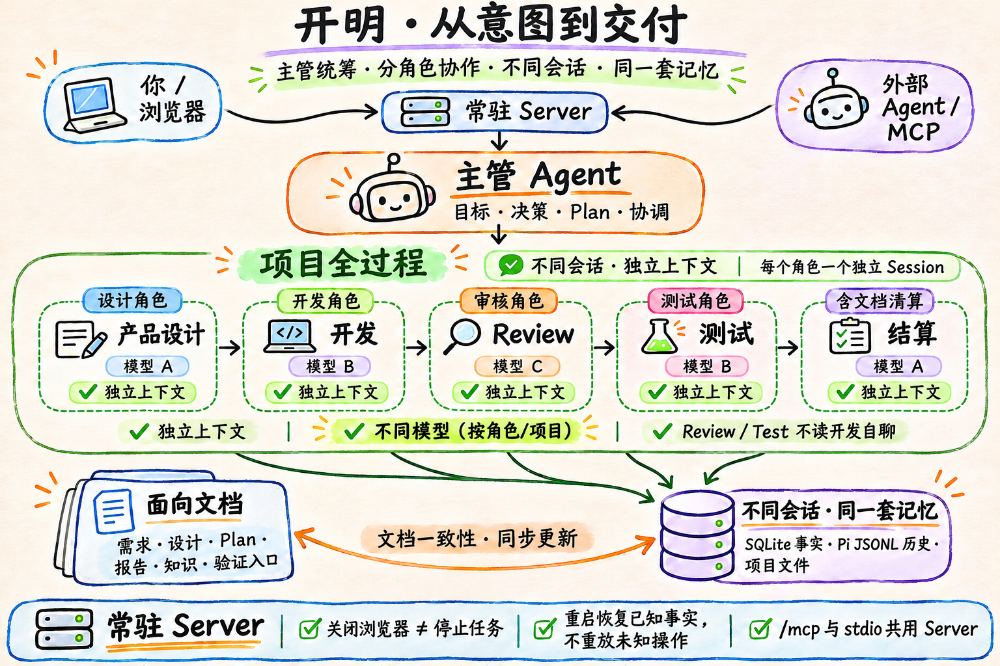

# 开明

**简体中文** | [English](README.en.md)

> AI 编码 Agent 已经能写出好代码，但把一件工作真正交付完，需要的远不止一次生成：目标要在多次对话和多个阶段间保持一致，结论要经得起独立检查，过程要在断线和重启后接得上，成果要以文档形式留在项目里。开明把这整个过程做成一个自托管、单用户的工作台。

开明不是代码补全插件，也不是一段用完即走的聊天记录。它把一次软件工作的完整生命周期——待办、规格、总体 Plan、Task、阶段、专业 Session、报告、验证结果和最终结算——保存为可追溯的项目资产，交付三个结果：

1. **事情做完**：得到实际代码或文档成果，知道哪些检查执行过、哪里还有问题；
2. **项目记住**：待办、规格与项目知识、代码和测试入口随工作更新，不只留下一份聊天总结；
3. **下次接得上**：离开后工作仍可推进；重新打开或换一个会话，能找到进展、成果和下一步。

**状态：早期开发版。** 公开使用前请先读 [安装与启动](docs/install.md)、[产品总览](docs/productnew/README.md) 和 [安全边界](#安全边界)。

## 为什么是这套工作流

今天的 AI 编码工具默认把一切放进一个越来越长的聊天。上下文窗口确实在变大，但交付的失败模式并不是窗口不够大造成的——它们是“一个长聊天承担一切”这种形态本身的性质，换更大的模型同样存在：

| 长聊天的失败模式 | 开明的设计回答 |
|---|---|
| **上下文漂移**：对早期事实的复述越来越不可靠，甚至自信地编造已经做过的决定 | **事实落文件**：规格、Plan、报告和知识是项目文件；会话按需加载当前文档，不继承可能走样的记忆 |
| **自我审查**：开发和检查在同一个上下文里，“看起来对”就宣布完成 | **结构化独立**：审核/测试是独立 Session、独立上下文，读真实文件和运行结果，不读开发的自评 |
| **无人接续**：关掉页面就丢进度；重启后不知道哪些做完了 | **常驻 Server + 事实核对**：执行与查看分离；恢复基于数据库和实际文件，不靠重放 |
| **范围漂移**：讨论中顺手做的事悄悄扩大交付范围 | **显式门槛**：用户明确要求才记待办，明确实施才进入交付；新发现先作为建议 |
| **无处交接**：结论散落在聊天里，下次从零开始 | **结算回写**：任务结束时把规格实现状态、待办关闭、模块知识和验证入口写回项目 |

每一个设计决定对应一个具体的失败模式，不是为了组织架构而设角色。开明围绕这些长期存在的事实设计，而不是围绕某个模型的上下文窗口设计：用户决定目标和取舍，Agent 在授权范围内组织工作，程序保存事实并核对必要结果。

## 第一性原理

### 1. 项目事实属于项目，不属于聊天

模型上下文会压缩、截断、丢失，甚至被错误复述——这不是偶发故障，而是长上下文的固有性质。规格、Plan、报告、项目知识和实际代码必须落在文件里；Task、输入、阶段、交互和报告引用必须落在数据库里。聊天是界面，不是事实源。

文档同时是会话的输入源：每个专业 Session 从相关文档装配上下文，而不是继承一段可能已经走样的长聊天。文档里的决定是唯一“发生过”的版本；聊天里的复述不是。

### 2. 执行和查看必须分开

浏览器只是观察和控制工作台的一个客户端。真正执行工作的是常驻 Server；关闭页面、换浏览器或断线都不应该终止正在进行的 Task。反过来，Server 停止意味着执行停止——不能把“页面还开着”误当成“任务还在跑”。

### 3. 人负责目标，Agent 负责执行

只有用户明确要求才记待办，只有明确实施才进入交付。发现的新问题先作为建议，不能自动扩大范围。授权、暂停、取消和重要取舍由用户作出；主管负责解释、组织和执行。

### 4. 独立性必须来自结构，而不是请求模型“自我审查”

审核和测试使用独立 Session、独立上下文和真实证据，而不是开发 Agent 在自己的聊天里声称通过。独立上下文不只是换一个角度：一个从文档加载事实的新会话没有可混淆的记忆——它没参与开发的聊天，既不会替开发背书，也不会复述开发聊天里可能已经走样的结论。上下文越小、越定向，幻觉能藏的地方就越少。

一个 Agent 的完成报告不是交付完成；程序核对身份、状态、必要报告、实际成果和保存结果。

### 5. 失败是常态，不是异常路径

模型会超时，进程会崩溃，保存可能不确定，用户会暂停。可靠的做法不是假设一切成功，而是先保存输入和事实，再执行；可恢复的工作恢复，无法确认的操作保留“执行情况未知”，不自动重放，不伪造成功。

### 6. 少造对象，优先使用已有机制

一个安装只有一个 Server、一个 SQLite、独立 Session 的 Pi 运行时；Task 只分只读和修改，专业角色通过同一套 Session 机制工作。不引入每个项目一个进程、通用工作流 DSL、额外审批对象或分布式调度器来制造复杂度。简单机制能支撑当前问题即可。

## 产品模型

```text
实例
└── 项目（真实目录，不被复制）
    ├── 主管 Session（一个话题/一条协作主线）
    │   └── Task（当前正在推进的一项交付目标）
    │       ├── 总体 Plan
    │       ├── 阶段（分析/设计/计划/开发/审核/测试/结算）
    │       └── 专业 Session（调查、设计、开发、审核、测试、结算）
    ├── 待办（以后要做的事，可直接编辑）
    ├── 规格（行为、验收要点、实现状态）
    └── 项目知识（模块、依据、实现与验证入口）
```

| 对象 | 含义 |
|---|---|
| **Project** | 用户选择的一个既有项目目录；工作台记录路径和归属，不复制项目。 |
| **Chief Session** | 用户与主管的协作上下文；同一时间最多推进一项未结束 Task，其他话题新开会话。 |
| **Task** | 一次有明确目标、总体 Plan、阶段和完成条件的交付工作。 |
| **Specialist Session** | 某个阶段的专业 Agent 上下文；独立历史、独立工具权限和独立审查。 |
| **Backlog** | 项目里的待办文件：编号、标题、状态；可选正文与规格引用。 |
| **Spec** | 模块规格：行为、异常、验收要点、实现状态与未知。 |
| **Result/Report** | 专业 Session 实际提交的正式结果；保存在项目或 Server 工作区，并记录引用。 |



<sub>手绘总览由本机 Codex 的 gpt-image-2 生成；文字精确版见 [SVG](docs/assets/kaiming-overview.zh.svg)。</sub>

**同一套记忆，不同会话。** 主管 Session 和每个专业 Session 有独立的上下文与历史；但它们共享同一个数据目录、同一份项目事实和同一套 Task/报告记录。换一个会话，不是换一套项目记忆。

**不同模型。** 模型按角色或项目配置，在一次运行中固定。设计、开发、Review、Test 可以使用不同模型；独立性来自独立上下文、职责分工和真实证据，不是来自“换一个模型”本身。

## 常驻进程

### 一个实例是什么

一个开明实例由三部分组成：

```text
一个数据目录 + 一个常驻 Server 进程 + 多个项目目录
```

Server 负责：

- 接收浏览器和外部 Agent 的输入；
- 保存输入、Task、交互和报告；
- 调度独立的 Pi Session，运行模型与工具；
- 通过 HTTP/SSE 把实时进展提供给浏览器；
- 在同一进程上提供 `/mcp`，或让 stdio MCP 进程附着到它；
- 在启动和运行期间执行恢复核对。

项目目录只是被打开的工作目录；数据目录保存运行记录。二者不能混在一起。

### 关闭浏览器不等于停止工作

浏览器关闭、刷新或断线时：

- Server 和正在进行的 Task 可以继续；
- 主管等待专业 Session 的关系保存在数据库；
- 用户重新打开页面或换浏览器后，从快照、历史和 Task 记录恢复视图；
- 需要用户回答的问题会保留；恢复后仍然可以看到并作答。

真正停止执行的是 Server 进程本身，或者用户显式暂停/取消 Task。**常驻进程是工作继续的前提**，不是可选装饰。

### 重启后恢复什么

Server 重启不是“把所有工作重新跑一遍”。恢复遵循事实核对：

- 保留 Task、Session 历史、阶段、报告和用户已作出的决定；
- 扫描上次运行留下的未完成输入，把无法确认边界的执行标为 `interrupted` 或待核实；
- 已成功完成的阶段不重做；
- 不恢复原工具执行栈，不补写伪造的 ToolResult，不自动重放未知操作；
- 需要继续时，主管基于真实记录和实际文件提交新的剩余工作。

这意味着：**页面关闭可以继续，进程重启可以接续，但没有人能凭空恢复一个已经不存在的内存调用。**

### 怎么让它长期运行

当前启动脚本提供的是一个前台常驻进程，不自动安装 systemd、launchd 或容器服务：

```bash
./scripts/start.sh
```

生产使用时，应由宿主环境的进程管理器托管，例如：

- **systemd / launchd**：编写用户服务，`ExecStart` 指向仓库中的 `scripts/start.sh`；
- **tmux / screen**：适合个人机器上的长期运行；
- **容器或编排器**：需要自行持久化数据目录和 `.env`，并只让一个实例写同一个数据目录。

同一数据目录不要同时启动多个 Server。MCP stdio 进程会优先附着已有实例，不应成为第二个数据库所有者。

## 一次工作怎么走

1. 用户选择项目，和主管讨论现状与目标。
2. 用户说“记下来”时，得到一条待办；它只记录以后要做的事，不启动工作。
3. 用户说“实施 B-12”，或直接给出开发目标。主管核对规格是否足以写出验收；不够则先设计，形成规格与切片清单并经用户确认。
4. 主管建立 Task，Plan 必须先写验收（来自规格或用户确认）与范围，再按当前步骤派发专业 Session。
5. 审核/测试发现的问题回到当前 Task 处理，由独立 Session 重新检查。
6. 完成条件满足后结算：更新规格的实现状态、关闭已完成的待办、遗留记为新的待办，保存成果与报告。
7. 用户离开后重新打开，看到同一 Task 的真实状态，而不是重讲一遍目标。

## 文档一致性与结算

开明是文档优先的工作台，而不是以聊天记录为主。规格、设计、总体 Plan、报告、项目知识和验证入口都是项目事实；它们决定下一次会话能读到什么，也决定一次交付是否真的完成。

- **阶段切换**：主管更新当前阶段和结果时，受影响的规格、导航、知识或验证入口一起维护，不让文档停留在旧状态。
- **结算不是只写代码**：结算包括文档清算——规格实现状态、待办关闭、模块知识、代码/测试入口、验证报告、未覆盖事项和遗留问题都要有落点。
- **一致性靠实际文件**：Review/Test 读取真实文档、代码和报告，不把主管的自述或聊天总结当成项目事实。
- **交接靠文档**：不同 Session 可以独立上下文，但通过同一套文档、规格引用和 Task 记录交接；新会话按需读取，而不是重讲整个项目。

程序核对身份、状态、必要报告、版本和真实保存；文档内容是否完整、是否符合目标，仍由主管和独立 Agent 判断。

## 能做什么

- **主管对话**：自由讨论、调查项目、澄清目标；只有明确要求才记待办，只有明确实施才进入交付。
- **待办与设计**：记下以后要做的事；由设计角色形成规格与切片清单，经用户确认后再实施。
- **受控交付**：主管制定总体 Plan，组织开发、独立审核、独立测试和结算；阶段不静默自动推进。
- **专业 Session**：按角色隔离上下文；同一阶段可并行多个成员，等待、暂停、继续和重启接续都有记录。
- **项目记忆**：待办、规格、代码和验证入口随工作更新，新会话不必重讲整个项目。
- **外部 Agent 接入**：Codex、Claude Code、Grok 等可通过 MCP 委派工作，在浏览器看到同一条会话、Task 和报告。
- **单机单用户**：一个 Server 管理多个项目、多个主管会话；数据在本地，模型凭证不进入对话。

## 设计取舍

| 取舍 | 选择 | 原因 |
|---|---|---|
| 每项目一个进程 vs 全局一个 Server | 全局一个 Server | 项目、会话、Task 和交互有统一事实源，MCP 与浏览器看到同一份工作。 |
| 浏览器执行 vs Server 执行 | Server 执行 | 页面关闭、换浏览器和断线不应终止工作。 |
| 自定义 Workflow DSL vs 角色 + Session + Task | 现有 Session/Pi + Task | 复杂流程需要模型判断，固定 DSL 会把人的取舍变成硬编码。 |
| 模型声称完成 vs 程序核对 | 保存、状态、报告、证据核对 | 语言结论不能替代实际文件、测试和运行结果。 |
| 一个长对话 vs 多专业 Session | 独立 Session | 上下文隔离、责任明确，Review/Test 不读开发自评。 |
| 自动重放未知操作 vs 保留待核实 | 保留并核实后继续 | 未知副作用不能假装没有发生，也不能自动重复。 |
| 团队 SaaS vs 单用户自托管 | 单用户、本地、自托管 | 当前产品边界明确，先做好个人项目的持续交付。 |

## 不做什么

当前版本不提供团队账号、RBAC、多租户托管、自动定时任务、生产发布自动化、通用项目管理套件，也不把浏览器或模型当作持久事实源。Agent 的 `bash` 与系统用户同权限，不是操作系统级沙箱。

## 架构

```text
浏览器 ── HTTP / SSE ──┐
                       ├── 常驻 Node Server
外部 Agent ── MCP ─────┘        │
                                ├── SQLite（项目、会话、输入、Task、报告、交互）
                                ├── Pi 原生会话历史（JSONL）
                                ├── 独立专业 Session / 模型循环
                                └── 你的项目目录（工作台不复制项目）
```

浏览器只负责展示和发出用户操作；Server 保存输入、调度 Agent、记录结果。外部 Agent 使用同一个 Server 和同一套工具，不另走一套业务规则。

## 环境要求

- macOS 或 Linux（POSIX）。当前实现使用 `node:sqlite` 和 POSIX 路径守卫，Windows 未验证。
- Node.js **24 LTS**。推荐 24.22.1+；较早的 24.x 可以运行，但 `officeparser` 可能打印 engine warning。
- 一个可用的 OpenAI 兼容 / Anthropic / 本地模型端点，以及对应 API key。
- 不需要 Docker，不需要全局安装开明。

## 快速开始

```bash
git clone <repository-url>
cd <repository-directory>

./scripts/setup.sh
./scripts/start.sh
```

`setup.sh` 会：

1. 安装服务端与 webapp 依赖；
2. 构建浏览器外壳（`kaiming/web-static`）；
3. 在 `kaiming/.env` 生成随机访问口令和本地配置（权限 600，不提交）；
4. 打印访问地址和口令。

浏览器打开 `http://127.0.0.1:4173`，输入口令登录。

然后进入 **Settings → Models**，添加模型服务、模型 id 和 API key，并选择默认模型。配置好之前，项目、待办和历史仍可阅读，但输入不会真正交给模型执行。

重新启动只需要：

```bash
./scripts/start.sh
```

## 安装在哪

| 内容 | 默认位置 | 说明 |
|---|---|---|
| 程序代码 | 任意目录，无需全局安装 | 克隆仓库并运行 `scripts/setup.sh` 即可 |
| 启动配置 | `kaiming/.env` | 访问口令、端口、数据目录；已 gitignore |
| 运行数据 | `kaiming/.kaiming-data/` | SQLite、会话历史、附件、模型凭证；可用 `KAIMING_DATA_DIR` 指定 |
| 浏览器构建 | `kaiming/web-static/` | 构建产物，不提交；`setup.sh` 生成 |
| 你的项目 | 任意本地目录 | 工作台只记录路径，不复制项目；不要把项目放进数据目录 |

详细的手动安装、环境变量、模型凭证、备份恢复、MCP 配置和故障排查见 **[docs/install.md](docs/install.md)**。

## 日常操作

```bash
./scripts/start.sh                 # 启动常驻 Server
# Ctrl-C 停止

# 备份：停掉工作台后复制数据目录
tar -czf kaiming-backup-$(date +%Y%m%d).tgz -C kaiming .kaiming-data

# 升级
git pull
./scripts/setup.sh
./scripts/start.sh
```

数据目录包含模型凭证和会话历史，备份件应按密钥保管。项目目录本身需要单独备份。

## 开发

```bash
cd kaiming
npm ci
npm --prefix webapp ci
npm run build
npm start

npm test                # 服务端单元/集成测试
npm --prefix webapp test
npm run typecheck
npm --prefix webapp run typecheck
npm run test:browser    # 真实 Chromium + 真实服务进程 + stub 模型
```

真实模型自检：

```bash
cd kaiming
cp config/model.example.json config/model.json   # 填 provider/model/key
npm run check:model
npm run check:runtime
```

`config/model.json` 仅供检查脚本使用，已被 gitignore；服务端模型配置以 Settings 或数据目录中的 `models.json` 为准。

## 外部 Agent 接入

工作台提供 stdio MCP 和常驻 `/mcp` 端点。Codex / Claude Code / Grok 可以把工作委派给同一个 Task，并在浏览器看到同一批进展。

- 本地 stdio：客户端拉起子进程，附着到已有 Server；没有实例时再按配置自启；
- 常驻 HTTP：连接同一 Server，多个调用方共享工作记录；
- 每个项目一条固定会话，重启后运行标识仍可查询；
- 认证和详细配置见 [MCP 服务](docs/technicalnew/mcp-service.md)。

## 安全边界

- 默认只监听 `127.0.0.1`，不要把端口直接暴露到公网；需要远程访问时自行加反向代理、TLS 和访问控制。
- 登录口令在 `kaiming/.env`，模型 key 在数据目录或 Settings 中保存；不要把这两类文件提交到 Git。
- Agent 的 `bash` 与启动工作台的系统用户同权限。工作台不是操作系统级沙箱；不要用它处理不可信代码或授予不必要权限。
- 文件工具（读、写、编辑、搜索）只能访问项目目录；`bash` 不受路径限制，但删除类命令（`rm`、`git reset --hard` 等）每次都要你在浏览器里确认。
- 项目目录不要放在数据目录内，否则文件工具会把整个项目当作私有数据拒绝访问。
- 只支持单用户；团队账号、RBAC 和托管服务不在当前范围。

## 文档

- [安装与启动](docs/install.md)
- [产品总览](docs/productnew/README.md) / [用户流程](docs/productnew/journeys.md)
- [技术设计入口](docs/technicalnew/README.md)
- [外部 Agent 接入（MCP）](docs/technicalnew/mcp-service.md)
- [产品验收](docs/productnew/acceptance.md)
- [文档总索引](docs/INDEX.md)

## 参与开发

提交改动前先读 [AGENTS.md](AGENTS.md) 和 [任务交付](docs/productnew/modules/delivery.md)。代码或展示类 Task 必须写明验证档（`visual` / `focused` / `broad`）；测试通过不等于产品验收通过。

## License

本项目采用 [MIT License](LICENSE)。可以自由使用、修改、分发和商业使用，但需保留版权与许可声明；软件按“现状”提供，不附带担保。
