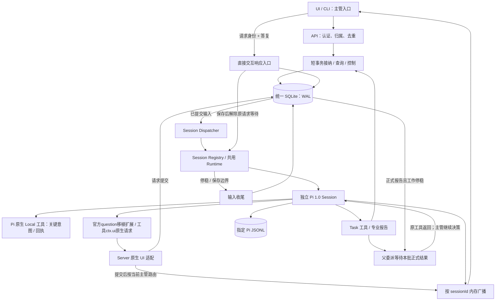
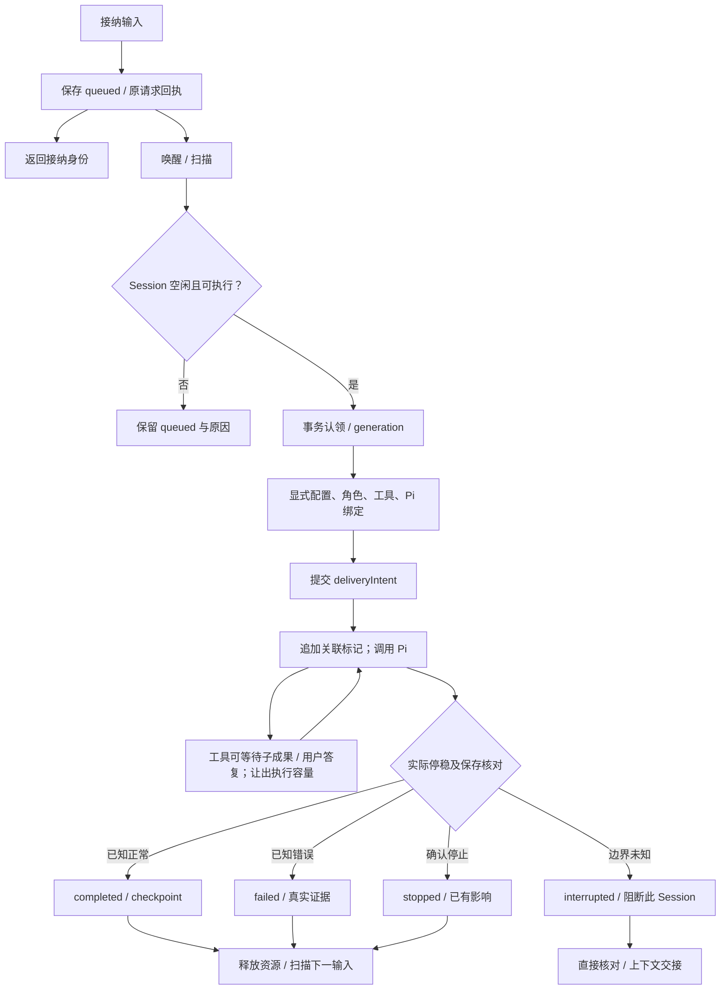
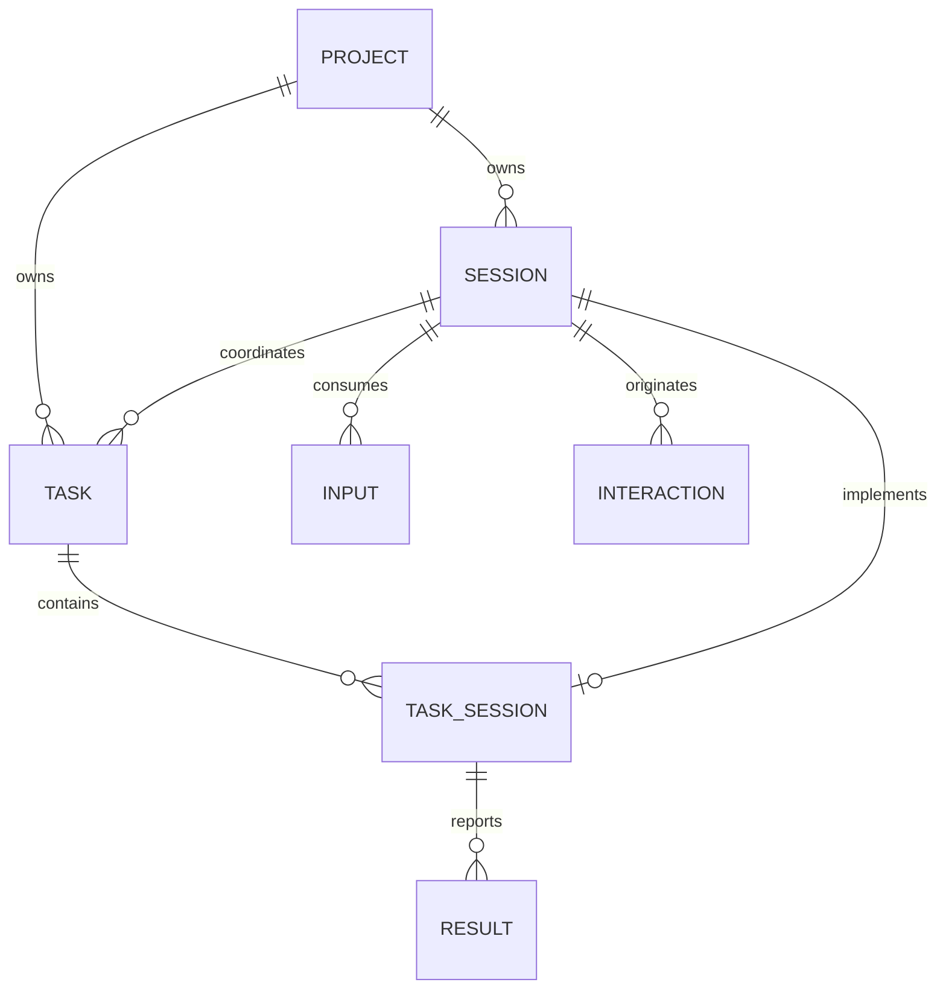

# 执行架构与职责

当前技术设计。产品含义见 [产品总览](../productnew/README.md)，实现字段和算法按链路展开。

## A1 执行总图

全局一个 Server。每个逻辑 Session 绑定独立 Pi 实例/历史；主管和专业 Agent 共用 Runtime。

| 边界 | 行为 | 展开 |
|---|---|---|
| 请求/写工具 → SQLite | 等短事务/必要文件保存；回执绑定原请求 | [S3/S6](storage-and-recovery.md) |
| SQLite → Dispatcher | 提交唤醒、启动/周期扫描；异步消费输入行 | [R3](runtime-contract.md#r3-共用-session-执行链路) |
| 委派工具 → 专业 Session | 创建/绑定后等待；事务不跨等待 | [M1](messaging-and-collaboration.md#m1-task-多-session-协作子图) |
| 子正式结果 → 主管 | 当前等待工具返回；原生交互由宿主转发，父委派仍等待；不另投重复结果输入 | [M2](messaging-and-collaboration.md#m2-委派等待协议) |
| 用户交互答复 → 原请求 | 直接保存并解除等待，不经过忙碌 Session 普通队列 | [M5](messaging-and-collaboration.md#m5-统一交互与授权) |
| Pi → UI | 原生事件内存广播；历史从 Pi 读取 | [M4](messaging-and-collaboration.md#m4-ui-快照与实时事件) |
| 停止/恢复 → Runtime | 直接控制，保存意图后中止/核对 | [S5/S7](storage-and-recovery.md) |

## A2 一项输入的执行子图

工具等待期间输入仍 processing，逻辑 Session 仍被占用；Server 继续服务其他 Session。等待不占子 Agent 所需的模型执行名额。输入 completed、专业成果完成和 Task 完成分别核对。

## A3 对象与事实来源

主管可累计完成多项 Task，同时只绑定一项未结束 Task，包括已暂停工作。完成、取消或安全交接后释放 currentTaskId。TaskSession 是 Task 与专业 Session 的内部关联；当前步骤需要时才创建，可以接续开发返工。新 Review/Test 使用独立 Session。没有用户层面的第二套分工对象。

| 事实 | 权威 |
|---|---|
| 项目/Session 身份、当前 Task、阶段、子 Session 关联、结果、交互、回执 | 统一 SQLite |
| 总体 Plan | `.dev/work/<taskId>/plan.md`；DB 存路径/摘要/授权引用 |
| 会话、工具正文、压缩与分支 | 精确绑定的 Pi JSONL |
| 需求内容与状态 | Markdown + YAML 头部，列表重建 |
| 项目知识、实际成果与交付报告 | 项目权威文件；索引只导航 |
| 原生流式输出 | 内存广播；断线重取快照/历史 |

## A4 模块责任

| 模块 | 职责 |
|---|---|
| API / EventHub | 认证、接纳/查询/控制、快照/广播；只在主管通道展示其交互 |
| ProjectService | realpath 绑定、入口初始化、需求保存/列表、配置 |
| TaskService | 四个主管核心工具、当前 Task、总体 Plan、关联/结果、完成核对；阶段由主管显式写入 |
| Store / Dispatcher | 短事务、CAS、去重、认领、容量、扫描；不解释自然语言或选择角色 |
| SessionRegistry / Runtime | 独立 Pi/工具/上下文、等待与收尾；模型循环仍归 Pi |
| 原生 UI 适配 | 原请求身份、路由到当前主管协作通道、答复保存并直接恢复源请求；不需要主管模型处理转发 |
| RecoveryService | 核对 DB/Pi/效果、补原回执或交接；未知不重放 |

这些是同一 Server 的职责，不要求每项建包/进程。SQLite WAL 是存储机制；Dispatcher 查询 session_inputs，不直接消费 -wal 文件。

## A5 运行资源与边界

- 同一部署环境的 AgentDev 全局一个 Server，统一入口/数据库；状态目录仅是存储位置。应用级 OS 排他锁身份固定，不随项目或传入目录改变；重复启动返回已有入口或明确拒绝。启动成功后增加 serverEpoch。
- Server 保存 DB、Pi 文件、规则/配置和恢复产物；项目保存 AGENTS.md、.dev/、成果与可迁移报告。凭证只存 Server 私有存储。
- 每个 Session 显式 cwd/model/credentialRef/role/tools/piFile；不切换全局 cwd/env，不寻找最近会话。
- 同一真实工作目录一个写入负责人；并行开发必须采用分离目录，组合成果再固定候选并检查。
- Review 读取固定候选；Test 使用同候选独立测试副本。独立 Session 不等于 OS 沙箱，首版使用 Pi Local operations。
- 其他话题新开主管 Session；状态查询、暂停/取消、已有交互答复可随时操作。Task 复制/迁移不会继承本环境执行权或授权。

## A6 主源与采用范围

| 主源 | 采用 | AgentDev 负责 |
|---|---|---|
| [Pi v1.0.0 SDK](https://github.com/earendil-works/pi/blob/v1.0.0/packages/coding-agent/docs/sdk.md) | Session、模型循环、原生工具/历史/取消、UI 适配 | 项目/Task、可靠接纳、当前步骤等待与授权持久化 |
| [OMP 同步委派](https://github.com/can1357/oh-my-pi/blob/9348320cc4a30a7195d36a1f05a6c11bcb701a17/packages/coding-agent/src/task/index.ts#L1463-L1570) | 有界并发、独立角色/Session、聚合工具返回 | 正式 Task、等待释放容量、重启后的关联/等待恢复 |
| [Durable 固定版本](https://github.com/earendil-works/pi/blob/a13d35a742c6ef8462812a28fbe1d8c8b7431c32/packages/durable/README.md) | 稳定请求、先保存、提交边界、未知效果不重放 | coding-agent SDK 中的所需机制 |

Durable 使用 pi-ai + Chord 的独立 Harness。这里使用 coding-agent SDK；关键能力按 [I1](implementation-checks.md#i1-pi-接入必须先通过的试验) 取证。
