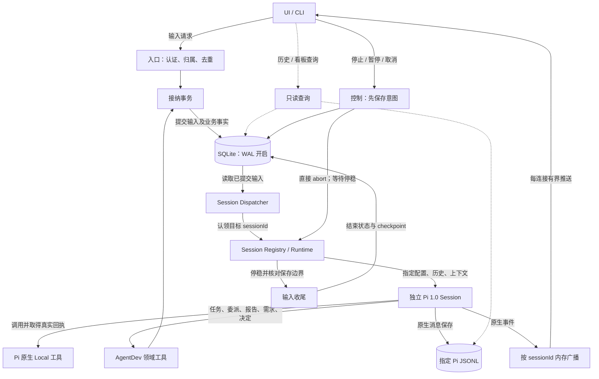
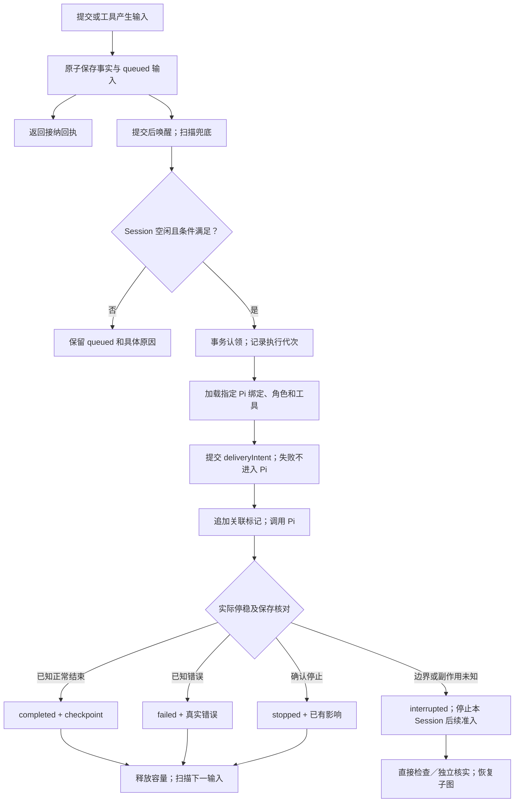
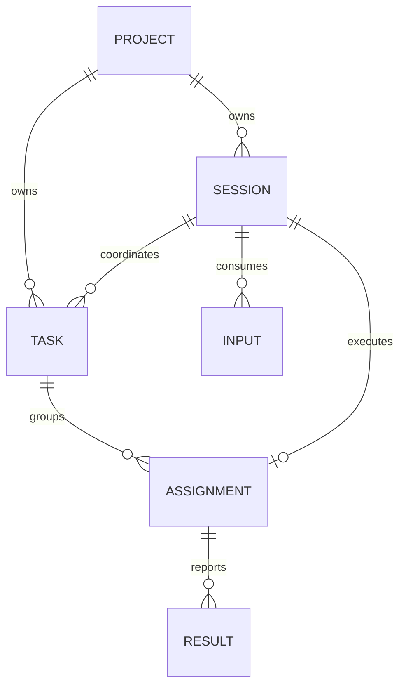

# 执行架构与职责

v1 设计基线。产品含义见 [产品总览](../productnew/README.md)；字段、算法与例外按下文链接展开。

## A1 执行总图

图中每个 Session 都有自己的 Pi 实例、历史与上下文。主管与专业 Agent 使用同一 Runtime 实现。

| 边界 | 程序执行方式 | 展开位置 |
|---|---|---|
| 请求/工具 → SQLite | 同步等待短事务提交，返回稳定身份；不等待 Task 完成 | [接纳与认领](storage-and-recovery.md#s3-事务与认领) |
| SQLite → Dispatcher → Runtime | 提交唤醒 + 启动/周期扫描；异步消费行记录 | [共用输入执行](runtime-contract.md#r3-共用-session-执行链路) |
| Pi → 原生工具 | 保留 Pi 循环，关键写操作包一层意图/回执 | [关键操作](storage-and-recovery.md#s4-关键操作与-checkpoint) |
| 专业结果 → 主管 | 结果和主管通知同事务；通知仍走共用 Runtime | [协作时序](messaging-and-collaboration.md#m1-task-多-session-协作子图) |
| Pi → UI | 内存广播，不进入业务 WAL 队列 | [UI 通道](messaging-and-collaboration.md#m4-ui-快照与实时事件) |
| 控制 → Runtime | 保存控制意图后直接中止；绕过普通输入队列 | [控制与恢复](storage-and-recovery.md#s5-停止暂停取消) |

## A2 一项输入的执行子图

Task 阶段是业务进展，输入终态是一次处理结果。主管 Session 可以 idle，关联 Task 仍 active 或等待专业结果。普通失败若有未解决副作用，采用 interrupted 路径。

## A3 对象与事实来源

每项专业分工绑定一个专业 Session；专业 Session 默认只服务该分工，可接收 Plan、实施和返工等多条输入。主管 Session 可协调多个 Task。只读调查允许无 Task，仍保存主管/专业 Session 与结果来源。图中 ASSIGNMENT / RESULT / INPUT 是内部记录。

| 事实 | 权威 |
|---|---|
| Project 身份、实际目录、配置、写入授权 | Server SQLite |
| Session 身份/活动绑定、Task、分工、决定、输入与关键回执 | Server SQLite |
| 会话正文、工具消息、压缩和分支 | 精确绑定的 Pi JSONL |
| 需求内容与总体状态 | 项目 Markdown + YAML 头部；列表可重建 |
| 产品/技术知识、代码与测试入口、项目内交付报告 | 项目权威文件；索引只导航 |
| 实时文本、思考和工具进度 | 内存；断线读取历史和当前状态 |

## A4 模块责任

| 模块 | 可以做什么 | 交给谁 |
|---|---|---|
| API / 订阅入口 | 认证、归属校验、接纳、查询、控制、流连接 | 业务变更调用对应服务 |
| ProjectService | realpath 绑定、项目文件、需求校验与列表、配置 | 正式工作由 TaskService 管理 |
| TaskService | Task、分工、Plan/决定/候选/结果、完成核对 | 角色选择与下一步由主管决定 |
| Store | 短事务、唯一约束、CAS、输入认领和回执 | 不解释自然语言或选择角色 |
| Dispatcher | 查可消费行、Session 串行、容量、公平与扫描 | Pi 生命周期由 Runtime 管理 |
| SessionRegistry / Runtime | 稳定身份到 Pi 的映射、输入处理、规则和工具绑定、收尾 | Pi 负责模型循环/压缩/原生重试 |
| SessionEventHub | 当前代次快照、广播、有界缓冲与重同步 | 不保存 Task 或另一份聊天 |
| RecoveryService | 核对原记录与效果，安全补登记/交接，恢复控制 | 语义调查用独立只读 Agent；具体未知由用户核实 |

这些是一个 Server 内的职责，不要求逐项建包或进程。SQLite WAL 是存储机制，Dispatcher 查询 session_inputs，不能读取 -wal 文件充当消息分发。

## A5 运行资源与边界

- 一个状态目录只运行一个 Server；OS 排他锁在进程存活期间持有。启动成功后增加 serverEpoch，拒绝旧代次写入。具体锁库与目录由部署 Plan 选择。
- Server 统一保存数据库、Pi 文件、规则版本和恢复产物；用户项目保存 AGENTS.md、.dev/、源码和可迁移报告。凭证只留 Server 私有存储。
- cwd、模型、凭证引用、角色、工具与 Pi 文件均显式绑定；不切换全局 process.cwd/process.env，不按 cwd 搜索最近会话。
- 同一共享工作目录一个写入负责人；跨项目可并行，只读 Session 可并行。需要并行写时给出分离目录，组合后重新验证。
- Review / Test 使用固定候选和独立上下文。普通 Session 分离不代表 OS 沙箱；首版直接使用 Pi Local operations。
- 复制项目文件不自动恢复本环境 Task 或授权。目录重绑定、主管交接先停写、核对引用和归属；采用 CAS，保证唯一协调权。

## A6 参考与采用范围

| 主源 | 采用 | AgentDev 自己负责 |
|---|---|---|
| [Pi v1.0.0 SDK](https://github.com/earendil-works/pi/blob/v1.0.0/packages/coding-agent/docs/sdk.md) | 原生 Session、模型循环、消息/历史、工具、取消 | 项目与 Task、可靠接纳、归属与完成条件 |
| [OMP task](https://github.com/can1357/oh-my-pi/blob/9348320cc4a30a7195d36a1f05a6c11bcb701a17/packages/coding-agent/src/task/index.ts)、[executor](https://github.com/can1357/oh-my-pi/blob/9348320cc4a30a7195d36a1f05a6c11bcb701a17/packages/coding-agent/src/task/executor.ts) | 批量专业分工、角色/工具、稳定 Session、独立上下文 | 跨阶段正式 Task、结果事务和持久投递 |
| [Durable 固定版本](https://github.com/earendil-works/pi/blob/a13d35a742c6ef8462812a28fbe1d8c8b7431c32/packages/durable/README.md) | 输入先保存、稳定请求、继续边界、未知效果不盲重放 | 用 coding-agent SDK 落实所需机制；不引入其 Harness |

Durable 基于 pi-ai + Chord；其 Conversation 与本产品 Session 更接近，其底层 Task 不能直接映射正式交付 Task。API 接入和故障验证入口见 [实现检查](implementation-checks.md)。
