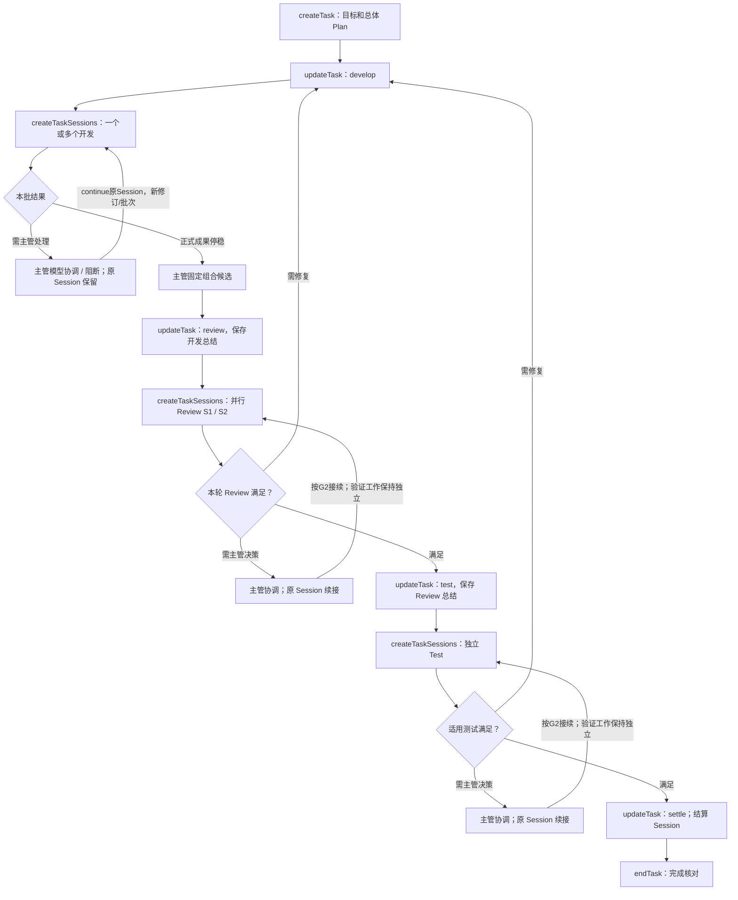
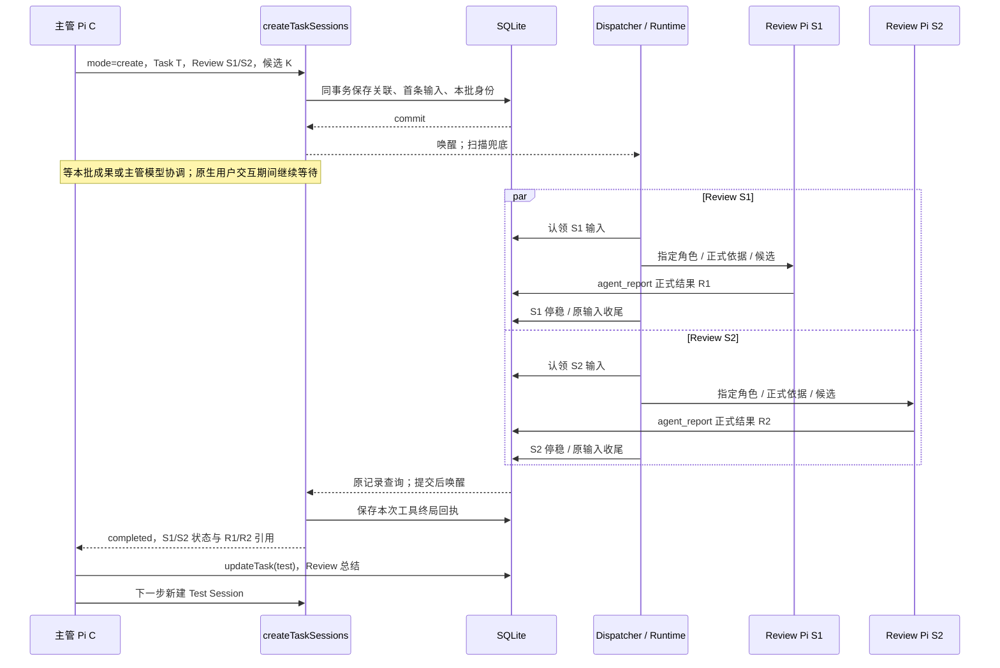
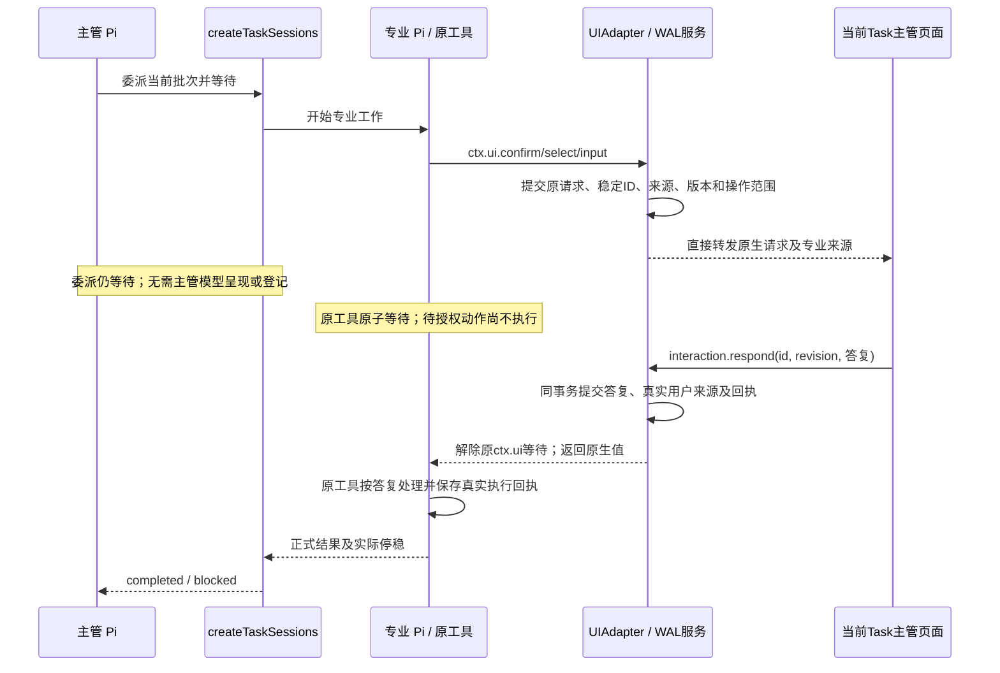

# 子 Session 协作、交互与 UI 通道

共用 Runtime 见 [R3](runtime-contract.md#r3-共用-session-执行链路)，持久字段/事务见 [S2/S3](storage-and-recovery.md)。

## M1 Task 多 Session 协作子图

所有专业 Session 必须绑定 Task；Task 类型与阶段的权威定义见 [G2](agents-and-tools.md#g2-模型工具)。以下图示标准代码交付，analysis 按 G2 保存正式调查成果并停稳后即可收口，design/light/document 采用各自适用过程。主管总体 Plan 描述过程；Session 到当前步骤才创建，主管显式更新阶段。专业 Agent 内部计划不作为另一个流程门禁。



两个 Review 对同一候选，完成/问题处理后 Test；轻量/文档按 D-04 适用独立检查，不伪造 Test。收到一份 Review 或一条“完成”文本不满足当前步骤结束。



工具接纳后 onUpdate 可展示真实身份；模型最终返回不是 queued，而是 M2 结果。真实检查 verdict=failed 也可以是本批已完成，主管组织修复；程序不自动选择下一角色。

## M2 委派等待协议

delegationId 指已保存的当前批次成员，不是新业务 Task。每次 create/continue/wait 工具调用各有稳定 requestKey 和不可变终局回执；后续 wait 同一 delegationId 读取最新事实，不改旧调用回执。

```typescript
type DelegationReturn = {
  taskId: string; // 所有专业工作必需
  delegationId: string;
  outcome: 'completed' | 'blocked';
  sessions: Array<{
    sessionId: string; inputId: string; workRevision: number;
    state: 'queued' | 'working' | 'waiting_user' | 'completed' | 'failed' | 'stopped' | 'interrupted';
    resultIds: string[]; interactionIds: string[]; error?: { code: string; message: string };
  }>;
  interactionIds: string[];
};
```

| 条件 | 返回 / 主管动作 |
|---|---|
| 本批所有目标输入停稳，期待正式结果齐全，无阻断 verdict、待处理交互或未知 | completed；核对语义结果，显式更新阶段或返工 |
| 成员提交正式阻断报告 verdict=blocked，需要 chief 模型判断 | blocked；保存本轮最终报告并停稳，主管处理后 continue 原 Session，以新 workRevision/批次接续 |
| 成员正在 ctx.ui.confirm/select/input 等待用户 | 本次委派继续等待；宿主按 M5 转发、关联答复并解除原工具等待 |
| 失败、停止、缺报告、未知效果或环境阻断需要处理 | blocked；返回各成员真实状态/原因，不假装全批结束 |

检查顺序以真实未知/控制阻断优先，再正式阻断报告，再完成，其他情况继续异步等待。回执保存先于返回；报告/停稳/交互提交后唤醒，注册等待后再查一次原事实避免漏唤醒；启动/周期扫描兜底。等待不依赖内存 Promise 作为事实来源。

成员保留最初 inputId。暂停恢复时，查询按 S2 的 continuationOfInputId 链找到该成员同 Session/同 workRevision 的合法接续输入，再读取其实际状态及链上有效结果；返回中的 inputId 是当前有效输入。没有合法接续时仍返回原停止/中断事实。真正返工增加 workRevision 并建立新批次，不把旧批次的目标改成新目标。

原生交互的 interactionIds 只供观察、关联与恢复；它们不触发委派终局返回。宿主直接解除原 ctx.ui 等待，原委派工具继续等待正式成果，不要求 chief 模型调用生命周期工具。真正需要主管判断时，专业 Agent 通过 agent_report(verdict=blocked) 提交本轮正式阻断报告，结束当前 workRevision 并停稳；父工具返回 blocked。主管解决原因后 mode=continue 原 Session，以新 workRevision/新批次接续，不丢弃 Session 或 Task。主管不能向仍在 processing 的专业 Pi 并发 prompt。已存在/完成的批次不能被 create 复制。

## M3 输入、Pi JSONL 与结果

| Input.kind | payload | 来源键 |
|---|---|---|
| user | Pi content、taskId? | user:<requestId> |
| delegation | instructions、refs、expectedKind、candidateId? | session:<sessionId>:work:<workRevision>:initial |
| continuation | instructions、refs、dependsOnResultIds? | 原 continue 工具 requestKey |
| system_notice | code、taskId?、relatedInputId?、reason、evidenceRefs? | 原控制/恢复操作 + code；仅空闲/恢复接续时消费 |

system_notice 首版 code=task.controlled/recovery.resolved。运行中控制先保存事实并让当前等待返回 blocked；仅无活跃等待/工具返回接入时，以稳定来源键投一份系统输入，不双重投递。公开用户入口不能伪造内部 kind。

| 内容 | SQLite | Pi / UI |
|---|---|---|
| 原输入 | 身份、内容、顺序与状态 | 消费时追加原生消息；用户气泡按 inputId 合并 |
| 模型/工具正文 | 不逐条复制 | 原生 JSONL 与内存事件 |
| 专业正式结果 | 摘要、报告/依据/候选与结果身份 | 原专业工具回执；主管委派工具聚合返回 |
| 子交互请求/用户答复 | 原请求、主体版本、来源、状态/答复 | 宿主提交原请求后直接在当前 Task 主管 UI 通道展示 |
| 流式文本/思考/工具进度 | 不持久化 | pending/内存广播；崩溃可能丢片段 |

返回模型的 content 必须含 taskId/delegationId/sessionId/outcome/正式结果引用；有报告或开放交互时附路径/interactionId；自由讨论中的专业调查也先建立 analysis Task。不能只放 details。blocked 返回不是 Task 完成。恢复系统消息用 sendCustomMessage/customType=agentdev.input/display=true，明确来源与事实，不伪装主管 assistant。[Pi 消息类型](https://github.com/earendil-works/pi/blob/v1.0.0/packages/coding-agent/docs/message-types.md)

原生输入/条目关联见 R4；流式临时 messageKey 映射 contextEpoch/entryId，PI-01/04 验证。不得按正文相同或数组位置去重。

## M4 UI 快照与实时事件

每逻辑 Session 一个 EventHub，每连接有界缓冲；广播不竞争消费。普通页面订阅主管通道即可获得自己的原生消息、Task 失效通知和宿主已呈现交互；不自动订阅全部子 Session。用户主动查看专业历史可单独读取，响应权限始终校验当前 Task 主管归属。

```text
session.stream.prepare：
  校验归属，建立临时缓冲订阅
  同一内存边界复制 epoch / boundary seq / 消息映射 / pending / 已知 leaf
  读取边界内的指定历史和业务状态，包括宿主已呈现且未解决交互
  返回 subscriptionId + 快照 + boundary

GET /api/v1/sessions/<sessionId>/stream?subscriptionId=<id>：
  校验主体/Session，接管缓冲，只发送 seq > boundary
  溢出 / 代次变化 / 关联不明 / 过期：stream.resync 后关闭，重新 prepare
```

短内存复制不等待文件/网络；历史限定捕获 leaf，pending 是边界副本。messageKey 去重避免重复片段。SSE 重连不持久重放 Last-Event-ID；重取快照/原事实。准备订阅短 TTL，断线销毁缓冲但不取消工作/交互。

```json
{
  "type": "pi", "projectId": "p-001", "sessionId": "chief-01",
  "inputId": "m-001", "epoch": "12/2", "seq": 41,
  "event": { "type": "agent_settled" }
}
```

event 保持 Pi AgentSessionEvent；inputId/messageKey 仅有实际关联时提供，epoch=serverEpoch/contextEpoch。业务通知 `{type:'invalidate',entity:'input'|'task'|'session'|'requirement'|'interaction',id,revision?}` 触发查询；交互事件见 M5。慢连接溢出不阻塞 Pi/其他页面。

## M5 统一交互与授权

本节是原生交互、宿主 WAL 关联、转发与响应的唯一完整契约；G2 只定义模型主动提问的薄工具，R/S 引用本节的接入与持久事实。复用 Pi `ctx.ui.confirm/select/input` 的请求/答复语义，通过 `session.bindExtensions({uiContext})` 接入宿主。SDK 不自动提供 RPC stdio 通道，也不承担本产品持久化、Task 归属或恢复。[Pi 交互规范](https://github.com/earendil-works/pi/blob/v1.0.0/packages/coding-agent/docs/rpc-extension-ui.md)、[SDK 绑定源码](https://github.com/earendil-works/pi/blob/v1.0.0/packages/coding-agent/src/core/agent-session.ts#L3211-L3222)

模型主动询问只使用 G2 的单个 question 薄工具，其实现调用 ctx.ui；工具内部需要授权时直接调用 ctx.ui。宿主不注册 interaction.request/present/wait/resolve/invalidate 等模型生命周期工具，不建立 Plan、需求、初始化或工具批准等业务 kind。问题内容表达业务含义；当前工具/服务提供真实操作摘要、对象版本和授权范围供关联校验，不能由模型答复生成授权。



底层事实表的 state=requested/presented/resolved/stale。requested 表示请求已提交、尚待宿主发布；presented 表示已提交宿主通道呈现状态，不能保证用户已看到。宿主完成这两步并在提交后发布事件，不需要主管模型。断线不丢请求，快照按原 interactionId 重现。原请求、来源与操作范围不可变；范围/版本变化、源调用停止或明确过期时由宿主失效为 stale。resolved 答复不可覆写；已解决请求的源动作仍受控制、版本和效果检查约束。

展示外层：type=interaction/projectId/chiefSessionId/sourceSessionId/taskId?/interactionId/revision/request。专业请求 taskId 必需；主管自由对话主动提问可无 Task。taskId 存在时路由及响应权限读取当前 tasks.chiefSessionId/ownerEpoch，保存的接纳来源不能代替当前主管。request 采用 extension_ui_request 的 id/method/title/message/options；id 映射稳定 interactionId。可读来源保留，不能伪装主管原生消息。

```json
{
  "type": "interaction", "projectId": "p-001", "chiefSessionId": "c-01",
  "sourceSessionId": "s-01", "taskId": "t-01", "interactionId": "q-01", "revision": 2,
  "request": { "type": "extension_ui_request", "id": "q-01", "method": "confirm", "title": "是否允许本次操作？", "message": "开发 Session S1 请求执行描述中的操作。" }
}
```

响应：confirm 使用 `{confirmed:boolean}`；select/input 使用 `{value:string}`；撤回用 `{cancelled:true}`；每次仅一种形状。select 显示字符串映射到保存的稳定选项值，不允许客户端追加选项/代码/工具名。未答复不视为同意，超时仅在明确配置时生效，默认不因离线自动批准。原生 false/undefined 或取消返回原调用，由原工具判断拒绝或修订，不执行未获授权的动作。

interaction.respond 直接进入宿主服务，校验访问、当前主管归属、presented 与 expectedRevision；涉及具体动作时同时校验 subjectVersion/操作摘要；同一重复答复返回原记录，不同答复冲突。服务事务保存答复、真实用户来源、必要授权事实与回执后，才解除原 ctx.ui 等待；它不排普通 chief 输入，不触发第二次 prompt，不需要主管再次批准。批准不等于操作成功，原工具仍须保存实际执行回执。明确携带 interactionId 的文字答复走同一服务；普通聊天不能猜配到一个或多个待解决请求。

稳定 requestKey 由原 inputId/contextEpoch/invocationKey 与该调用内的 interactionSequence 派生，绑定不可变请求摘要；工具调用以 toolCallId 作为 invocationKey，扩展调用无 toolCallId 时以宿主在执行边界保存的稳定调用身份作为 invocationKey。序号及身份在请求提交时保存，不靠随机重建或正文相等去重。请求提交前不能发布；答复提交前不能解除原等待。事务不跨用户、模型或工具长 await。注册等待后重查原事实，提交后唤醒并以扫描兜底。

所有宿主等待绑定所属工具/Session 的 AbortSignal；uiContext 使用调用 opts.signal，缺省时接入当前执行取消信号；Pi 不替宿主取消自建 Promise。失效、停止或超时解除本调用、注销监听并释放本等待的预约；UI 适配返回 false/undefined 或明确取消，原待授权动作不得执行。仅停止主管观察输入不替用户拒绝仍有效的子请求；停止源专业输入或 Task pause/cancel 才使对应未解决请求 stale，具体范围见 S5。迟到回调必须核对 contextEpoch/generation/ownerEpoch 和控制，不能改新执行或授权新范围；迟到真实证据可保存为历史。

重启只恢复请求、答复和操作事实，不能假定原 Promise 或工具栈存在。先按 S7 核对原效果与 Pi 边界；有有效活跃调用才按原 ID 解除等待。无有效原调用时，仅在公开回执修补试验通过且可确认配对时补原回执，否则交接上下文并接续剩余工作。resolved 只证明原范围获得答复，不证明动作尚未执行；未知效果保留阻断。requested 由宿主继续发布，presented 从快照重现，stale 不复活；不重建专业 Session 或重复派发动作。

## M6 主源与检查

OMP 的 [同步聚合](https://github.com/can1357/oh-my-pi/blob/9348320cc4a30a7195d36a1f05a6c11bcb701a17/packages/coding-agent/src/task/index.ts#L1463-L1570) 与 [persisted-revive](https://github.com/can1357/oh-my-pi/blob/9348320cc4a30a7195d36a1f05a6c11bcb701a17/packages/coding-agent/src/task/persisted-revive.ts) 供有界并行、独立角色和配置恢复参考；其内存任务不替代 SQLite 事实。Durable 的 [后台子会话](https://github.com/earendil-works/pi/blob/a13d35a742c6ef8462812a28fbe1d8c8b7431c32/packages/durable/test/examples/23-subagent-background.ts) 参考稳定输入/通知边界。当前产品的原生交互关联、主管协调返回和重启续接必须按 [I1/I3](implementation-checks.md) 实际验证。
