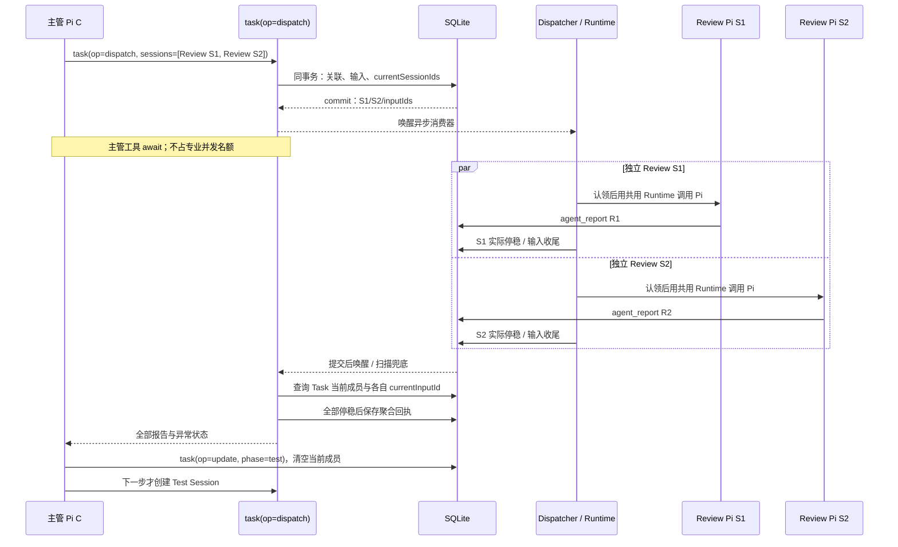
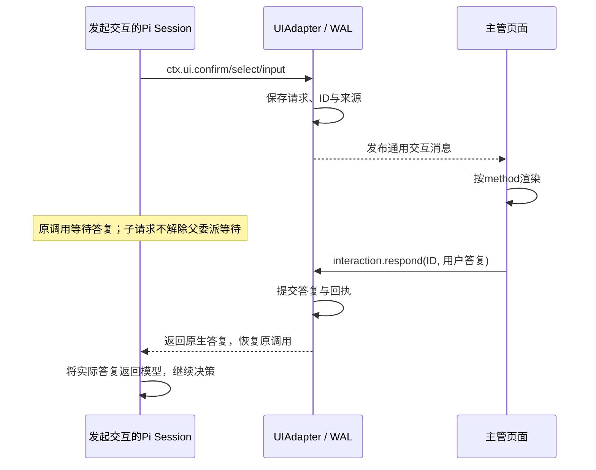

# 子 Session 协作、交互与 UI 通道

共用 Runtime 见 [R3](runtime-contract.md#r3-共用-session-执行链路)，持久字段与事务见 [S2/S3](storage-and-recovery.md)。

## M1 Task 多 Session 协作子图

Task 只有 read/write 两类，唯一枚举/工具字段见 [G2](agents-and-tools.md#g2-模型工具)。所有专业 Session 绑定 Task。下图为 write Task 的标准代码工作；read 调查保存 Server 报告收口，轻量/文档采用适用独立 Review 与结算，不伪造 Test。

```mermaid
flowchart TD
  TASK[task(op=create)：type=write / 总体 Plan] --> DEVPHASE[task(op=update)：开始 develop 步骤]
  DEVPHASE --> DEV[task(op=dispatch)：开发；写入 currentSessionIds]
  DEV --> DOUT{当前步骤全部停稳？}
  DOUT -->|未结束| WAIT[继续异步等待；超时返回状态，不取消]
  WAIT -->|主管 wait 或核实后 continue| DEV
  DOUT -->|全部结束| AGG[汇总报告与异常；主管决定]
  AGG -->|缺项或修复| DEVPHASE
  AGG -->|成果满足| FIXED[记录实际交付状态]
  FIXED --> REVIEWPHASE[task(op=update)：review；保留旧结果，清空当前成员]
  REVIEWPHASE --> REVIEWS[task(op=dispatch)：Review S1 / S2 并行]
  REVIEWS --> ROK[等全部成员结束 / 汇总全部 Review]
  ROK -->|修复| DEVPHASE
  ROK -->|满足| TESTPHASE[task(op=update)：test]
  TESTPHASE --> TEST[task(op=dispatch)：独立 Test]
  TEST --> TOK[等 Test 结果 / 主管判断]
  TOK -->|修复| DEVPHASE
  TOK -->|满足| SETTLE[task(op=update)：settle；委派结算]
  SETTLE --> END[task(op=end)：必要报告 / 实际交付 / 真实保存]
```

普通子交互按 M5 经宿主直达主管页面，父工具仍等待。正式 blocked 报告结束该子输入；其他成员未结束时继续等，全部结束或等待超时才把报告/异常聚合给主管。超时之后主管可处理已经返回的阻断，但不能把仍运行工作当成结束。



Review verdict=failed 可以是工作正常结束的报告，主管必须判断修复；结果聚合不是业务通过。

## M2 委派等待协议

等待集合唯一取 **task.currentSessionIds**：当前 Task 当前步骤的专业 Session，不含主管、不含历史步骤。每成员查询 task_sessions.currentInputId，再取该输入正式报告/交互/终态。不是查询整个 Task 的所有历史 Session，也不为每次等待建立另一套批次对象。

```typescript
type DelegationReturn = {
  taskId: string;
  outcome: 'completed' | 'blocked' | 'timeout';
  sessions: Array<{
    sessionId: string; inputId: string;
    state: 'queued' | 'working' | 'waiting_user' | 'stopping' | 'completed' | 'failed' | 'stopped' | 'interrupted';
    resultIds: string[]; interactionIds: string[];
    error?: { code: string; message: string };
  }>;
};
```

| 当前事实 | 分配层行为 / 返回 |
|---|---|
| 存在 queued/working/waiting_user/stopping 成员 | 异步继续等待；一份报告不能提前宣布本步骤结束 |
| 全部成员停稳，期待报告齐全，无 blocked/中断/停止/执行异常 | completed，包含所有报告；verdict=failed 仍由主管判断 |
| 全部成员结束，但有正式 blocked、缺报告、失败/停止/中断 | blocked，汇总已有报告及每项真实异常；不丢成功成员 |
| waitTimeoutMs 到达、仍有未结束成员 | timeout，全部成员当前状态、已有报告及交互；不停止/取消/重建子工作 |
| 父输入停止或 Task 控制 | 解除父观察等待，按控制事实返回 blocked 或取消；Task/子停止范围见 S5 |

报告和输入收尾提交后唤醒，注册等待后重查事实，周期扫描兜底；不把内存 Promise 当状态源。read/write 共用同一等待算法。create/continue 保存身份后等待，wait 只观察已存在工作。旧回执不可变，新 wait 可取最新快照。

主管收到 timeout 先查看状态：运行或等用户的继续等待；技术异常中断/停止先核实历史/成果，只用 dispatch 续办剩余工作；用户暂停/取消不自动重启，completed 成果不重跑。queued 只是未执行，不是停止，不用 dispatch 复制。

正式 blocked 成员处理后可在当前步骤用 dispatch 续办原 Session，currentInputId 指向新输入，旧结果保留；其他已完成成员仍留在集合，不重新执行。新一步由 task(op=update) 提供 phase 清空当前集合，哪怕同名阶段也明确新步骤；历史结果通过 task(op=get) 找回。

子用户请求不让父工具提前返回；宿主直接解除原 ctx.ui 等待，不等待主管模型处理转发。主管不能向仍 processing 的专业 Pi 并发 prompt。

## M3 输入、Pi JSONL 与结果

| Input.kind | payload | 稳定来源 |
|---|---|---|
| user | Pi content、taskId? | user:<requestId> |
| delegation | instructions、refs、expectedKind、writeScope? | 原 dispatch 调用 + 成员身份 |
| continuation | 剩余 instructions、refs、dependsOnResultIds?、resumedFromInputId? | 原 continue/明确续办调用 |
| system_notice | taskId?、code、相关输入/证据/原因 | 原控制/核实操作 + code |

system_notice 首版 code=task.controlled/recovery.resolved，仅空闲时消费；控制先直接保存和解除等待，无活跃返回通道才投一份通知，不双重报告。公开入口不能伪造内部 kind。

| 内容 | SQLite | Pi / UI |
|---|---|---|
| 接纳输入 | 身份、content、顺序与状态 | 消费时追加原生消息；用户气泡按 inputId 合并 |
| 模型/原生工具正文 | 不复制 | 原生 JSONL；内存事件广播 |
| 正式结果 | 摘要、来源、报告引用 | 专业工具回执；主管等待聚合返回 |
| 用户交互 | 原请求/来源/状态/真实答复 | 提交后主管通道显示，直接响应源调用 |
| 文本/思考/工具进度 | 不落业务 WAL | 内存推送；重连读取历史，不承诺恢复崩溃片段 |

模型 content 必须含 taskId/sessionId/outcome/结果路径，待用户请求附 interactionId；不能只放 details。恢复消息 sendCustomMessage/customType=agentdev.input-notice/display=true，内容明确来源/事实，不伪装 assistant。输入关联书签名称见 R4（agentdev.input-marker）；不得按正文或数组位置去重。

## M4 UI 快照与实时事件

每逻辑 Session 一个 EventHub，每连接有界缓冲；广播不竞争消费。普通页面订阅主管通道即可获得自己的原生消息、Task 失效通知和已保存交互；不自动订阅全部子 Session。用户主动查看专业历史可单独读取，响应权限始终校验当前 Task 主管归属。

```text
session.stream.prepare：
  校验归属，建立临时缓冲订阅
  同一内存边界复制 epoch / boundary seq / 消息映射 / pending / 已知 leaf
  读取边界内的指定历史和业务状态，包括已保存且 pending 的交互
  返回 subscriptionId + 快照 + boundary

GET /api/v1/sessions/<sessionId>/stream?subscriptionId=<id>：
  校验主体/Session，接管缓冲，只发送 seq > boundary
  溢出 / 代次变化 / 关联不明 / 过期：stream.resync 后关闭，重新 prepare
```

短内存复制不等待文件/网络；历史限定捕获 leaf，pending 是边界副本。messageKey 去重避免重复片段。SSE 重连不持久重放 Last-Event-ID；重取快照/原事实。准备订阅短 TTL，断线销毁缓冲但不取消工作/交互。

```json
{
  "type": "pi", "projectId": "p-001", "sessionId": "chief-01",
  "inputId": "m-001", "epoch": "12/2", "seq": 41,
  "event": { "type": "agent_settled" }
}
```

event 保持 Pi AgentSessionEvent；inputId/messageKey 仅有实际关联时提供，epoch=serverEpoch/当前 Pi 实例代次。业务通知 `{type:'invalidate',entity:'input'|'task'|'session'|'requirement'|'interaction',id,revision?}` 触发查询；交互事件见 M5。慢连接溢出不阻塞 Pi/其他页面。

## M5 统一交互与授权

确认是一轮可等待的问答：模型判断是否需要询问、选择 Pi 通用交互类型并组织内容；UI 按类型渲染；用户答复写入 WAL，再返回原调用供模型继续。Plan、需求、风险等含义放在问题内容中，不定义业务确认 kind 或专用确认协议。

通过 session.bindExtensions({uiContext, mode}) 把 ctx.ui.confirm/select/input 接入宿主 UIAdapter，复用 Pi 原生请求/答复字段；**必须绑定 UI 适配器**，交互开关是「是否绑定适配器」而非 mode 字符串（实测绑定+`rpc`/绑定+`print` 都可交互，未绑定时 ctx.hasUI=false；与固定版本 `hasUI()` 实现一致），mode 按宿主真实身份声明（浏览器宿主首版 `"rpc"`）。适配器必须实现为普通对象：SDK 以对象展开包装 uiContext，类实例的原型方法会在包装后丢失。模型使用 G2 的 question 扩展，工具内部已有 ctx.ui 交互使用相同通道。[Pi 交互规范](https://github.com/earendil-works/pi/blob/v1.0.0/packages/coding-agent/docs/rpc-extension-ui.md)、[SDK 绑定源码](https://github.com/earendil-works/pi/blob/v1.0.0/packages/coding-agent/src/core/agent-session.ts#L3211-L3222)



展示消息沿用现有外层：type=interaction、projectId、chiefSessionId、sourceSessionId、taskId?、interactionId、revision、request。专业 Session 的 taskId 必需；宿主按当前 Task 的主管通道呈现，保留专业来源。主管自由对话可无 Task。内层 request.type=extension_ui_request，request.id=interactionId：

| request.method | 请求字段 | 用户 response | 原 ctx.ui 返回 |
|---|---|---|---|
| confirm | title、message | {confirmed:boolean} 或 {cancelled:true} | boolean，取消为 false |
| select | title、options:string[] | {value:string} 或 {cancelled:true} | 选项字符串或用户自填的答复，取消为 undefined |
| input | title、placeholder? | {value:string} 或 {cancelled:true} | 输入文本，取消为 undefined |

UI 只根据 method 渲染并发送实际答复；选项来自请求，不由 UI 添加业务动作。选择请求始终附带一个「自行输入」入口：选项可能都不成立，逼用户挑一个会把错误决定写进记录；自填答复原样交给模型，不映射成某个选项、不解释成同意。模型需要另问或改用输入时，再发起相应通用交互。未答复不视为同意；取消后将取消结果返回原调用，由模型决定继续、调整或停止。

```json
{
  "type": "interaction", "projectId": "p-001", "chiefSessionId": "c-01",
  "sourceSessionId": "s-01", "taskId": "t-01", "interactionId": "q-01", "revision": 2,
  "request": { "type": "extension_ui_request", "id": "q-01", "method": "confirm", "title": "是否继续？", "message": "此处为模型或原工具提供的问题内容。" }
}
```

```json
{
  "requestId": "reply-01",
  "method": "interaction.respond",
  "params": {
    "projectId": "p-001", "chiefSessionId": "c-01",
    "interactionId": "q-01", "expectedRevision": 2,
    "response": { "confirmed": true }
  }
}
```

interaction.respond 直接接入现有 WAL 服务：核对当前归属、请求 ID/版本与答复形状（select 为非空字符串：选项之一或用户自填；空答复不成立，非字符串不成立），提交后解除原 ctx.ui 等待。它不排普通 Session 输入、不触发新 prompt、不等待主管模型转发。业务含义由模型根据问题和真实答复判断，Server 不解析业务批准范围，也不增加业务确认字段。

请求持久化后才发布，答复持久化后才继续；断线从快照重现原请求，重复答复复用原回执。停止、失效与重启沿用 [S2/S3/S5/S7](storage-and-recovery.md)，question 和 UI 不维护另一套恢复状态。

## M6 主源与检查

OMP 的 [同步聚合](https://github.com/can1357/oh-my-pi/blob/9348320cc4a30a7195d36a1f05a6c11bcb701a17/packages/coding-agent/src/task/index.ts#L1463-L1570) 与 [persisted-revive](https://github.com/can1357/oh-my-pi/blob/9348320cc4a30a7195d36a1f05a6c11bcb701a17/packages/coding-agent/src/task/persisted-revive.ts) 供有界并行、独立角色和配置恢复参考；其内存任务不替代 SQLite 事实。Durable 的 [后台子会话](https://github.com/earendil-works/pi/blob/a13d35a742c6ef8462812a28fbe1d8c8b7431c32/packages/durable/test/examples/23-subagent-background.ts) 参考稳定输入/通知边界。当前产品的原生交互关联、主管协调返回和重启后的事实核对与续办必须按 [I1/I3](implementation-checks.md) 实际验证。
