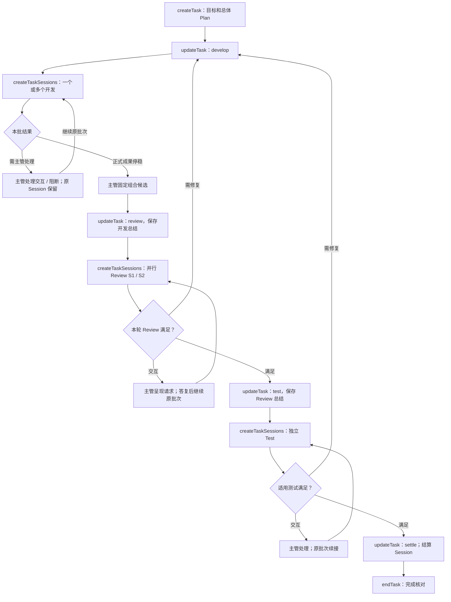
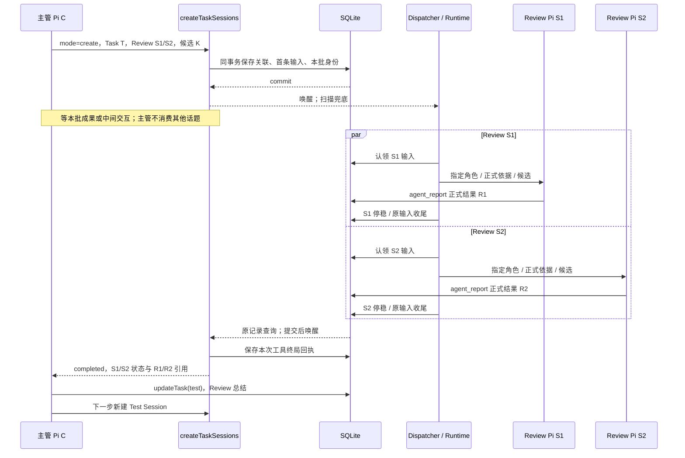
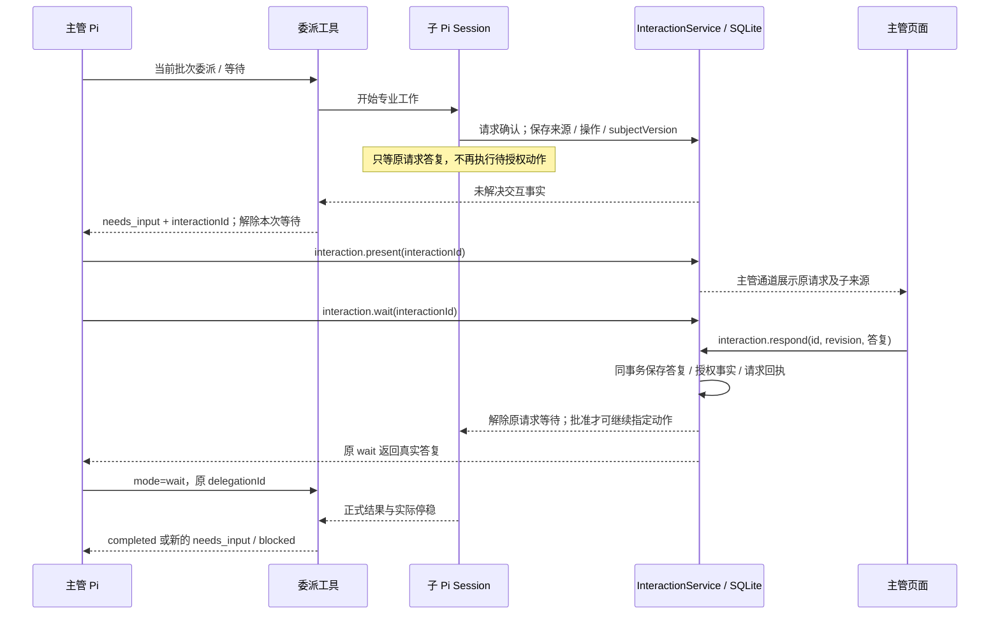

# 子 Session 协作、交互与 UI 通道

共用 Runtime 见 [R3](runtime-contract.md#r3-共用-session-执行链路)，持久字段/事务见 [S2/S3](storage-and-recovery.md)。

## M1 Task 多 Session 协作子图

一项 Task 是完整交付。主管总体 Plan 描述过程；Session 到当前步骤才创建，主管显式更新阶段。专业 Agent 内部计划不作为另一个流程门禁。



两个 Review 对同一候选，完成/问题处理后 Test；轻量/文档按 D-04 适用独立检查，不伪造 Test。收到一份 Review 或一条“完成”文本不满足当前步骤结束。



工具接纳后 onUpdate 可展示真实身份；模型最终返回不是 queued，而是 M2 结果。真实检查 verdict=failed 也可以是本批已完成，主管组织修复；程序不自动选择下一角色。

## M2 委派等待协议

delegationId 指已保存的当前批次成员，不是新业务 Task。每次 create/continue/wait 工具调用各有稳定 requestKey 和不可变终局回执；后续 wait 同一 delegationId 读取最新事实，不改旧调用回执。

```typescript
type DelegationReturn = {
  taskId?: string; // 正式工作必需；无 Task 的只读调查省略
  delegationId: string;
  outcome: 'completed' | 'needs_input' | 'blocked';
  sessions: Array<{
    sessionId: string; inputId: string; workRevision: number;
    state: 'queued' | 'working' | 'waiting_user' | 'completed' | 'failed' | 'stopped' | 'interrupted';
    resultIds: string[]; interactionIds: string[]; error?: { code: string; message: string };
  }>;
  interactionIds: string[];
};
```

| 条件 | 返回 / 主管动作 |
|---|---|
| 本批所有目标输入停稳，期待正式结果齐全，无待处理交互/未知 | completed；核对语义结果，显式更新阶段或返工 |
| 任何成员有未解决交互 | needs_input；保存请求并结束本次等待，主管 present/wait/处理；原 Session/其余成员保留 |
| 失败、停止、缺报告、未知效果或环境阻断需要处理 | blocked；返回各成员真实状态/原因，不假装全批结束 |

检查顺序以真实未知/控制阻断优先，再交互，再完成，其他情况继续异步等待。回执保存先于返回；报告/停稳/交互提交后唤醒，注册等待后再查一次原事实避免漏唤醒；启动/周期扫描兜底。等待不依赖内存 Promise 作为事实来源。

成员保留最初 inputId。暂停恢复时，查询按 S2 的 continuationOfInputId 链找到该成员同 Session/同 workRevision 的合法接续输入，再读取其实际状态及链上有效结果；返回中的 inputId 是当前有效输入。没有合法接续时仍返回原停止/中断事实。真正返工增加 workRevision 并建立新批次，不把旧批次的目标改成新目标。

主管呈现并处理已有 interactionId 后用 mode=wait 继续原 delegationId。开放交互会再次返回 needs_input，提示词要求先处理，不忙轮询。授权答复继续原工具等待，不追加同一专业输入；只有真正的新指令/返工才使用 continue。已存在/完成的批次不能被 create 复制。

## M3 输入、Pi JSONL 与结果

| Input.kind | payload | 来源键 |
|---|---|---|
| user | Pi content、taskId? | user:<requestId> |
| delegation | instructions、refs、expectedKind、candidateId? | session:<sessionId>:work:<workRevision>:initial |
| continuation | instructions、refs、dependsOnResultIds? | 原 continue 工具 requestKey |
| system_notice | code、taskId?、relatedInputId?、reason、evidenceRefs? | 原控制/恢复操作 + code；仅空闲/恢复接续时消费 |

system_notice 首版 code=task.controlled/recovery.resolved。运行中控制先保存事实并让当前等待返回 blocked；仅无活跃等待/工具返回接入时，以稳定来源键投一份系统输入，不双重投递。公开用户入口不能伪造内部 kind。

| 内容 | SQLite | Pi / UI |
|---|---|---|
| 原输入 | 身份、内容、顺序与状态 | 消费时追加原生消息；用户气泡按 inputId 合并 |
| 模型/工具正文 | 不逐条复制 | 原生 JSONL 与内存事件 |
| 专业正式结果 | 摘要、报告/依据/候选与结果身份 | 原专业工具回执；主管委派工具聚合返回 |
| 子交互请求/用户答复 | 原请求、主体版本、来源、状态/答复 | 主管模型处理后才在主管 UI 通道展示 |
| 流式文本/思考/工具进度 | 不持久化 | pending/内存广播；崩溃可能丢片段 |

返回模型的 content 必须含 delegationId/sessionId/outcome/报告路径/待处理 interactionId；正式工作还必须含 taskId，无 Task 调查省略它，不生成虚构 Task。不能只放 details。中间返回不是专业完成或 Task 完成。恢复系统消息用 sendCustomMessage/customType=agentdev.input/display=true，明确来源与事实，不伪装主管 assistant。[Pi 消息类型](https://github.com/earendil-works/pi/blob/v1.0.0/packages/coding-agent/docs/message-types.md)

原生输入/条目关联见 R4；流式临时 messageKey 映射 contextEpoch/entryId，PI-01/04 验证。不得按正文相同或数组位置去重。

## M4 UI 快照与实时事件

每逻辑 Session 一个 EventHub，每连接有界缓冲；广播不竞争消费。普通页面订阅主管通道即可获得自己的原生消息、Task 失效通知和主管已呈现交互；不自动订阅全部子 Session。用户主动查看专业历史可单独读取，不获得直接响应 requested 请求的权限。

```text
session.stream.prepare：
  校验归属，建立临时缓冲订阅
  同一内存边界复制 epoch / boundary seq / 消息映射 / pending / 已知 leaf
  读取边界内的指定历史和业务状态，包括主管已呈现且未解决交互
  返回 subscriptionId + 快照 + boundary

GET /api/v1/sessions/<sessionId>/stream?subscriptionId=<id>：
  校验主体/Session，接管缓冲，只发送 seq > boundary
  溢出 / 代次变化 / 关联不明 / 过期：stream.resync 后关闭，重新 prepare
```

短内存复制不等待文件/网络；历史限定捕获 leaf，pending 是边界副本。messageKey 去重避免重复片段。SSE 重连不持久重放 Last-Event-ID；重取快照/原事实。准备订阅短 TTL，断线销毁缓冲但不取消工作/交互。

```json
{
  "type": "pi", "projectId": "p-001", "sessionId": "chief-01",
  "inputId": "m-001", "epoch": "12/2", "seq": 41,
  "event": { "type": "agent_settled" }
}
```

event 保持 Pi AgentSessionEvent；inputId/messageKey 仅有实际关联时提供，epoch=serverEpoch/contextEpoch。业务通知 `{type:'invalidate',entity:'input'|'task'|'session'|'requirement'|'interaction',id,revision?}` 触发查询；交互事件见 M5。慢连接溢出不阻塞 Pi/其他页面。

## M5 统一交互与授权

复用 Pi confirm/select/input 的请求/答复语义；SDK 用 uiContext 接入，没有自动获得 RPC stdio 通道。Pi 原生协议不承担本产品持久化、Task 归属或恢复。[Pi 交互规范](https://github.com/earendil-works/pi/blob/v1.0.0/packages/coding-agent/docs/rpc-extension-ui.md)、[SDK 绑定源码](https://github.com/earendil-works/pi/blob/v1.0.0/packages/coding-agent/src/core/agent-session.ts#L3211-L3222)



请求只有一个生命周期：requested → presented → resolved；主体/操作内容改变或明确过期则 stale。chief 发起请求可直接 presented，子请求必须先交回主管，由 present 展示；Server 不自动替主管批准/解释，UI 不直接发现和弹子请求。

展示外层：type=interaction/projectId/chiefSessionId/sourceSessionId/taskId?/interactionId/revision/request。request 采用 extension_ui_request 的 id/method/title/message/options；id 映射稳定 interactionId。可读来源保留，不能伪装主管原生消息。操作摘要/subjectVersion/允许响应由服务保存和校验。

```json
{
  "type": "interaction", "projectId": "p-001", "chiefSessionId": "c-01",
  "sourceSessionId": "s-01", "taskId": "t-01", "interactionId": "q-01", "revision": 2,
  "request": { "type": "extension_ui_request", "id": "q-01", "method": "confirm", "title": "是否允许本次操作？", "message": "开发 Session S1 请求执行描述中的操作。" }
}
```

响应：confirm 使用 `{confirmed:boolean}`；select/input 使用 `{value:string}`；撤回用 `{cancelled:true}`；每次仅一种形状。select 显示字符串映射到保存的稳定选项值，不允许客户端追加选项/代码/工具名。未答复不视为同意，超时仅在明确配置时生效，默认不因离线自动批准。

interaction.respond 直接进入服务，校验访问/主管归属、presented/subjectVersion/操作摘要/expectedRevision；相同重复答复返回原记录，不同答复冲突。批准不是执行成功：保存答复后才解除原调用等待，具体保存需求/效果仍按原工具/业务执行。接纳答复时由服务记录真实用户来源，模型不能生成同意。

文字答复：已呈现请求的文本输入带 interactionId，通过同一响应服务直接处理，不排普通用户输入；普通聊天意图需主管理解时在安全边界处理，不能把任意一句“继续”配到未知请求。需求加入、总体 Plan、危险操作共用此渠道，权限范围不能因为都显示同意按钮而互相替代。

拒绝把 false/取消返回原调用；未获授权的动作不执行，由子 Agent 报告影响或提出修订。主管要修改原问题/范围，先调用 interaction.invalidate(id, expectedRevision, reason)。事务保存 stale 与回执后，解除源 request 和主管 wait：领域工具返回 INTERACTION_STALE，原生 UI 适配返回 false/undefined 或取消；原待授权动作不执行。服务发现主体版本变化或明确过期使用同一失效服务。需要修改专业指令时先停稳，再 continue 原 Session；由当前操作提出新请求，不能用修改展示文字或另一个已批准问题激活旧动作。所有宿主等待绑定取消信号，stale/超时也须解除等待并注销回调，具体停止范围按 S5。Task pause/cancel/交接与交互按 S5/S7 核对，不恢复过期上下文的内存回调。

## M6 主源与检查

OMP 的 [同步聚合](https://github.com/can1357/oh-my-pi/blob/9348320cc4a30a7195d36a1f05a6c11bcb701a17/packages/coding-agent/src/task/index.ts#L1463-L1570) 与 [persisted-revive](https://github.com/can1357/oh-my-pi/blob/9348320cc4a30a7195d36a1f05a6c11bcb701a17/packages/coding-agent/src/task/persisted-revive.ts) 供有界并行、独立角色和配置恢复参考；其内存任务不替代 SQLite 事实。Durable 的 [后台子会话](https://github.com/earendil-works/pi/blob/a13d35a742c6ef8462812a28fbe1d8c8b7431c32/packages/durable/test/examples/23-subagent-background.ts) 参考稳定输入/通知边界。当前产品的中间交互返回和重启续接必须按 [I1/I3](implementation-checks.md) 实际验证。
