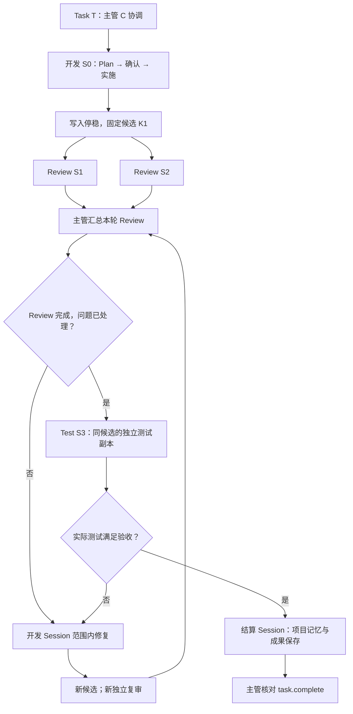
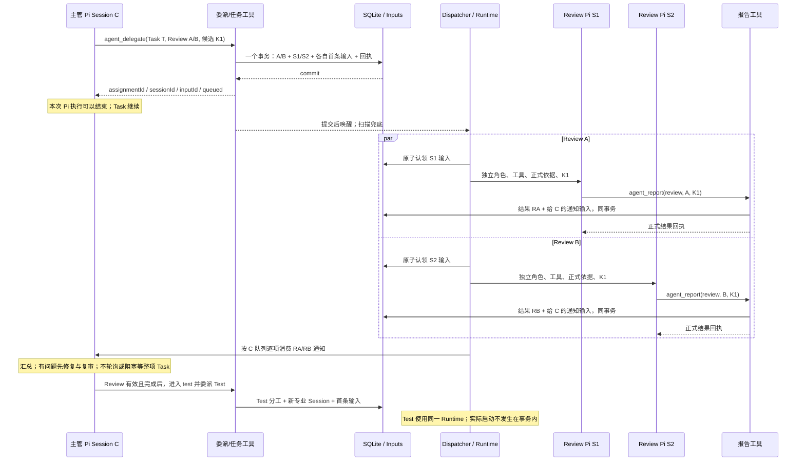

# 消息、子 Session 协作与 UI 通道

本页定义协作子图和消息协议。共用执行链路见 [A1/A2](architecture.md)，存储事务见 [S2/S3](storage-and-recovery.md)。

## M1 Task 多 Session 协作子图

Task 累计关联整个交付过程中的专业 Session；存在多条关联不意味着所有阶段同时运行。标准代码顺序来自 D-04/D-05：Review 后才 Test，返工重新 Review。



图中的阶段选择由主管依据规则完成。程序验证阶段/候选/报告有效性，不收到一个结果就自动启动下个角色。轻量/正式文档使用 D-04 适用流程，不添加无意义 Test。

下图展开一次“同一候选，两个并行 Review，再启动 Test”。所有返回身份都来自数据库接纳；实际 Pi 对象在消费时创建。



结果到达顺序可以不同。主管接到 RA 可处理问题，但未满足本轮 Review 完成条件时不能启动 Test。报告与停稳通知均去重；一份结果不覆盖另一个 Reviewer。主会话本次回复结束不取消专业工作。

## M2 持久输入协议

统一 Input 外层定义在 S2。kind 的业务载荷如下，所有引用在接纳/消费时校验：

| kind | payload | 生成者与来源键 |
|---|---|---|
| user | content（Pi 原生文本/图片块） | 用户入口；user:<requestId> |
| delegation | instructions、refs、expectedKinds、dependsOnResultIds、candidateId? | 委派服务；assignment:<assignmentId>:initial |
| agent_message | instructions、refs、dependsOnResultIds、planResultId? | agent_send；原工具 requestKey |
| result_notice | resultId | agent_report 事务；result:<resultId>:chief:<ownerEpoch> |
| decision | decisionId | 用户选择/resolve 事务；decision:<decisionId>:resolved |
| system_notice | code、relatedInputId?、taskId?、assignmentId?、command?、status?、revision?、reason?、evidenceRefs? | Runtime/控制/恢复服务；执行通知使用原输入 + code + generation；Task 控制使用 task-control:<requestKey> |

system_notice.code 首版为 assignment.settled、assignment.failed、assignment.interrupted、task.controlled、recovery.resolved。分工/恢复通知必须有 relatedInputId，分工通知还需 assignmentId；task.controlled 必须有 taskId、command、status、revision，无需伪造 relatedInputId。Task 通知的 command 为 pause/resume/cancel/complete/adopt，status/revision 为该控制事务提交后的 Task 状态。它是需要主管处理的真实执行事实，不装入每 token/进度事件。无正式报告的专业执行正常结束发 REPORT_MISSING，失败/中断保留真实原因；不能从最后一句话补成功结果。

下面只展示接纳服务生成的消息身份与载荷；状态、版本、时间等完整记录字段按 S2 补齐。

```json
{
  "schemaVersion": 1,
  "inputId": "i-result-01",
  "projectId": "p-001",
  "sessionId": "chief-01",
  "taskId": "t-001",
  "sourceKey": "result:r-01:chief:1",
  "kind": "result_notice",
  "payload": { "resultId": "r-01" }
}
```

消费 result/decision 时读取当前正式记录及 validity/subjectVersion，再组成模型上下文。不能把接纳时旧摘要当作永远有效，也不能将普通 UI 通知当业务事实。只有指定服务可生成内部 kind；公开入口只接纳 user 与显式控制。

## M3 与 Pi JSONL / 模型消息的关系

| 内容 | SQLite | Pi / UI |
|---|---|---|
| 接纳的原始输入 | 原内容、身份、顺序与状态 | 实际消费才加入 Pi；排队用户气泡按 inputId 显示 |
| 用户/自定义上下文的输入关联 | inputId → marker / 根条目 / checkpoint | 公开 CustomEntry 标记候选；根条目仍沿用原生消息 |
| 助手/工具正文 | 不逐条复制；只存必要边界与关键操作回执 | Pi 原生 JSONL，实时输出走内存 |
| 专业结果 | 正式结果摘要、报告引用、主管输入 | 专业会话工具回执；主管消费后的明确来源 CustomMessage |
| 流式文本/思考/工具进度 | 不持久化 | 当前 pending 与内存广播；崩溃可能丢片段 |

模型结果通知示例（由结果记录构造）：

```text
来源：专业结果 r-01，Task t-001，分工 a-01，Session review-01。
候选：k-01；依据：正式需求/Plan 的记录引用。
结论：failed。摘要：缺少失效令牌测试。
报告：.dev/work/t-001/a-01/review.md（已核对摘要）。
当前有效性：current。当前分工执行状态：reported / completed。
请依据任务流程处理本结果；其余分工状态可通过 task.get 查询。
```

CustomMessage 的 customType=agentdev.input，content 含上述可见事实，details 可放结构化 ID，display=true。不能只把 ID 放 details；不能伪装专业结果为主管 assistant 回复。[Pi 消息类型](https://github.com/earendil-works/pi/blob/v1.0.0/packages/coding-agent/docs/message-types.md)

进入 Pi 后 queued 用户气泡与对应原生用户条目合并为一个显示身份；不按正文相等或数组下标合并。流式临时 messageKey 在宿主分配，原生条目保存后映射到 contextEpoch/entryId；PI-01/PI-04 验证此映射，尚未验证不私改 Pi 类型。

## M4 UI 快照与实时事件

每个逻辑 Session 一个 EventHub，绑定当前 Pi；每连接独立有界缓冲。广播订阅者都收到输出，不能竞争消费。慢客户端溢出发 stream.resync 后关闭，Pi/其他连接继续。页面关闭只退订。

```text
session.stream.prepare：
  校验访问，创建临时订阅并开始缓冲
  在同一内存边界复制：epoch、boundary seq、消息关联、当前 Pi 状态/已知历史 leaf
  读取该边界以内的指定历史和业务状态，不把边界之后消息塞入旧快照
  返回 subscriptionId + 快照 + boundary

GET /api/v1/sessions/<sessionId>/stream?subscriptionId=<id>：
  校验同一访问主体/Session；接管准备阶段缓冲
  只发送 seq > boundary 的事件，然后继续实时广播
  溢出、代次变化、快照关联不明或订阅过期：要求重新 prepare
```

复制内存边界只做短同步操作，不阻塞 Pi 等文件/网络。异步历史读取限定到已捕获 leaf；pending 使用边界时的副本。快照与增量对同一 messageKey 去重，不能重复追加已包含片段；这是 PI-04 的必测条件。

```json
{
  "type": "pi",
  "projectId": "p-001",
  "sessionId": "chief-01",
  "inputId": "m-001",
  "epoch": "12/2",
  "seq": 41,
  "messageKey": "pending:12:3:1",
  "event": { "type": "agent_settled" }
}
```

event 原样保持 Pi AgentSessionEvent 结构，不重新定义文本/思考/工具 delta。epoch=serverEpoch/contextEpoch；seq 只在内存通道单调递增。inputId/messageKey 在有明确关联时提供，绑定类事件不伪造关联。

业务通知为 `{type:'invalidate',entity:'input'|'task'|'assignment'|'requirement',id,revision?}`，客户端重新查询；若携带状态，必须按该记录 revision 合并。程序结果由 DB/文件查询恢复，不靠通知重放。订阅控制消息为 stream.resync（reason），均非持久业务输入。

SSE 重连不能用 Last-Event-ID 请求持久事件重放。断线销毁连接缓冲，重新 prepare；准备未连接的订阅有短 TTL。Server/Pi 实例更换使旧 epoch 失效，稳定 sessionId 通道重新绑定。专业 Session 有自己的通道；主管只收到正式通知，不混入完整专业聊天。

原生历史可读即可展示，不要求每条正文先登记 DB。Pi 已显示文本但关键保存失败时，页面保留可读内容，输入显示 interrupted；不把 message_end 或助手“完成”当 Task completed。

## M5 决定与按钮回调

decision.propose 返回保存的 decisionId、revision、kind、question、choices、subjectRef/version。UI 自行渲染文字与按钮。点击只提交该决定身份/版本与 value；不提交任意工具名、执行代码或整个客户端业务对象。

重复相同选择返回原决定；内容/依据变化拒绝旧选择。决定与主管输入同事务保存；后续 requirement.create / requirement.implement / plan.confirm 等动作由主管按内置规则调用工具实现。自由文字答复通过 sourceInputId 落同一决定，不增第二套业务状态。

## M6 借鉴与实现检查

- OMP：角色/工具目录、明确 task 参数、独立 Session、稳定身份与冷恢复契约。借鉴 [persisted-revive](https://github.com/can1357/oh-my-pi/blob/9348320cc4a30a7195d36a1f05a6c11bcb701a17/packages/coding-agent/src/task/persisted-revive.ts) 的“恢复配置与工具”，不是只恢复聊天。
- OMP 结果归属/代次检查可参考 [registry](https://github.com/can1357/oh-my-pi/blob/9348320cc4a30a7195d36a1f05a6c11bcb701a17/packages/coding-agent/src/registry/agent-registry.ts)。其 [job-manager](https://github.com/can1357/oh-my-pi/blob/9348320cc4a30a7195d36a1f05a6c11bcb701a17/packages/coding-agent/src/async/job-manager.ts) 内存投递不能证明 Server 崩溃后可靠。
- Durable 的 [后台子会话](https://github.com/earendil-works/pi/blob/a13d35a742c6ef8462812a28fbe1d8c8b7431c32/packages/durable/test/examples/23-subagent-background.ts) 参考输入接纳、结果通知和稳定请求；AgentDev 压缩成 assignment/result/主管 Input，不引入 Anchor/Reporter 任务体系。

多 Reviewer、阶段次序、迟到结果、恢复与快照交界全部进入 [实现检查](implementation-checks.md)。
