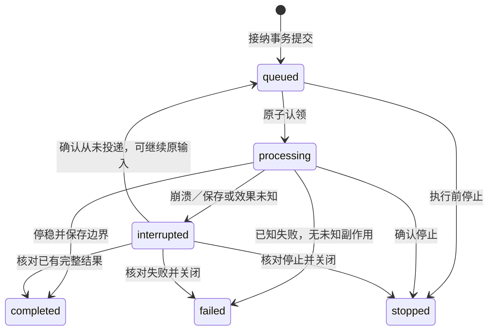

# 项目与 Session 运行契约

本页定义公开接入和共用 Pi 执行流程。存储原子性见 [S3](storage-and-recovery.md#s3-事务认领与等待)，角色/工具见 [G1～G4](agents-and-tools.md)。接口版本 v1；未实施。

## R1 公开入口

首版同源 HTTP JSON 请求 + SSE 实时输出。请求入口 `POST /api/v1/rpc`，先认证再校验项目归属。查询不调用模型；API 不接受任意 Pi 工具名或 cwd。模型/凭证设置使用配置服务，私有凭证不进入响应。

```json
{
  "requestId": "m-001",
  "method": "session.input.submit",
  "params": {
    "projectId": "p-001",
    "sessionId": "s-001",
    "content": [{ "type": "text", "text": "先讨论，不开始开发" }]
  }
}
```

```json
{
  "requestId": "m-001",
  "result": { "inputId": "m-001", "status": "queued", "revision": 1 }
}
```

失败响应为 requestId + error:{code,message,details?}，与 result 互斥。写调用必须有稳定 requestId，第一次发送前生成，重试复用。每个 ID 在同一安装下绑定 method + 完整规范化参数；同 ID 不同归属/内容返回 REQUEST_CONFLICT。规范化只处理 Schema 默认值和对象键顺序，不归并自然语言。

| method | 参数 | 返回 / 行为 |
|---|---|---|
| project.open | path | realpath 唯一 Project、会话/工作摘要、知识入口；只登记/读取，不创建会话、模型或项目文件 |
| project.get | projectId | 概要与当前绑定/入口问题；目录缺失明确报告；不含任务列表（任务一律走 `task.list`） |
| project.list | limit?、cursor? | 已登记项目列表：realPath、目录是否存在、会话/任务数、最后活动、更新时间；cursor 为 `updatedAt\|projectId`；不读项目文件 |
| project.rebind | projectId、expectedRevision、path | 原 ID 的新目录绑定；先停写、校验引用与确认来源，禁止因同名自动认领 |
| session.create | projectId | chief 的逻辑 Session；Pi 懒创建，无模型也能创建/读取；标题不存储，由首条用户输入派生 |
| session.get | projectId、sessionId | role、currentTaskId、activity、stopping、当前输入、等待原因、排队数、lastActivityAt、config{providerId,modelId,source}；activity=idle/queued/processing/stopping（stopping=已请求停止但尚未停稳）；config 取当前输入认领时记录的配置，只回这三个字段，不含服务端目录 |
| session.list | projectId、limit?、cursor? | 会话列一次取齐：sessionId、roleId、revision（清理的 CAS 依据）、title（派生，60 码点截断）、activity、lastActivityAt、currentTaskId、queuedInputs；cursor 为 `lastActivityAt\|sessionId`；不调用 `stream.prepare`、不读历史文件 |
| session.messages.list | projectId、sessionId、cursor?、before?、limit | 指定 Pi 历史、input 关联与状态；cursor 向前翻（nextCursor），before 向后翻（previousCursor，页首 entry；到最早为 null），两者不可同时给；无历史的未开始会话为空，有历史而文件缺失报错 |
| session.input.submit | projectId、sessionId、content、taskId? | 用户输入只投 chief；当前 Task 的补充须关联原 taskId，按安全边界处理；普通新话题排队至原 Task 结束或新开主管会话 |
| session.input.get | projectId、sessionId、inputId | 当前状态、历史边界/结果的公开引用、错误/停止原因；原内容保持不变 |
| session.input.stop | projectId、sessionId、inputId | 保存停止意图后直接 abort；返回 Input 原 status/revision、stopRequested 与 Session.activity；未停稳 activity=stopping，未知为 interrupted |
| task.list/get | projectId、taskId?、cursor?、limit? | Task 看板/详情，无模型也可读 |
| task.control | projectId、taskId、expectedRevision、command | pause/resume/cancel，调用同一 TaskService；停止范围见 S5 |
| requirement.list/get | projectId、过滤/分页或 requirementId | 使用同一文件读取服务，返回非法文件信息，不经模型 |
| interaction.respond | projectId、chiefSessionId、interactionId、expectedRevision、response | 请求/响应、当前主管路由、去重、保存后解除等待均按 M5；返回已收到与当前请求状态 |
| session.stream.prepare | projectId、sessionId | subscriptionId、epoch、boundary、快照；先缓冲后读快照，见 M4 |
| task.report.get | projectId、taskId、resultId | 校验 Task/结果归属，读取 Server 或项目报告正文；不接受任意路径 |
| config.get/save/test | projectId?、roleId?；save:expectedRevision/value，test:配置引用 | 脱敏有效配置、版本/实际试连结果；密钥仅保存私有凭证引用 |
| project.files.list/read | projectId、path；list:cursor?/limit，read:expectedVersion? | 项目相对目录/文件正文；实际路径归属检查，不访问外部符号链接 |
| session.cleanup | projectId、sessionId、expectedRevision | 只清理无未结束工作且不被当前 Task/成果引用的会话；被引用时拒绝并列明原因 |
| auth.login/logout | login:本机配置的访问口令；logout:当前会话 | login 建立同源 cookie；logout 撤销 cookie/关闭所属流连接；不进入模型/WAL 业务输入 |
| session.recovery.inspect | projectId、sessionId | interrupted 输入、Pi 绑定、已有结果与待核实事实；直接读取 |
| session.recovery.resolve | projectId、sessionId、inputId、expectedRevision、evidenceRefs、resolution | resolution=completed/failed/stopped，核对归属、CAS及已有证据后关闭原输入，证据不足保持 interrupted；不调用模型、不重发操作 |

project.rebind / task.control / recovery.resolve 是显式控制；session.input.submit 中自然语言“暂停”由主管理解后调用控制工具。旧页面的 input.stop 只停止指定 inputId，不误停后来的输入。

认证采用首版本机配置访问口令换取同源安全会话 cookie，写入校验来源/CSRF；退出立即拒绝旧连接和后续请求。SSE 不通过 URL 携带访问凭证。目录与文件接口检查实际路径归属，脱离项目的符号链接不能经 Web 文件接口访问。这些是接入与数据保护，不扩展多用户权限系统。

## R2 输入状态与版本



| 状态 | 程序含义 |
|---|---|
| queued | 已接纳未进入 Pi；可因模型/目录/控制/前序恢复而阻断 |
| processing | 当前有效代次处理中，含 Pi 原生重试和工具执行 |
| completed | 本输入正常处理结束，边界与结果引用已确认；不表示 Task 完成 |
| failed | 已知错误已记录，现有成果保留；不自动重投原输入 |
| stopped | 确认不再执行；不代表回滚已有影响 |
| interrupted | 无法确认边界或效果，先恢复核对，本 Session 后续普通输入不启动 |

已进入 Pi 的输入不以原 inputId 重新 queued/prompt。核实后关闭原输入为实际已知终态，剩余工作按 G2/S7 由主管提交新的 continuation 输入，resumedFromInputId 仅供追溯；使用原生历史继续，不恢复原工具执行栈，不补写 ToolResult。

每次持久变化 revision 加一。重复接纳/停止/查询返回当前状态；旧 revision 的 queued 回执不能覆盖新 completed。session.activity 从当前 input、工具等待与控制意图派生；waiting_children/waiting_user 时 input 仍 processing，Pi 不接受第二次并发 prompt。paused/cancelled Task 不因浏览器打开恢复。

## R3 共用 Session 执行链路

所有专业 Session 的调度、调查和恢复核实都必须绑定 Task；自由讨论无需 Task，需委派时先创建 read Task。Task 类型、阶段与完成条件唯一采用 G2/G3，不在 Runtime 重定义。

```text
dispatch(sessionId):
  核对控制、恢复、目录、配置、Session 空闲、专业 Session 并发限制
  Store.claimNext：按 S3 的可消费范围事务认领最早输入，增加执行代次
  Registry.getOrCreate：取得该 sessionId 的唯一 Pi 实例
  固定 actor、cwd、模型、规则版本、工具集合和活动历史绑定
  先提交 deliveryStartedAt，再记录输入关联标记，投递原生用户消息或明确来源 CustomMessage
  Pi 运行；原生事件立即进入内存广播
  等实际 settled；核对错误、停止、宿主正式结果及指定历史保存边界
  Store.finish：CAS 保存终态/checkpoint/公开结果引用
  释放 Session / 专业并发名额，扫描下一输入；唤醒已持久关联的委派等待点
```

- 同一 Session 只有一个执行所有者；Dispatcher 公平轮转可运行 Session，每次认领一项。同一可消费范围内 queued 不能越过前序 unresolved interrupted；当前 Task 外的输入保留至其结束。
- 事务不跨模型、Shell、网络或文件复制的长 await。每个 Pi 实例的事件/工具绑定当前 inputId 与 generation，迟到回调拒绝修改新执行。
- 用户/委派/接续输入共用此函数。专业结果与正式阻断报告通过当前委派工具返回；原生交互按 M5 直接解除原请求等待，不作为第二次 prompt 插入忙碌 Pi。
- 普通原生工具失败由 Pi 如实返回；主管可组织修复。宿主关键保存失败、重启或无法核实停止边界时 interrupted，不要求程序从每条原生工具失败推断业务效果。
- 当前用户消息先保存；只在 Pi 空闲时投递。首版不用 Pi steer/followUp 作第二条输入队列，不重复入两队。
- 一个主管同时协调一项未结束 Task；当前 Task 的交互、补充与恢复可处理，其他目标用另一个主管。查询/交互响应/停止/恢复直接进入对应服务；主管自身 interrupted 不能启动普通队列。
- `waiting_user` 的原生交互等待不计入运行停滞/总时长窗口：用户在思考不是 provider 停滞。主管自身输入被停滞或超时中止时，宿主关闭为 stopped、在 recovery 记录 `host:*` 证据并注入系统提示说明结果未知，队列随后继续；不重投原输入，也不要求用户在界面另行恢复。
- 专业 report 成功不等于 Pi 停稳。正式最终报告后禁止该输入继续修改成果；Runtime 确认结束才释放负责人并满足当前步骤完成条件。正式报告与停稳保存事实后唤醒原委派等待；原生交互等待不提前结束委派。
- task(op=dispatch) / 原生 ctx.ui 都是可取消异步等待，保留 Session 执行所有权。主管不占专业 Session 并发名额；专业名额=1 也能推进。首版不接管逐模型请求调度，每 Session 不接收第二次并发 prompt。

## R4 Pi 接入的明确契约

使用 `createAgentSession` 的显式 cwd/model/sessionManager/resourceLoader/tools/customTools。SessionManager 创建到指定目录；恢复先检查指定文件，再 open，必要时 branch 到已确认条目；在创建 AgentSession 前完成选择。[SDK](https://github.com/earendil-works/pi/blob/v1.0.0/packages/coding-agent/docs/sdk.md)

Pi 接入层只负责以下小范围连接，不接管模型循环：

| 宿主动作 | 接入要求 |
|---|---|
| create/open | 验证绑定、header/历史、cwd、实际模型和角色/工具契约；禁止默认模型回退或“最近文件” |
| deliver user/delegation/continuation | 保留原生 content，使用 prompt/sendUserMessage；inputId 是宿主关联，不存在原生参数 |
| return child result / blocker | 原 task(op=dispatch) 的 content/structuredContent 带真实 ID、状态与引用；保存原操作回执后返回，不再追加同一结果的 CustomMessage |
| user interaction | 按 G2 经 resourceLoader.extensionFactories 加载官方 question 移植扩展，pi.registerTool 注册一次；通过 session.bindExtensions({uiContext, mode}) 绑定宿主，**绑定 UI 适配器是必需动作**：实测（绑定+`rpc`、绑定+`print` 两种组合）与固定版本源码（`hasUI()` 只判断 uiContext 是否绑定）一致——绑定时 ctx.hasUI=true、未绑定时 false，交互开关是「是否绑定适配器」。mode 只用于宿主自我声明与 TUI-only 行为，按真实身份给值（浏览器宿主首版 `"rpc"`）。另外适配器必须是普通对象：SDK 用对象展开包装 uiContext，类实例的原型方法会在包装后丢失（实测 notify 变 undefined）。ctx.ui.confirm/select/input 按 M5 的消息协议关联、提交、转发、答复和恢复；子请求不解除父委派等待，无主管模型呈现步骤 |
| recovery/control notice | 只在空闲时 sendCustomMessage，customType=agentdev.input-notice，模型可见内容含来源/ID/事实；不能给仍在等待的同一次调用重复输入 |
| input correlation | 用公开 appendCustomEntry 写 agentdev.input-marker 标记，串行定位其实际根输入条目；保留 markerId/inputEntryId，不按正文相等匹配 |
| observe | subscribe 的同步 listener 仅广播/记录内存状态；不能 await 监听器承担持久事务 |
| finish | 核对 agent_settled、错误/取消、宿主正式结果及指定历史文件边界；完成后记录 checkpoint |
| stop | 工具内 ctx.abort 发起取消；外层 await session.abort 等实际空闲 |

agentdev.input-marker 标记保存 inputId、requestDigest、generation；它是 Pi 自定义条目，不把工程元数据伪装成用户文本。恢复/控制通知使用 agentdev.input-notice，属于会进入模型上下文的 custom message；两者名称不同，按名称扫描书签不会命中通知，不需要再判断条目种类。委派工具的模型可见返回定义在 M2；uiContext 的确切接口按固定版本导出类型接入，不将 SDK 嵌入改成 RPC 子进程。

这套关联路线需 [PI-01](implementation-checks.md#i1-pi-接入必须先通过的试验) 验证：首次文件建立、模板转换、压缩、分支、扩展拦截、写失败与重复追加。标记不能确定根输入时停止准入、保留 interrupted，核实后明确续办剩余工作；禁止让实现 Agent 自己添加原生 inputId 字段。

首次 Pi 文件可能尚未建立；bindings.hasHistory 只有确认持久条目后才置 true。hasHistory=true 而缺文件/空文件/身份错误必须 HISTORY_UNAVAILABLE。Pi open 的新建行为不能当作恢复。[open 行为](https://github.com/earendil-works/pi/blob/v1.0.0/packages/coding-agent/src/core/session-manager.ts#L1029-L1054)

message_end 先广播后 appendMessage；agent_end 可能随后原生重试；agent_settled 只表示不再自动续工作。它们均不证明文件/数据库已提交。扩展 pi.on("turn_end") 的 messageEntryId/toolResultEntryIds 可用于关联；公开 session.subscribe 的 turn_end 不提供这些 ID，但仍需读取指定文件确认内容；必要 fsync 由宿主边界检查完成，不只读内存 leaf。[保存顺序](https://github.com/earendil-works/pi/blob/v1.0.0/packages/coding-agent/src/core/agent-session.ts#L1110-L1135)

## R5 配置、初始化与只读使用

Project 首次 realpath 绑定由唯一约束保证，显示名不作身份。打开不生成 `.dev/`；主管进入时读 AGENTS、INDEX、PROJECT，缺失如实报告。写入授权和初始化差异确认引用 P-02，已确认后正常工作复用，不重复问。

逻辑 Session 创建不要求可用模型；认领时解析角色/项目/Server 覆盖，固定 effectiveConfigHash 与 credentialRef。活动输入不受设置变更影响；后续 queued 可用新配置。原已执行输入恢复时用原配置，不可用等待明确变更，不静默换模型。

配置服务至少支持读取脱敏有效配置、保存预期版本的项目/角色覆盖、试连并返回实际 provider/model 与错误。密钥保存 Server 私有目录，查询只返引用/可用性；初始化与模型安装参数由部署 Plan 给出实际说明，对应 AC-27。

## R6 共同错误目录

| code | 含义与后续 |
|---|---|
| UNAUTHORIZED / FORBIDDEN / NOT_FOUND | 会话凭证、项目归属或目标不存在；先解决访问，不能隐式换目标 |
| INVALID_ARGUMENT / REQUEST_CONFLICT / VERSION_CONFLICT | Schema、同请求不同参数、CAS 冲突（宿主 RPC 与界面操作）；返回字段/当前状态，调用者重新核对 |
| PROJECT_UNAVAILABLE / MODEL_UNAVAILABLE | 尚未开始输入保留 queued 和原因；已有历史/看板仍可读 |
| HISTORY_UNAVAILABLE / PI_INPUT_UNCONFIRMED | 精确恢复/关联不成立；保留记录，进入检查或交接 |
| STORAGE_UNAVAILABLE / EFFECT_UNCONFIRMED | 保存或效果不可确认；停止后续准入，不把已可能生效的操作自动重做 |
| WORKSPACE_BUSY / TASK_BUSY / TASK_CONTROLLED / STAGE_NOT_READY | 当前写入负责人、Task 控制或依赖未满足；不启动不适用专业工作 |
| REPORT_MISSING / REPORT_STALE / COMPLETION_INCOMPLETE | 无正式报告、报告正文文件缺失或已被改动、完成缺项（含交付已变化需重新复核）；保留 Task 与真实证据 |
| INTERACTION_STALE / STREAM_RESYNC_REQUIRED | 请求已失效或须重取快照；请求保存后可响应，不另设呈现门禁 |

known errors 的错误形状一致；失败 details 提供可读原因/当前引用，不泄漏凭证。机器字段的枚举由本页/G2/S2 定义，新增公开方法/消息种类须改相应契约与检查，不在局部实现中私建协议。
