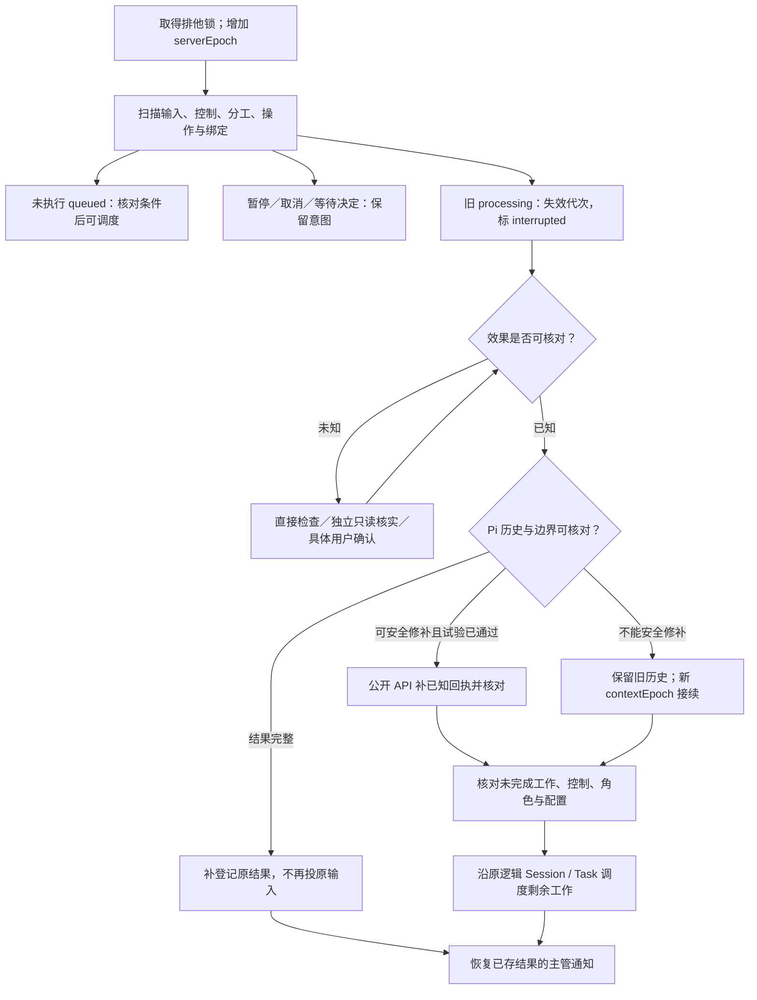

# 持久输入、操作回执与崩溃恢复

产品依据：D-06/D-07、AC-19～AC-24。技术规则：数据库接纳事实、Pi 上下文和文件效果分开核对；不承诺任意外部操作恰好执行一次。

## S1 存储基线

统一 Server SQLite：journal_mode=WAL、synchronous=FULL、foreign_keys=ON；启动读取 PRAGMA 验证，写连接统一配置。数据库在 Server 状态目录，不按项目拆库。SQLite 自己 checkpoint 合并日志，Agent checkpoint 指向继续边界。[WAL](https://www.sqlite.org/wal.html)、[同步配置](https://www.sqlite.org/pragma.html#pragma_synchronous)

Dispatcher 读取 session_inputs 表。Pi 文本/思考/工具进度不写该表；数据库不存另一份聊天全文。短事务在提交后发内存唤醒；启动和周期扫描同一记录兜底。扫描周期与容量是 Server 配置，不能成为可靠性唯一条件。

## S2 记录字段与唯一约束

这是逻辑 Schema，SQL 列展开/索引实现可由 Plan 决定，以下字段含义、枚举与约束不能自行改变。ID 是安装内稳定不透明字符串；时间为 UTC RFC3339；摘要为 sha256；JSON 对象带 schemaVersion:1。外键同项目归属必须通过服务与约束校验。

| 记录 | 必要字段 | 约束 |
|---|---|---|
| projects | id、realPath、revision、writeAuthorizationRef、initializationRef、configRef、workspaceClaims | realPath 唯一；移动用 CAS，不按名字匹配 |
| sessions | id、projectId、roleId、specialization、taskId?、assignmentId?、cwd、configRef、activeContextEpoch、recoveryBlock? | 专业 assignmentId 唯一；稳定 id 不由 cwd 推导 |
| session_bindings | sessionId、contextEpoch、piFile、branchEntryId?、hasHistory、configHash、rulesHash、createdAt | (sessionId,contextEpoch) 唯一；sessions 只指一个活动绑定；旧绑定保留 |
| tasks | id、projectId、chiefSessionId、ownerEpoch、requirementId?、kind、goal/scope、acceptanceRefs、sourceInputId、authorizationRefs、goalRevision、phase、status、revision、basisRefs、nextStep/blockReason、candidate?、controlIntent、settlement? | 同 requirementId 仅一个未结束 Task；协调权唯一；completed 只能完成核对写入 |
| assignments | id、projectId、taskId?、chiefSessionId、sessionId、batchKey、roleId、instructions、refs、dependencies、expectedKinds、candidateId?、status、revision、workRevision、activePlanResultId?、planApproval? | sessionId 唯一；同 Task 多个同角色分工分别保存；批次 key 可重建原回执 |
| results | id、assignmentId、workRevision、sourceInputId、requestKey、kind、summary、reportRef/hash、basisRefs、candidateId?、verdict?、checks、final、supersedes?、settlement?、validity | 正文与结构化报告不可变；requestKey 唯一；validity=current/stale/late 为投影；修订新增记录 |
| session_inputs | 见下方 Input | (sessionId,seq)、sourceKey 唯一；一个 Session 至多一个 processing |
| operations | id、requestKey、inputId、sessionId、generation、contextEpoch、toolCallId、toolName、argsDigest、effectClass、intent、receipt?、state | requestKey 唯一；state=intent/known/uncertain；原身份绑定原参数 |
| decisions | id、projectId、taskId?、chiefSessionId、kind、subjectRef/version、question、choices、initialization?、revision、status、resolution/sourceInputId? | status=open/resolved/stale；一次有效解决；旧版本选择拒绝；初始化差异包随决定持久保存 |
| request_receipts | requestKey、method、paramsDigest、refs、status、result/error | key 安装内唯一，完整参数绑定；status=pending/committed；普通 DB 写在同事务记 committed；文件多步骤可 pending，终局失败以 committed+error 保存 |

Task.kind=standard/light/document；status=active/waiting/pausing/paused/cancelling/cancelled/completed；phase 见 G2。结算中由 active/waiting + phase=settle 表达，不另存竞争状态。Assignment.status=queued/working/waiting/reported/completed/failed/stopped/interrupted。reported 证明正式提交，completed 还需其当前输入停稳；Task 完成是另一步。结果 verdict=failed 可以是正常完成的检查，不等于执行 failed。

| 分工触发 | 新状态与动作 |
|---|---|
| 首条输入认领 | queued → working |
| Plan final=false 提交/停稳 | waiting，保存 Plan；输入 completed，分工未完成 |
| 批准 Plan、接续输入 | waiting → queued → working；同 Session、同 workRevision |
| 最终报告提交/停稳 | working → reported → completed；只冻结当前 workRevision 的写入 |
| 明确范围内返工 | completed/reported（先停稳）→ queued；workRevision+1，保留旧结果，复核 Plan；Review/Test 新检查另建分工 |
| 暂停确认 | 未执行 queued 保留；当前输入 stopped，未完成分工 waiting，已 final 的结果保留 |
| resume | 未解决 unknown 不启动；待确认 Plan 仍 waiting；其他未完分工生成一次新的剩余工作输入 |
| 无 final 结果而异常/普通结束 | failed/interrupted 或 waiting+REPORT_MISSING 通知；不补成功报告 |

```typescript
type Input = {
  schemaVersion: 1;
  inputId: string;
  projectId: string;
  sessionId: string;
  taskId?: string;
  assignmentId?: string;
  assignmentWorkRevision?: number;
  seq: number;
  sourceKey: string;
  kind: 'user' | 'delegation' | 'agent_message' | 'result_notice' | 'decision' | 'system_notice';
  payload: object; // M2 按 kind 校验的业务载荷
  paramsDigest: string;
  status: 'queued' | 'processing' | 'completed' | 'failed' | 'stopped' | 'interrupted';
  revision: number;
  generation: { serverEpoch: number; claim: number } | null;
  effectiveConfig?: object; // model/provider/credentialRef/cwd/rulesHash，不能含密钥
  deliveryIntent?: { contextEpoch: number; recordedAt: string }; // 首次可能进入 Pi 前必须保存
  checkpoint?: Checkpoint;
  stopIntent?: { requestKey: string; reason: string };
  resultRefs: string[];
  error?: { code: string; message: string; evidenceRefs?: string[] };
  createdAt: string;
  updatedAt: string;
};
type Checkpoint = {
  contextEpoch: number;
  piFile: string;
  leafEntryId: string;
  inputMarkerId: string;
  inputEntryId?: string;
  outputEntryIds: string[];
  configHash: string;
};
```

共同引用结构：DocumentRef={path,purpose,sha256}，path 为项目相对路径，服务在接纳时核对/补齐摘要；ReportRef={path,sha256}；Candidate={candidateId,root,manifestRef,contentDigest,basisDigest,createdAt}。PlanApproval={planResultId,goalRevision,basisDigest,authorizationRef,approvedAt}；Task.goalRevision 仅正式目标/依据实质修订增加。Report/Plan 记录引用当时版本，不用运行时文件覆盖历史。

Assignment.workRevision 表示同一分工的当前工作修订，不是 Run 对象。Plan 提交后等待确认；最终报告后当前修订禁止再写。明确返工接续同一 developer Session 时增加 workRevision，保留旧结果并核对/更新 Plan 批准。Runtime 收尾不能把无 final 结果的 Plan 输入完成误写为整个分工 completed。

workspaceClaims 记录真实工作目录的写入/capture/settlement 所有者与 generation；重叠目录不得同时持有冲突归属。候选复制先预约 capture，短事务结束后复制，期间阻止新写入。前后清单及外部变化核对失败返回 CANDIDATE_CHANGED；释放预约。崩溃由原操作恢复清理，不把锁留成永久阻断。

request_receipts 是技术去重记录，不是业务命令/Run。用户输入 inputId=requestId；内部输入由服务分配，sourceKey 由原业务事实派生。例如 result:<resultId>:chief:<ownerEpoch>。操作/tool requestKey 使用 G2 的宿主键，sourceKey 和工具回执键不能互相替代。

## S3 事务与认领

| 动作 | 一个 DB 事务内必须保存 | 提交后的动作 |
|---|---|---|
| 接纳用户输入 | 请求去重、原 payload、Session 顺序 seq、queued/revision | 返回接纳；唤醒 Dispatcher |
| 建 Task | 唯一活跃需求约束、目标/归属/授权、来源与请求回执 | 返回 taskId；不自动开专业 Session |
| 批量委派 | 所有 assignment、专业 Session、首条 queued 输入、原批次回执 | 返回全部身份；异步创建实际 Pi |
| 接续专业 Session | 归属与批准核对、专业输入、回执 | 返回 inputId；唤醒 |
| 提交专业结果 | 已保存报告引用、result、assignment 进展、主管 result_notice、回执 | 返回 resultId；唤醒主管 |
| 记录用户决定 | subjectVersion、解决值/来源、主管 decision 输入、回执 | 返回收到；主管调用业务工具 |
| 输入收尾 | 当前 generation/控制核对、终态/checkpoint、分工状态、必要停稳/异常通知 | 释放容量，扫描下一输入 |
| Task 控制/完成/交接 | 当前 revision、控制意图或有效完成清单/协调归属、回执、主管 task.controlled 通知 | 执行 abort / 刷新通知 / 通知新主管 |

认领采用短写事务（例如 BEGIN IMMEDIATE）与 CAS：

```text
claimNext(session):
  再检查 Session 无 processing、无未解决前序中断、控制允许
  取本 Session 最早 queued；不能跳过同 Session 更早输入
  专业 Session 再检查 Task/分工控制、阶段、写入负责人和容量；chief 的讨论/通知/控制不受 Task pause/cancel 阻断
  固定有效配置与 generation = (本次 serverEpoch, claim+1)
  UPDATE queued → processing, revision+1（预期原 revision/status）
  COMMIT 后开始 Pi；失败则没有执行权
```

同进程调度预约容量与事务认领成对释放，不能先启动后登记。queued 有模型/目录阻断时保留原因，允许扫描其他 Session。写入 Session 的工作目录归属持久记录在 Task/分工，崩溃后不能直接认为已释放，先核对残留影响。

提交失败不返回成功。响应丢失用原 key 查询/重试；原 key 参数不同冲突。结果/通知由同事务保存，禁止先 callback 主管再落结果。通知待消费期间读取当前 Task 协调归属；交接用 ownerEpoch 生成新主管通知，旧 queued 通知停用，旧主管读到历史也无派发权。

## S4 关键操作与 checkpoint

read 等无副作用操作沿用 Pi 历史，不建立第二份全文账本。edit/write/bash、领域文件保存、Git 提交等可能产生持久影响的操作保存必要意图与回执。原生工具内部实现仍调用 Pi 默认 Local operations。

```text
关键工具 execute：
  校验 actor / Plan / 代次 / 控制 / 写入归属
  保存原 operationId、参数摘要、预期对象与 intent
  await 原生 execute（signal、onUpdate 原样传递）
  保存真实 receipt（成功/失败/退出码/产物摘要）
  只有 receipt 保存成功才向模型返回正常结果
```

| effectClass | 重启后的默认处置 |
|---|---|
| read_only | 核对上下文后可重新读取 |
| verifiable_file | 比较明确目标及预期/实际摘要；已完成复用，不能确定就待核实 |
| unsafe | 任意 bash/外部影响/未知后代进程不自动重放；取得真实证据或用户确认具体事实 |

不靠命令字符串关键词判断安全，不给全部 Shell 一个“可重试”标签。失败结果也可能有部分影响，receipt 需区分已知完成与 unknown。

关键保存失败先设置宿主 fault latch，拒绝本 Session 新输入及后续副作用工具；发起 ctx.abort，外层等 idle，状态 interrupted。写 DB 失败时保留内存故障与日志，服务恢复后/重启扫描未收尾 processing，不伪造一条已保存终态。

工具/hook throw 不保证停止；Pi 会把 execute 异常转成错误结果，hook 异常可能被捕获。关键包装使用可等待 execute；关键工具顺序执行避免一批并行效果已启动，仍需 fault latch + 显式取消 + 外层收尾。[异常处理](https://github.com/earendil-works/pi/blob/v1.0.0/packages/agent/src/agent-loop.ts#L820-L850)、[批次顺序](https://github.com/earendil-works/pi/blob/v1.0.0/packages/agent/src/agent-loop.ts#L505-L523)

进入 Pi 前必须先提交 input.deliveryIntent，然后才能追加标记/调用 prompt 或 sendCustomMessage。首次 CustomMessage/marker 可能尚未建文件；absence of root 不能证明没有启动模型。投递意图已保存而边界不明时默认 interrupted。

checkpoint 只在实际停稳、关键回执齐全、指定 Pi 文件可核对时提交。不复制整个模型记忆。generation 拒绝旧回调更新执行状态；旧工具的真实迟到证据可附加保留，不能拿它完成新的输入。

## S5 停止、暂停、取消

```text
保存控制意图 → 拒绝该范围的新认领/写入 → ctx/外层 abort
  → 等 Pi 与已知受管理工具停稳 → 保存实际 stopped/paused/cancelled
  → 尚有未知进程/效果：interrupted + 待核实，不宣布已停止
```

- input.stop 只针对指定输入；不清空其他 queued，也不取消主管已委派的 Task。
- Task pause/cancel 覆盖该 Task 未结束分工及相关写入；先停准入，后停止；先到 completed 的结果不改写为撤销。
- 控制事务生成一次 sourceKey=task-control:<requestKey> 的主管 system_notice(code=task.controlled)，包括实际命令和状态；chief 可处理该通知与其他工作。
- queued：pause 保留排队；cancel 保存 stopped。working：确认停止后保存状态，已有文件/结果保留。
- resume 先核对所有中断与控制事实，再恢复原 Task。未开始 queued 原样保留；已 stopped 的当前输入不重新执行，按原 Plan/已知成果为未完成分工创建一次去重的接续输入，只做剩余工作，必要时 handoff。Plan 等待批准保持 waiting。旧 final 结果不重做；“继续”不能解除 unknown。
- abort 在当前工具内只发起，不等待自己的 idle；外层负责等待。原生工具能管理的进程沿 Pi 取消；无法确认的 detached 进程保持待核实，不重建通用进程管理器猜测。
- Task adopt/rebind 先阻止旧协调权的新写入与派发，停稳相关写工作，核对目录/结果/决定，再 CAS 转交。通知使用新 ownerEpoch；默认不复制主管聊天或继承旧环境授权。

## S6 文件、结果与结算的跨存储顺序

报告/需求/项目知识/提交都不能与 SQLite 形成共同事务。写工具按稳定 operationId 记录步骤和摘要；重复补齐原步骤。

```text
报告提交：分配稳定 resultId/operationId 并保存意图
  → 原子保存/读取核对项目报告文件
  → DB 事务：result + 分工进展 + 主管通知 + 回执
  → Pi 保存工具结果；失败时复用 DB result，禁止重做专业工作

结算：当前验证对象与依据核对
  → 保存受影响知识、需求摘要、索引和项目内报告
  → 执行相应文档检查，登记每项路径/摘要
  → Git 保存本次成果与记录，或确认本机保存
  → DB 事务：核对完整清单，Task completed
```

Git 回执记录 commit、parent、提交文件清单与内容摘要；发现已有同一步提交先核对，不重复提交。无法分离用户无关改动/暂存项时阻断。未收口的需求完成摘要结合 Task 显示待核对，不触发重开发。

结算工具输入中的 settlement 固定为下列最小结构，保存于 results 的结构化字段并由 tasks.settlement 引用；服务读取实际文件/Git 核对，不解析自然语言完成清单。

```typescript
type SettlementManifest = {
  schemaVersion: 1;
  taskId: string;
  candidateId: string;
  basisDigest: string;
  verificationResultIds: string[];
  deliveredManifestRef: { path: string; sha256: string };
  documents: Array<{ path: string; sha256: string; disposition: 'updated' | 'checked_unchanged'; checkRefs: string[] }>;
  requirement?: { id: string; version: string; summaryRef: string };
  reportRefs: Array<{ path: string; sha256: string }>;
  issuesRef?: { path: string; sha256: string };
  coverageDispositions: Array<{ resultId: string; check: string; decisionId: string }>;
  saveReceipt:
    | { mode: 'git'; commit: string; parent: string; manifestRef: string }
    | { mode: 'local'; savedAt: string; manifestRef: string };
};
```

服务先核对实际交付源码/配置/测试树与 candidate 清单一致；列明结算资料变化并执行相应文档检查，不能把源码或正式目标改变列成例外。Git 回执由服务从实际提交核对，local 回执验证文件摘要。没有关联需求时 requirement 可空，无遗留时 issuesRef 可空；不适用项明确记录检查，不能用空清单绕过应更新知识。

结算后正文不必再加一个“已提交”报告并制造下一次提交；DB 记录最终保存回执，项目报告可以写稳定证据引用。写规则/新增代码会使验证对象变化，必须回到适用检查，不能混入结算。

## S7 Server 重启恢复子图



启动时不调用模型重做所有 Task。只有确知未开始的 queued 才自动准入；前一输入 interrupted 时本 Session 后续普通队列阻断。其他无关联 Session 可以继续。

| 崩溃位置 | 恢复动作 |
|---|---|
| 事务提交前 | 无接纳证据，客户端原 key 重试；不启动工作 |
| 提交后、唤醒前 | 扫描原 queued；无第二次接纳 |
| 认领后、进入 Pi 前 | 只有强制投递前 deliveryIntent 未保存且实现保证未调用 Pi，才可回 queued。缺 root/intent 本身不证明未启动；其余 interrupted 后核对/交接 |
| Pi 已有输入、DB 缺关联 | 通过标记/绑定补关联；不能再追加同一用户消息 |
| 工具 intent 后、receipt 前 | verifiable_file 核对；unsafe 待核实，默认禁止重放 |
| result/通知提交后、Pi 工具回执前 | 保留正式结果；公开补回执试验通过才修补，否则上下文交接 |
| Pi 完整结束、DB finish 前 | 核对指定文件及关键回执，补原终态/checkpoint |
| 暂停/取消处理中 | 保留控制，核对残留执行，确认后收口 |
| 结算文件/Git 后、Task completed 前 | 核对原清单/提交，补缺步骤和完成登记 |
| 历史缺失/损坏或模型配置丢失 | 保存 HISTORY_UNAVAILABLE/MODEL_UNAVAILABLE，不能 open 空历史或静默换模型 |

恢复控制直接进入 RecoveryService，不排在被阻断的普通输入后。独立 investigator 可只读核实并提交 recovery 报告；宿主/用户核对证据后通过 recovery.resolve 处理具体 operationId 的 effect_verified/not_executed/stop_unresolved。stop_unresolved 只能关闭继续执行并保留风险，不能使 Task completed。

能从公开 SessionManager.appendMessage 补 ToolResultMessage，但没有跨存储事务保障。只有 PI-03 覆盖配对、分支、重复补写、继续行为后才启用；否则首版默认 handoff。[公开 appendMessage](https://github.com/earendil-works/pi/blob/v1.0.0/packages/coding-agent/src/core/session-manager.ts#L1204-L1214)

handoff 保存旧文件，增加 contextEpoch，沿原 sessionId/inputId 携带正式目标、当前依据、有效决定/结果、已知操作与尚未完成工作。旧 epoch 不能再运行，旧 UI 片段不能写入新绑定。未核实 unsafe 效果时禁止用新上下文绕过阻断。

备份必须在停稳后包含 SQLite 一致快照、被引用 Pi 文件、规则/配置引用和项目交付产物；凭证按私有存储处理。只复制 .db 而漏未合并 WAL/Pi 文件不能称可恢复备份。具体备份入口属于部署实施 Plan，恢复需要实际演练。
