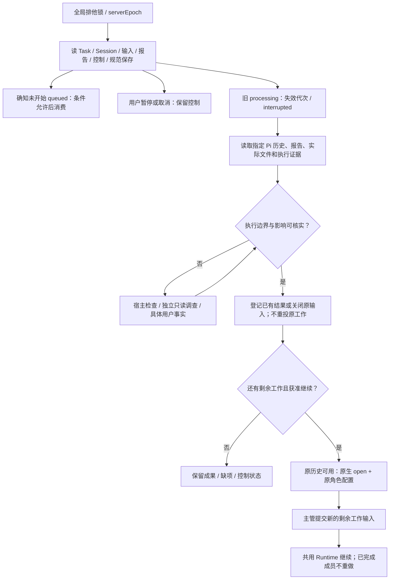

# 持久输入、等待回执与崩溃恢复

产品依据：D-06/D-07、AC-19～AC-24。首版恢复 Task、Session 历史和已知成果，核实后继续剩余工作；不恢复原工具执行栈，不自动重放未知操作。

## S1 存储基线

全局 Server 统一 SQLite，journal_mode=WAL、synchronous=FULL、foreign_keys=ON；启动验证 PRAGMA，写连接统一配置。数据库不按项目拆分。[WAL](https://www.sqlite.org/wal.html)、[同步配置](https://www.sqlite.org/pragma.html#pragma_synchronous)

Dispatcher 读取 session_inputs，提交后唤醒，启动/周期扫描兜底；不直接消费 SQLite 的 -wal 文件。流式文本、思考和工具进度不写 WAL 业务表，Pi JSONL 保存原生会话。SQLite checkpoint 是数据库维护，不是工具执行栈快照。

## S2 最小持久记录

以下固定记录语义，SQL 列/索引由实施选择。ID 安装内稳定不透明，时间 UTC RFC3339，文件摘要 sha256。归属用 ID 与真实路径，不用名称或相似文本。

| 记录 | 必要字段 | 约束 |
|---|---|---|
| projects | id/realPath/revision/initializationRef/configRef | realPath 唯一；项目写入授权引用真实用户决定 |
| sessions | id/projectId/roleId/specialization/cwd/configRef/currentTaskId?/recoveryBlock?/title? | chief 至多一项未结束 Task；专业 Session 只归一个 Task；title 是用户命名，空表示未命名、读取时取该会话首条用户发言；改名不改变归属、历史或授权 |
| providers | providerId/baseUrl/api/name?/models/credentialRef/revision | providerId 安装内不变，是 models.json key、指派与凭证引用的标识；name 仅供显示，空则用 providerId；api 必须显式保存（协议不推断） |
| model_overrides | scope/scopeId/roleId?/providerId/modelId/revision | `scope=role` 时 scopeId 是角色；`scope=project` 时 scopeId 是项目，roleId 空表示该项目默认、非空表示该项目内某个角色；同一 (scope,scopeId,roleId) 至多一行 |
| session_bindings | sessionId/piFile/branchEntryId?/hasHistory/configHash/rulesHash | 指定 Pi 文件；保留原绑定记录，禁止寻找最近文件 |
| tasks | id/projectId/chiefSessionId/ownerEpoch/requirementId?/type/requiresTest/goal/scope/acceptanceRefs/basisRefs/planRef/authorizationRefs/phase/currentSessionIds/status/revision/summary/nextStep/blockReason/completionResultId?/sourceInputId | 两类 Task、阶段与更新边界唯一见 G2；currentSessionIds 只含当前步骤的专业 Session；revision 仅供界面与宿主 RPC 使用，不进入模型工具参数；控制意图落在对应 session_inputs 的 stopRequestKey/stopReason |
| task_sessions | sessionId/taskId/roleId/specialization?/phase/label/instructions/refs/dependencies/expectedKind/writeScope/workspaceRef?/currentInputId | 续办时更新 currentInputId；历史输入/结果保留；writeScope 用于并行写成员的覆盖告警 |
| results | resultId/taskId/sessionId/inputId/roleId/kind/summary/verdict?/deliveryState?/bodyRef/basisRefs/checks/settlement?/createdAt | 不覆盖原报告，多份报告按保存顺序保留；kind 取自成员派发时的 expectedKind；deliveryState 记录提交时程序观察到的交付状态与被观察路径，供完成核对重算比较；resultId 由内容派生，同一报告重试映射同一行 |
| session_inputs | 见 Input | (sessionId,seq)/sourceKey 唯一；同 Session 至多一项 processing |
| interactions | id/requestKey/projectId/taskId?/sourceSessionId/sourceInputId/invocationKey/sequence/method/request/revision/state/response?/responseSource? | 原请求身份和答复事实；专业来源必有 taskId；当前主管路由读取 Task |
| file_saves | requestKey/target/observedVersion/contentHash/content/state/receipt? | 仅宿主负责的 Plan/报告/需求/初始化保存；observedVersion 由程序记录本会话上次读到的内容，不要求模型携带；state=pending/saved/conflict |
| request_receipts | requestKey/method/paramsDigest/status/result?/error? | status=pending/committed；同 key 不同参数冲突；成功与失败回执都如实保存 |
| usage_entries | inputId/projectId/sessionId/taskId?/roleId/providerId/modelId/inputTokens/outputTokens/cacheReadTokens/cacheWriteTokens/reasoningTokens/costTotal/responses/startedAt/endedAt | 追加写入，不改写历史；(inputId,providerId,modelId) 唯一，重试不会重复计数；数值全部取自响应上报的用量，缺失记 NULL 而不是 0；按项目/角色/模型三种维度统计时由查询 GROUP BY 得出，不维护累加计数器 |

interactions.state=pending/resolved/stale。pending 已保存、可展示；resolved 答复不可覆写，相同重试返回原回执，不同答复冲突；stale 不恢复原等待。没有“UI 已呈现”准入状态，保存后广播、断线从快照重现。请求/答复唯一见 M5。

Task.status=active/waiting/pausing/paused/cancelling/cancelled/completed。阶段/业务摘要由主管 task(op=update) 写，控制状态由服务记录；子事件不自动推进 phase。专业状态通过 currentInput、正式报告与 pending 交互查询：queued/working/waiting_user/stopping/completed/failed/stopped/interrupted。正式结果保存且 Pi 停稳才 completed；一次输入结束没有期待报告为 REPORT_MISSING。检查 verdict=failed 是检查结论，不等于执行异常。

```typescript
type ArtifactRef = { storage: 'project' | 'server'; path: string; sha256: string };
type Input = {
  schemaVersion: 1;
  inputId: string; projectId: string; sessionId: string; taskId?: string;
  seq: number; sourceKey: string; paramsDigest: string;
  kind: 'user' | 'delegation' | 'continuation' | 'system_notice';
  payload: object;
  status: 'queued' | 'processing' | 'completed' | 'failed' | 'stopped' | 'interrupted';
  revision: number; generation: { serverEpoch: number; claim: number } | null;
  effectiveConfig?: object; // 无密钥
  deliveryStartedAt?: string;
  checkpoint?: { piFile: string; leafEntryId: string; inputMarkerId: string; inputEntryId?: string; configHash: string };
  stopIntent?: { requestKey: string; reason: string };
  resumedFromInputId?: string; // 仅追溯新续办输入来源，不恢复旧执行栈
  resultRefs: string[]; error?: { code: string; message: string; evidenceRefs?: string[] };
  createdAt: string; updatedAt: string;
};
```

DocumentRef={path,purpose,sha256} 是项目依据的内容摘要；PlanRef/ReportRef 采用 ArtifactRef。read Task 的 Plan 保存 Server `work/<taskId>/plan.md`，报告保存 `work/<taskId>/<sessionId>/<resultId>.md`；write Task 使用项目相同结构的 `.dev/work/<taskId>/`；API 通过受控 Task/结果身份读取，不暴露 Server 任意路径。原生历史仍在指定 Pi 文件，不复制报告成第二份正文。

交付身份由程序观察：有 Git 时取提交/工作树，没有 Git 时取 Task 声明范围内交付文件的内容摘要；不引入候选对象，也不要求模型传递版本。Review/Test 报告提交时记录该状态，完成核对时比较。

同一 Task 的当前步骤可以有多个写成员，按声明的 writeScope 分工；程序核对范围重叠并告警，是否并行由主管判断。首版不要求分离目录，并行多个 Task 的独立 worktree 属于后续版本。负责人覆盖运行写工作，停稳后释放；恢复前核实外部变化，不靠永久锁猜测已完成。复核/测试期间不再修改其交付文件，测试环境有需要时使用副本/独立 worktree。

## S2 用量记录的边界

用量只在一次输入（claim → 终态）内部聚合写入，不在流式过程中写库：

- 输入开始时记录 Pi 历史的消息下标；此后每完成一次 assistant 响应（`message_end`）就取该下标之后的 assistant 消息，按响应自带的 `provider`/`model` 归并，累加 `input`/`output`/`cacheRead`/`cacheWrite`/`reasoning`/`cost.total`，`responses` 记归并的响应数。
- 每次写入的是**该输入的绝对累计值**，按 `(inputId, providerId, modelId)` upsert：中途崩溃时已花费的 tokens 仍然记账，重放或重复刷新不会翻倍。因为写入发生在每次响应之后而不只是输入结束，长跑的成员在进行中就能看到已产生的用量；输入结束时再写一次就是最终值。
- 失败的输入同样记账（`try/finally` 里最后一次刷新）：已完成的响应是真实花掉的，停止/失败不是免费的证据。用量记录失败不阻断输入的终态（统计缺失不改变对话结果，但会在验证记录中如实报告）。
- 角色取该 Session 的 `roleId`，Task/项目取会话归属，模型取响应自己的 `provider`/`model`——模型不取配置里的意图值，因此压缩等内部调用按真实模型归属。
- 服务方未上报用量的响应（老网关、部分代理）记 NULL；界面据此显示「未上报」，不用 0 冒充。
- 不做历史回填：`.pi` 历史里的事实不作为首版统计来源，避免启动时扫描全部会话文件。

统计由查询完成：`usage.report` 对同一 WHERE 做三次聚合（合计 / 按角色 / 按模型），作用域就是 `projectId` 是否参与过滤；不维护可漂移的计数器。

## S3 事务、认领与等待

| 动作 | 短事务保存 | 提交后 |
|---|---|---|
| 接纳输入 | 去重、payload、seq、queued、回执 | 返回接纳身份，唤醒 Dispatcher |
| task(op=create) | 已保存 Plan 引用、目标/type/必要报告声明、主管槽位、Task、回执 | 返回 taskId；不预建未来步骤 |
| task(op=update) | 阶段/总结；新步骤清空 currentSessionIds，旧关联保留 | 刷新看板；不自动派发角色 |
| create/continue 专业工作 | Session/Task 关联、首条或续办输入、currentInputId/currentSessionIds、接纳身份 | 异步调度；工具等待 M2 |
| agent_report / 输入收尾 | 正式结果及原回执 / 实际终态及历史边界 | 唤醒 Task 当前步骤等待 |
| 原生请求 / respond | 原请求 / 真实答复与回执 | 请求保存后主管通道广播；答复保存后直接解除原调用等待 |
| 委派等待结束 | 本次工具回执（completed/blocked/timeout） | 返回主管 Pi；不再投重复报告输入 |
| control/end/adopt | 控制/完成/协调归属、currentTaskId、回执 | 直接控制或唤醒等待 |

```text
claimNext(session):
  核对无 processing、前序中断已核实、控制允许、目录/配置可用
  chief 有当前 Task：只选该 Task 补充/续办输入；其他 queued 留到 Task 结束
  chief 自身已停稳且无未核实中断时，Task 暂停不阻止其状态/控制/恢复输入；项目写 op 仍拒绝
  选择可消费范围内最早 queued
  专业输入核对 Task、角色、当前步骤、只读/写权限、工作目录
  Task.status=paused 或 Task 含未核实 interrupted 输入：只有显式 investigator + expectedKind=recovery 可只读认领，其他专业工作拒绝
  专业 Session 预约并发名额；短事务 CAS queued → processing，记录 generation
  COMMIT 后运行 Pi；失败释放预约
```

首版限制同时运行的专业 Session 数量，不自建逐模型请求公平调度器。主管等待不占专业并发名额；子 Session 等用户答复时可以保留其名额，但等待答复的服务处理不占名额。所有等待都是可取消的异步等待，事务不跨长 await。同 Session 的执行所有权保留到 Pi 停稳。

M2 等待注册后重查数据库，提交后唤醒，扫描兜底。查询使用 task.currentSessionIds，再读各成员 currentInputId/报告；不查首席本身，不等待历史已结束步骤。create 的幂等回执保存成员身份，重试不能添加第二份；wait 是新查询调用，可返回后续新状态，不改旧调用回执。

Task 交接先停稳原主管协调和相关写入，CAS 更新 chiefSessionId/ownerEpoch，目标主管无未结束 Task。等待/响应权限与 UI 路由读取当前 Task 所有者；旧主管不能再派发或响应，原来源/报告保留。

原生请求的 requestKey 来自 inputId + invocationKey + 调用内 sequence；工具调用以 toolCallId 关联，其他扩展用宿主调用身份。UIAdapter 保存关联，不靠正文去重。绑定 AbortSignal，提交后唤醒，取消返回原生取消值并注销监听。Server 重启没有原 Promise，按 S7 处理。

## S4 关键操作与 checkpoint

Pi 原生 read/grep/find/ls/edit/write/bash、工具循环、重试、压缩及历史直接复用。不给每次原生 edit/write/bash 建另一套执行意图/效果账，不补写缺失 ToolResult，不接管其执行栈。

宿主仅可靠保存自身负责的输入、Task、委派、交互、报告和规范文件。字段校验或普通工具失败如实返回 isError，不能伪造成功；宿主关键保存无法确认时阻断该 Session 后续准入，发起 abort，外层等待实际停稳，保留 interrupted 与具体失败事实。单纯 throw 不作为已停止证据。

投递前提交 deliveryStartedAt，再追加输入关联标记并调用 Pi。只有确知尚未进入 Pi 的输入可以再次排队；文件缺失或无 marker 不足以证明从未执行。checkpoint 仅在实际 settled、期待报告和指定历史可读取时保存当前边界，不复制模型记忆或本地工具栈。generation 拒绝旧回调改写新的执行状态。

## S5 停止、暂停、取消

```text
保存控制意图 → 拒绝相关新认领 → 发起 Pi abort
  → 外层等 Pi 及已知受管理工具停稳 → 保存实际停止状态
  → 无法确认的进程/影响保留 interrupted 与待核实说明
```

- input.stop 只停止指定输入和它的观察等待，不自动取消子 Session 或整个 Task。
- Task pause/cancel 覆盖该 Task 未结束子工作；先保存请求已收到，再实际停止。已有文件、报告和已完成结果保留，不声明回滚。
- pause 保留 queued；cancel 将未开始工作 stopped。主动暂停/取消的工作不能因超时或扫描自动重启。
- Task resume 由明确用户操作发起，核对历史、实际成果与控制后恢复 Task；已完成子工作不重做，未开始 queued 可以消费，已中断/停止工作由主管提交新的剩余工作输入。单纯 resume 不消除未知。
- 主管等待超时只返回快照，不调用 abort，不改变子工作状态。主管决定 wait 或核实后 continue；技术异常停止不等于用户暂停。规则见 M2/G2。
- 工具内只发起 ctx.abort，不等自己的 idle；外层 await session.abort。所有委派/UI 等待绑定信号并注销监听，不能把 abort 永久卡在等待中。
- 停止源输入或 Task 使其 pending 交互 stale，并解除源 UI 等待；停止父观察等待不替用户取消仍有效的子请求。resolved 答复保存为历史，不能令被暂停/取消动作继续。
- Pi 可管理的 bash 进程沿原生取消；无法确认的 detached 进程如实待核实，不增加通用进程管理器。

## S6 文件、结果与结算的跨存储顺序

文件与 SQLite 不存在共同事务。仅对宿主规范保存使用 file_saves，先保存稳定目标/预期版本/正文，再同目录临时文件原子替换，读取核对摘要，最后登记 DB 引用与回执。重试核对原保存：实际为新摘要只补登记，仍为预期旧摘要可补保存，其他变化返回 VERSION_CONFLICT；不覆盖外部编辑。

```text
Plan：稳定 taskId + file_saves → 原子保存 Plan → DB Task/planRef/currentTaskId/回执
报告：稳定 resultId → body 原子保存
    → DB result/回执 → 唤醒当前步骤等待
结算：Agent 核对成果/验证 → 更新受影响知识、需求、导航、遗留
    → 准备结算报告 → Git 提交本次成果及报告；或本机保存并核对
    → agent_report(body + 实际保存回执)，不重写已保存报告
    → chief task(op=end)：先由宿主观察复核覆盖路径的提交状态（`runtime/git-delivery.ts`），
      未提交即返回 COMPLETION_INCOMPLETE + 缺项；通过后事务保存 completed / 释放主管槽位
```

read Task 的报告按同一保存顺序写 Server，核对专业工作停稳后用调查/恢复报告 task(op=end)，不强制 Review/Test、结算或 Git。write Task 执行适用独立检查与结算。Plan 创建/修订串行核对主管槽位与文件内容，部分保存失败只补登记/缺项。

```typescript
type SettlementManifest = {
  schemaVersion: 1;
  taskId: string;
  verificationResultIds: string[];
  updatedRefs: Array<{ path: string; sha256: string }>;
  requirement?: { id: string; version: string };
  issuesRef?: { path: string; sha256: string };
  saveReceipt:
    | { mode: 'git'; commit: string; files: Array<{ path: string; sha256: string }> }
    | { mode: 'local'; savedAt: string; files: Array<{ path: string; sha256: string }> };
};
```

Agent 判断知识是否完整、未覆盖如何处置、需求是否满足、哪些记录需要更新。报告写明原因、风险、真实用户决定引用和遗留。程序只核对报告身份/种类、必要复核/测试、交付状态与真实保存；不计算自然语言授权范围或业务含义。真实 failed 不改成未覆盖。

有关需求完成内容/状态文件与项目报告先纳入同次保存，再 task(op=end) 核对交付状态；该核对包含提交状态（复核覆盖路径相对 HEAD 已提交），提交仍由模型执行。保存失败 Task 保持未完成，不再开发没有变化的成果。Git 回执从实际提交读取，保护无关改动和暂存；已有明确同次提交核对后复用，不盲目重复提交。最终 commit 写 DB 回执，不回写已提交报告制造下一次提交。

## S7 Server 重启恢复子图



恢复是事实核对与续办，不是重新调用原工具。不恢复旧工具 Promise、父委派工具栈，不修补 Pi ToolResult；主/子双方从 task(op=get) 看当前步骤成员和报告，再用 task(op=dispatch) 处理余下工作。

| 崩溃位置 | 首版处理 |
|---|---|
| 输入提交前 / 提交后唤醒前 | 原 key 重试 / 扫描已保存 queued，不重复接纳 |
| 认领后但确知从未投递 | 核对强制投递前标记未提交且实现保证未调用 Pi，才回 queued；其他 interrupted |
| Pi 已有输入、DB 尚未收尾 | 从指定历史/标记核对边界，不重新 prompt 原输入 |
| 原生工具执行中或结果不明 | 查实际文件、日志、报告与用户事实；未知阻断，不自动重放 |
| 正式结果已保存、Pi 工具结果缺失 | 结果保留；新续办输入带该事实，不补写 ToolResult，不重做成果 |
| 原生请求/答复已保存 | 活跃原调用可直接继续；重启调用已不存在，pending 置 stale，resolved 作为续办事实；仍需询问时模型发新通用请求 |
| Pi 已停稳、DB finish 前 | 核对历史与期待结果后补原终态/checkpoint |
| Plan/需求/报告部分保存或结算后未 task(op=end) | 核对实际文件/提交，只补保存登记或完成缺项 |
| 历史缺失/损坏、配置不可用 | HISTORY_UNAVAILABLE/MODEL_UNAVAILABLE；保留原资料，不开空历史冒充恢复、不静默换模型 |

恢复入口直接服务，不排在中断输入后。主管自身 interrupted 时先由宿主/用户走 R1 inspect/resolve：核对该主管输入历史边界和自身 file_saves/回执后关闭原输入，再由用户向原 chief/Task 提交新续办输入。仅在观察子工作的父输入可以按已知停止事实关闭；子输入的未知独立保留，不能随父关闭消除。主管自身保存事实仍未知时不调用模型，先完成直接核实。

主管可运行后，用 task op=recover 将 investigator 的证据/实际文件核实结论提交同一恢复服务，核对并关闭该 Session 的中断输入；再按控制与剩余目标 dispatch 续办。不从报告正文自动解析恢复状态，不以报告提交自动解除阻断。允许主管在暂停/中断 Task 内显式安排 investigator + expectedKind=recovery 的只读核实（不解除项目写入控制，不恢复原开发）；结果保存 Server，并与被核实 Task 关联。程序在 create/dispatch 同时校验例外、只读权限及关联，保留原 currentSessionIds、不 resume 原开发、不向活跃 Session 并发 prompt；业务核实由主管/独立 Agent 完成。

历史有效时用 SessionManager.open 指定文件并恢复原角色、工具、规则与配置；历史不能用于继续时保留原文件和失败原因，由主管明确选择原生分支或新的独立 Session，附正式依据、已知成果及剩余目标，不通过新上下文绕过未知/控制。后者是明确重建上下文，不承诺自动历史修复。

备份在停稳后包含 SQLite 一致快照、引用的 Pi 文件、规则/配置和项目产物；不只复制未合并 WAL 的 .db。凭证私有处理，备份恢复需实际演练。
