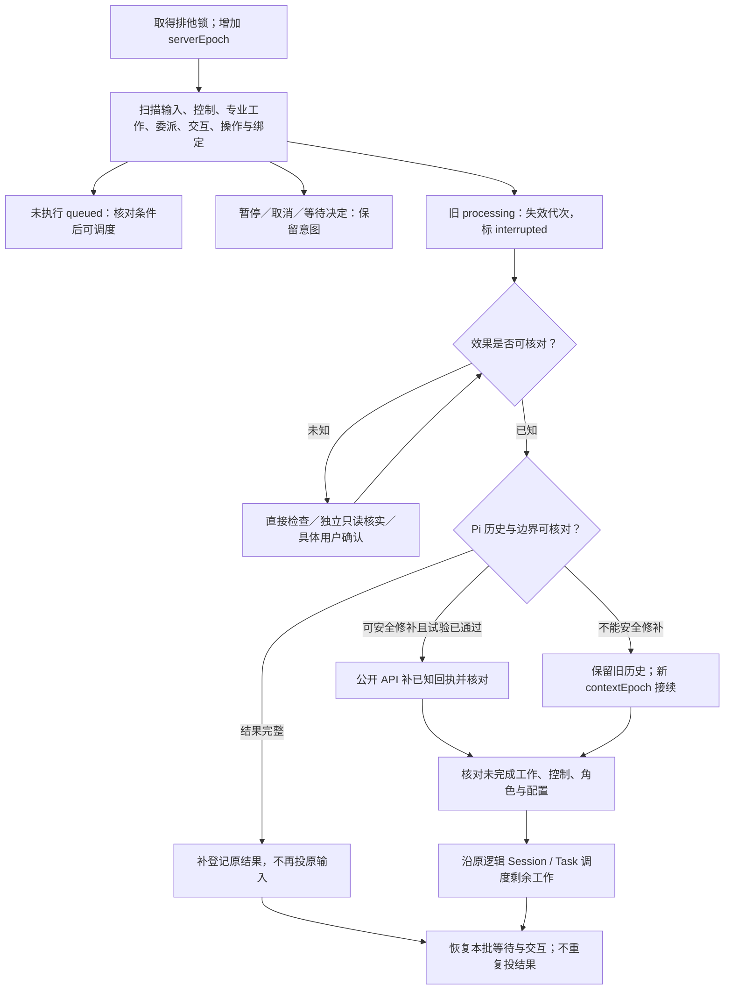

# 持久输入、等待回执与崩溃恢复

产品依据：D-06/D-07、AC-19～AC-24。DB 保存接纳事实；Pi 上下文和效果分别核对，不承诺任意外部操作恰好执行一次。

## S1 存储基线

全局 Server 统一 SQLite，journal_mode=WAL、synchronous=FULL、foreign_keys=ON；启动验证 PRAGMA，写连接统一配置。数据库不按项目拆分；SQLite checkpoint 与 Agent 继续边界是不同用途。[WAL](https://www.sqlite.org/wal.html)、[同步配置](https://www.sqlite.org/pragma.html#pragma_synchronous)

Dispatcher 读取 session_inputs。提交后内存唤醒，启动/周期扫描兜底；扫描周期/容量为 Server 配置。流式文本/思考/工具进度不写业务输入表，不存第二份聊天全文。

## S2 最小持久记录

逻辑 Schema 固定语义，SQL 列/索引由实现决定。ID 安装内稳定不透明；时间 UTC RFC3339；摘要 sha256。外键/同项目归属校验；不使用 cwd、名字或相似文本代替身份。

| 记录 | 必要字段 | 约束 |
|---|---|---|
| projects | id/realPath/revision/writeAuthorizationRef/initializationRef/configRef/workspaceClaims | realPath 唯一，移动 CAS |
| sessions | id/projectId/roleId/specialization/cwd/configRef/currentTaskId?/activeContextEpoch/recoveryBlock? | chief 的 currentTaskId 至多一个未结束 Task |
| session_bindings | sessionId/contextEpoch/piFile/branchEntryId?/hasHistory/configHash/rulesHash | 绑定唯一；旧 epoch 保留，只有一个活动绑定 |
| tasks | id/projectId/chiefSessionId/ownerEpoch/requirementId?/kind/goal/scope/acceptanceRefs/basisRefs/planRef/authorizationRefs/phase/status/revision/summary/nextStep/blockReason/candidate?/settlement?/controlIntent/sourceInputId | 同需求、同主管未结束唯一；只有主管显式更新 phase，endTask 写 completed |
| task_sessions | sessionId/taskId?/chiefSessionId/roleId/stage/instructions/refs/dependencies/expectedKind/candidateId?/workRevision/currentInputId | 一个专业 Session 归一个专业目标；返工保留旧 workRevision；只读调查可无 Task |
| delegations | id/requestKey/taskId?/chiefSessionId/ownerEpoch/members[{sessionId,inputId,workRevision}]/stage/basisDigest | 当前一步的固定成员；后续 wait 不改原成员或重建 Session |
| results | id/taskId?/sessionId/workRevision/sourceInputId/requestKey/kind/summary/reportRef/basisRefs/candidateId?/verdict?/checks/supersedes?/settlement? | 正文/结构不可变；validity=current/stale/late 为当前依据投影；requestKey 唯一 |
| session_inputs | 见 Input | (sessionId,seq)/sourceKey 唯一；同 Session 至多一个 processing |
| interactions | id/requestKey/projectId/taskId?/chiefSessionId/sourceSessionId/sourceInputId/contextEpoch/toolCallId?/operationId?/workRevision?/kind/method/request/subjectRef/version/actionRef?/revision/state/response?/responseSource?/initialization? | state=requested/presented/resolved/stale；原请求/操作范围固定，一份有效答复 |
| operations | id/requestKey/inputId/sessionId/generation/contextEpoch/toolCallId/toolName/argsDigest/effectClass/intent/receipt?/state | state=intent/known/uncertain；长委派等待 intent 包含 delegationId/成员，终局 receipt 是 M2 返回 |
| request_receipts | requestKey/method/paramsDigest/refs/status/result/error | status=pending/committed；参数绑定原 key；终局失败 committed+error |

Task.kind=standard/light/document；phase=clarify/design/plan/develop/review/test/settle；status=active/waiting/pausing/paused/cancelling/cancelled/completed。阶段/业务摘要由 updateTask 写；实际控制由服务完成，不从子事件推导另一份 phase。

专业状态通过 currentInput/正式结果/开放交互查询：queued/working/waiting_user/completed/failed/stopped/interrupted，不另同步一份看板状态。正式结果保存且输入停稳才 completed；检查 verdict=failed 不等于执行异常。一次输入处理结束无正式结果返回 REPORT_MISSING。

```typescript
type Input = {
  schemaVersion: 1;
  inputId: string; projectId: string; sessionId: string; taskId?: string; workRevision?: number;
  seq: number; sourceKey: string; paramsDigest: string;
  kind: 'user' | 'delegation' | 'continuation' | 'system_notice';
  payload: object;
  status: 'queued' | 'processing' | 'completed' | 'failed' | 'stopped' | 'interrupted';
  revision: number; generation: { serverEpoch: number; claim: number } | null;
  effectiveConfig?: object; // 无密钥
  deliveryIntent?: { contextEpoch: number; recordedAt: string };
  checkpoint?: Checkpoint; stopIntent?: { requestKey: string; reason: string };
  continuationOfInputId?: string; // 停稳后恢复同一未完成工作；不是新增目标的 continue
  resultRefs: string[]; error?: { code: string; message: string; evidenceRefs?: string[] };
  createdAt: string; updatedAt: string;
};
type Checkpoint = {
  contextEpoch: number; piFile: string; leafEntryId: string;
  inputMarkerId: string; inputEntryId?: string; outputEntryIds: string[]; configHash: string;
};
```

DocumentRef={path,purpose,sha256}；ReportRef={path,sha256}；PlanRef={path,sha256,authorizationRef}；Candidate={candidateId,root,manifestRef,contentDigest,basisDigest,createdAt}。项目引用相对路径，接纳时核对/补摘要，历史记录保留当时版本。总体 Plan 只有一份固定文件，变更保留引用版本/操作回执；没有子 Plan 批准记录。

workRevision 标识同专业 Session 的当前目标修订。最终报告后禁止此修订再写；停稳后明确返工才增加 workRevision/新输入。授权继续同一挂起工具不会增加 workRevision 或创建第二份输入。

恢复输入的 continuationOfInputId 指向同 Session、同 workRevision 的已停稳前序输入；每个前序最多一个此类后继，禁止环和跨目标接续。resume/recovery 事务同时保存去重来源键、接续关系和 task_sessions.currentInputId；旧 delegation.members 保持不变。等待沿该链查询当前输入及有效结果，只承认原阶段/依据未改变、控制和效果已核对的接续；缺关系不能凭相同 Session 猜测。新目标或真实返工由 continue 建立新 workRevision/批次，不加入原恢复链。

workspaceClaims 记录真实目录的 writer/capture/settlement 所有者与 generation；重叠目录不得冲突。复制候选先预约，前后清单核对，外部变化返回 CANDIDATE_CHANGED。崩溃核对原操作后释放，不能永久锁死。

用户 inputId=requestId；内部 sourceKey 派生原业务事实。工具原 key 的回执不可变，新的 wait 调用可以读取新事实；不能把它当原调用重试并改原返回。

## S3 事务、认领与等待

| 动作 | DB 事务保存 | 提交后 |
|---|---|---|
| 接纳输入 | 去重、原 payload、seq、queued | 返回接纳，唤醒 |
| createTask | 已保存总体 Plan 引用、目标/授权、主管槽位、Task/源输入关联、回执 | 返回原 taskId；不建全部专业 Session |
| updateTask | 当前 revision、阶段/总结/下一步；目标变化的已保存 Plan/依据版本与失效事实、回执 | 刷新看板，不自动启动下一角色 |
| create/continue 专业工作 | Session/Task 关联、原输入、本批成员、操作 intent、接纳回执 | 调度，异步等待 M2 条件；接纳不等于模型最终返回 |
| agent_report / 输入收尾 | 正式结果/原回执；或实际终态/checkpoint | 唤醒原批等待，不额外投同一结果输入 |
| 子交互 request / 主管 present | 原请求/来源/版本；或呈现状态/回执 | request 让委派返回 needs_input；present 后主管通道展示 |
| interaction.invalidate / 自动失效 | CAS requested/presented → stale、原因/回执 | 解除源请求与主管 wait，退订回调；取消原待授权动作 |
| 用户 respond | 版本/答复/真实用户来源/必要授权事实/回执 | 解除原请求与主管 wait；不排普通输入 |
| 委派工具终局返回 | 原 operation receipt = M2 结果、request_receipt | 才向 Pi 返回；响应丢失复用原结果 |
| control/end/adopt | 控制/完成核对/协调归属、currentTaskId、回执 | 中止或唤醒当前等待；空闲时一次系统通知 |

```text
claimNext(session):
  检查无 processing、无未核对前序中断、控制允许
  chief 当前 Task 存在时：只选择当前 Task 关联输入；其他 queued 保留待该 Task 结束
  选择上述可消费范围内最早 queued；同范围保持顺序
  专业输入检查 Task 控制/当前阶段/授权/工作目录负责人
  预约执行容量，短事务 CAS queued → processing，记录 generation
  COMMIT 后才能开始 Pi；失败则释放预约
```

同 Session 执行所有权保持到停稳；await 子工作/用户时让出模型容量，继续调用模型前重新申请。运行子 Session 不依赖主管占用的名额；跨 Session 公平。等待注册后重查 DB；故障/唤醒丢失由扫描原记录处理。

requestKey 参数不同冲突，事务失败不返回成功；文件跨存储按 S6。Task 交接先停稳原协调执行/必要写入，ownerEpoch 改变后旧主管不能派发/present/授权，未结束工作仍归同 Task；新主管由 currentTaskId 找回原批次/交互。

有 Task 的委派/交互记录中的 chiefSessionId/ownerEpoch 保留接纳来源；当前 wait/present/respond 权限与主管 UI 路由统一读取 tasks.chiefSessionId/ownerEpoch，不拿旧接纳者当当前所有者。交接后快照和交互事件使用当前主管身份，旧页面答复拒绝；无 Task 调查始终归原主管，不参与 Task 转交。

## S4 关键操作与 checkpoint

read 等无副作用操作沿用 Pi 历史，不建立第二份全文账本。edit/write/bash、领域文件保存、Git 提交等可能产生持久影响的操作保存必要意图与回执。原生工具内部实现仍调用 Pi 默认 Local operations。

```text
关键工具 execute：
  校验 actor / 总体 Plan 与授权 / 代次 / 控制 / 写入归属
  保存原 operationId、参数摘要、预期对象与 intent
  await 原生 execute（signal、onUpdate 原样传递）
  保存真实 receipt（成功/失败/退出码/产物摘要）
  只有 receipt 保存成功才向模型返回正常结果
```

| effectClass | 重启后的默认处置 |
|---|---|
| read_only | 核对上下文后可重新读取 |
| verifiable_file | 比较明确目标及预期/实际摘要；已完成复用，不能确定就待核实 |
| unsafe | 任意 bash/外部影响/未知后代进程不自动重放；取得真实证据或用户确认具体事实 |

不靠命令字符串关键词判断安全，不给全部 Shell 一个“可重试”标签。失败结果也可能有部分影响，receipt 需区分已知完成与 unknown。

关键保存失败先设置宿主 fault latch，拒绝本 Session 新输入及后续副作用工具；发起 ctx.abort，外层等 idle，状态 interrupted。写 DB 失败时保留内存故障与日志，服务恢复后/重启扫描未收尾 processing，不伪造一条已保存终态。

工具/hook throw 不保证停止；Pi 会把 execute 异常转成错误结果，hook 异常可能被捕获。关键包装使用可等待 execute；关键工具顺序执行避免一批并行效果已启动，仍需 fault latch + 显式取消 + 外层收尾。[异常处理](https://github.com/earendil-works/pi/blob/v1.0.0/packages/agent/src/agent-loop.ts#L820-L850)、[批次顺序](https://github.com/earendil-works/pi/blob/v1.0.0/packages/agent/src/agent-loop.ts#L505-L523)

进入 Pi 前必须先提交 input.deliveryIntent，然后才能追加标记/调用 prompt 或 sendCustomMessage。首次 CustomMessage/marker 可能尚未建文件；absence of root 不能证明没有启动模型。投递意图已保存而边界不明时默认 interrupted。

checkpoint 只在实际停稳、关键回执齐全、指定 Pi 文件可核对时提交。不复制整个模型记忆。generation 拒绝旧回调更新执行状态；旧工具的真实迟到证据可附加保留，不能拿它完成新的输入。

## S5 停止、暂停、取消

```text
保存控制意图 → 拒绝该范围的新认领/写入 → ctx/外层 abort
  → 等 Pi 与已知受管理工具停稳 → 保存实际 stopped/paused/cancelled
  → 尚有未知进程/效果：interrupted + 待核实，不宣布已停止
```

- input.stop 只针对指定输入；不清空其他 queued，也不取消主管已委派的 Task。
- Task pause/cancel 覆盖该 Task 未结束专业工作及相关写入；先停准入，后停止；先到 completed 的结果不改写为撤销。
- 控制事务先保存真实状态/回执并让相关等待返回 blocked；无活跃返回通道时保存去重 task.controlled 系统输入。主管只处理当前 Task，不因此开始其他目标。
- queued：pause 保留排队；cancel 保存 stopped。working：确认停止后保存状态，已有文件/结果保留。
- resume 先核对所有中断与控制事实，再恢复原 Task。未开始 queued 原样保留；已 stopped 的当前输入不重新执行，按总体 Plan/已知成果为未完成专业工作创建一次去重的接续输入，只做剩余工作，必要时 handoff。停止源输入的未解决交互保留为 stale 历史，当前操作需要时生成新请求；不能恢复未获授权的动作。旧正式结果不重做；“继续”不能解除 unknown。
- abort 在当前工具内只发起，不等待自己的 idle；外层负责等待。原生工具能管理的进程沿 Pi 取消；无法确认的 detached 进程保持待核实，不重建通用进程管理器猜测。
- 宿主的 uiContext.confirm/select/input、interaction.wait、createTaskSessions 等待及容量重申请必须绑定所属工具/Session 的 AbortSignal；uiContext 使用调用 opts.signal，缺省时显式接入当前输入/工具的取消信号。Pi 不替宿主取消自建 Promise。signal/stale/超时触发时解除本调用、注销监听/回调、释放预约；UI wait 返回 false/undefined 或明确取消，委派 wait 返回 blocked 或按取消信号退出，再由 Runtime 核对收尾，外层 abort 不能永远卡在等 idle。
- 仅停止主管当前输入：解除其委派/交互观察等待，不取消子 Session 的原请求/工作。停止子源输入或 Task pause/cancel：对应未解决源请求标 stale，并解除源 UI wait 与主管观察等待；已解决答复保留为历史，不能使被暂停/取消动作继续。parent present/wait 的取消不是替用户拒绝仍有效的子请求。
- Task adopt/rebind 先阻止旧协调权的新写入与派发，停稳相关写工作，核对目录/结果/决定，再 CAS 转交。通知使用新 ownerEpoch；默认不复制主管聊天或继承旧环境授权。

## S6 文件、结果与结算的跨存储顺序

总体 Plan/报告/需求/项目知识/提交都不能与 SQLite 形成共同事务。写工具按稳定 operationId 记录步骤和摘要；重复补齐原步骤。

```text
总体 Plan：校验授权/提案摘要与旧版本，预约原 requestKey/稳定 taskId
  → 保存 operation intent：目标路径、旧/新摘要、完整 Plan 内容与原槽位约束
  → 同目录临时文件原子替换 plan.md，读取核对新摘要
  → DB 事务：Task/Plan 引用、currentTaskId 或新 revision、原回执
  → 返回 taskId/planRef；恢复核对文件与原 intent，只补原登记

报告提交：分配稳定 resultId/operationId 并保存意图
  → 原子保存/读取核对项目报告文件
  → DB 事务：result + 原回执；提交后唤醒本批等待
  → Pi 保存工具结果；失败时复用 DB result，禁止重做专业工作

结算：当前验证对象与依据核对
  → 保存受影响知识、需求摘要、索引和项目内报告
  → 执行相应文档检查，登记每项路径/摘要
  → Git 保存本次成果与记录，或确认本机保存
  → 主管 endTask：DB 事务核对完整清单，Task completed / 释放 currentTaskId
```

Plan 保存期间同主管槽位/同需求与同 Task 的 Plan 修订只允许一个待完成操作；跨存储失败保留预约并阻断新的覆盖，核对原文件后补登记或报告冲突。外部编辑不能用原 intent 覆盖。已有新摘要则复用，仍为预期旧摘要才补原保存，其他摘要返回版本冲突；未核对完不让专业写入使用不一致 Plan。

Git 回执记录 commit、parent、提交文件清单与内容摘要；发现已有同一步提交先核对，不重复提交。无法分离用户无关改动/暂存项时阻断。未收口的需求完成摘要结合 Task 显示待核对，不触发重开发。

结算工具输入中的 settlement 固定为下列最小结构，保存于 results 的结构化字段并由 tasks.settlement 引用；服务读取实际文件/Git 核对，不解析自然语言完成清单。

```typescript
type SettlementManifest = {
  schemaVersion: 1;
  taskId: string;
  candidateId: string;
  basisDigest: string;
  verificationResultIds: string[];
  deliveredManifestRef: { path: string; sha256: string };
  documents: Array<{ path: string; sha256: string; disposition: 'updated' | 'checked_unchanged'; checkRefs: string[] }>;
  requirement?: { id: string; version: string; summaryRef: string };
  reportRefs: Array<{ path: string; sha256: string }>;
  issuesRef?: { path: string; sha256: string };
  coverageDispositions: Array<{ resultId: string; check: string; interactionId: string }>;
  saveReceipt:
    | { mode: 'git'; commit: string; parent: string; manifestRef: string }
    | { mode: 'local'; savedAt: string; manifestRef: string };
};
```

服务先核对实际交付源码/配置/测试树与 candidate 清单一致；列明结算资料变化并执行相应文档检查，不能把源码或正式目标改变列成例外。coverageDispositions 的 interactionId 必须指向已有效解决的真实用户交互，处置答复须匹配指定 resultId/check 的未覆盖原因与风险范围，不能以普通同意替代。Git 回执由服务从实际提交核对，local 回执验证文件摘要。没有关联需求时 requirement 可空，无遗留时 issuesRef 可空；不适用项明确记录检查，不能用空清单绕过应更新知识。

结算后正文不必再加一个“已提交”报告并制造下一次提交；DB 记录最终保存回执，项目报告可以写稳定证据引用。写规则/新增代码会使验证对象变化，必须回到适用检查，不能混入结算。

## S7 Server 重启恢复子图



启动时不调用模型重做所有 Task。只有确知未开始的 queued 才自动准入；前一输入 interrupted 时本 Session 后续普通队列阻断。其他无关联 Session 可以继续。

| 崩溃位置 | 恢复动作 |
|---|---|
| 事务提交前 | 无接纳证据，客户端原 key 重试；不启动工作 |
| 提交后、唤醒前 | 扫描原 queued；无第二次接纳 |
| 认领后、进入 Pi 前 | 只有强制投递前 deliveryIntent 未保存且实现保证未调用 Pi，才可回 queued。缺 root/intent 本身不证明未启动；其余 interrupted 后核对/交接 |
| Pi 已有输入、DB 缺关联 | 通过标记/绑定补关联；不能再追加同一用户消息 |
| 工具 intent 后、receipt 前 | verifiable_file 核对；unsafe 待核实，默认禁止重放 |
| result/委派回执提交后、Pi 工具回执前 | 复用原结果/原工具终局回执；补回执试验通过才修补，否则上下文交接 |
| 子请求已保存、主管呈现前 | 原批次返回 needs_input，主管按原 interactionId 呈现；不重建子 Session |
| 用户答复已保存、解除等待前 | 核对原效果/原上下文，解除活跃原等待；重启无 Promise 则恢复绑定/交接，不自动重做动作 |
| Pi 完整结束、DB finish 前 | 核对指定文件及关键回执，补原终态/checkpoint |
| 暂停/取消处理中 | 保留控制，核对残留执行，确认后收口 |
| 结算文件/Git 后、Task completed 前 | 核对原清单/提交，补缺步骤和完成登记 |
| 历史缺失/损坏或模型配置丢失 | 保存 HISTORY_UNAVAILABLE/MODEL_UNAVAILABLE，不能 open 空历史或静默换模型 |

恢复控制直接进入 RecoveryService，不排在被阻断的普通输入后。独立 investigator 可只读核实并提交 recovery 报告；宿主/用户核对证据后通过 recovery.resolve 处理具体 operationId 的 effect_verified/not_executed/stop_unresolved。stop_unresolved 只能关闭继续执行并保留风险，不能使 Task completed。

能从公开 SessionManager.appendMessage 补 ToolResultMessage，但没有跨存储事务保障。只有 PI-03 覆盖配对、分支、重复补写、继续行为后才启用；否则首版默认 handoff。[公开 appendMessage](https://github.com/earendil-works/pi/blob/v1.0.0/packages/coding-agent/src/core/session-manager.ts#L1204-L1214)

handoff 保存旧文件，增加 contextEpoch，沿原 sessionId/inputId 携带正式目标、当前依据、有效交互/结果、已知操作与尚未完成工作。旧 epoch 不能再运行，旧 UI 片段不能写入新绑定。未核实 unsafe 效果时禁止用新上下文绕过阻断。


委派和交互恢复先读持久事实，不恢复一个空的内存 Promise：

1. 旧 processing 先失效代次并 interrupted，核对所有子输入/关键效果；其他独立 Session 可以继续。
2. 已知报告停稳的子工作不再启动；同 delegationId 查询旧成员/结果。待授权/中断工作不会因父上下文替换获得新授权。
3. 原 createTaskSessions 工具回执已保存则复用；未保存时从本批事实形成 needs_input/blocked/completed，并保存一次原回执。不能重建原成员。
4. 原 Pi 工具调用配对可公开修补且 PI-03/08 已通过才继续原文件；否则新 contextEpoch 交接，给主管 currentTaskId/总体 Plan/原批次/未解决交互/已知结果。
5. requested 请求先由恢复后的主管 present；presented 请求在主管快照重现；resolved 答复只恢复原授权范围。原执行效果不明保持阻断，不能把批准当作没有执行过。
6. 活跃 SDK UI wait 可按原 ID 解除；Server 重启后须验证恢复绑定，不能把答复送到已失效 epoch 的回调。

备份必须在停稳后包含 SQLite 一致快照、被引用 Pi 文件、规则/配置引用和项目交付产物；凭证按私有存储处理。只复制 .db 而漏未合并 WAL/Pi 文件不能称可恢复备份。具体备份入口属于部署实施 Plan，恢复需要实际演练。
